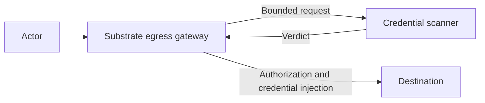

# Egress credential scanner

The scanner is an Envoy External Authorization v3 server. Its second scan tier
(the Semgrep engine) is deferred and removed from the code: see the last section
and [ARCHITECTURE.md](ARCHITECTURE.md) "Decided" 9. It loads
Gitleaks rules before its gRPC health service reports ready. By default it
uses the Gitleaks rules pinned in `go.mod` that can match HTTP text. Use
`--rules` to load a TOML file from a trusted mount. Operator rules that
require a repository file path fail startup.



Apply the policy to the selected route on agentgateway 1.7.0. Leave
`includeRequestHeaders` unset so the scanner receives all request headers.
Route authorization runs before Substrate injects the upstream credential.
The scanner checks the path, query, headers and UTF-8 JSON or plain text
body. It rejects unsupported encodings and bodies over 512 KiB. Matching
stops at the first finding. The scanner denies requests that exceed its
75 ms scan deadline or exhaust the budget of 64 suppressed matches.

```yaml
policies:
  extAuthz:
    host: egress-scan.ate-system.svc:8080
    protocol:
      grpc: {}
    failureMode: deny
    includeRequestBody:
      maxRequestBytes: 524288
      allowPartialMessage: false
      packAsBytes: true
    policies:
      http:
        requestTimeout: 80ms
```

The timeout is 80 ms: Gitleaks scans for at most 75 ms.

Admit only the gateway to the scanner's listener. The Hindsight pilot and
its cluster latency check are tracked in
[HOME-729](https://factory-plan.jomcgi.dev/factory/issue/HOME-729).

## Second scan tier (Semgrep engine): deferred, removed from the code

The scanner had an optional second tier that posted the scanned text to a
Semgrep engine and merged the verdict with Gitleaks. It ran in observe mode on
2026-11-24 and in enforce mode for a few hours that day. Joe deferred it the same
day (ARCHITECTURE.md "Decided" 9) and the Pro engine converges on Mandoline
later. The scanner has one detector path now.

- **Code:** removed from `egress-scan` (`semgrep.go`, `observe.go`, the two-tier
  orchestration, the metrics, the flags and the chart values). It stays in git
  history. The last commit that holds it is `61a15fffb6` on `main`.
- **Design:** ARCHITECTURE.md "Engine path" and the sections after it keep the
  design and its measurements. They are deferred and not built.
- **Service behind it:** `gate/` (engine-gate) keeps its source, tests and
  README. It is not deployed. Its warm pool of single-use fork actors may serve
  tool-call sandboxes later.
- **To bring the tier back:** restore the files from that commit, the chart
  values, the Application values of PR #8648 and the 310 ms gateway timeout, and
  follow `gate/README.md` for the gate.
