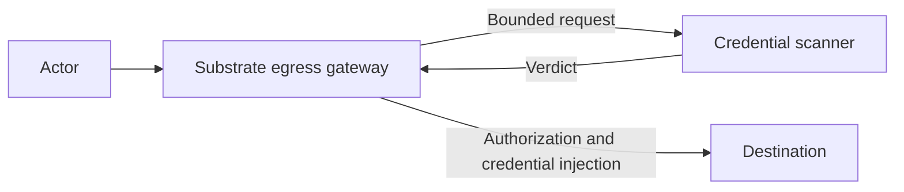
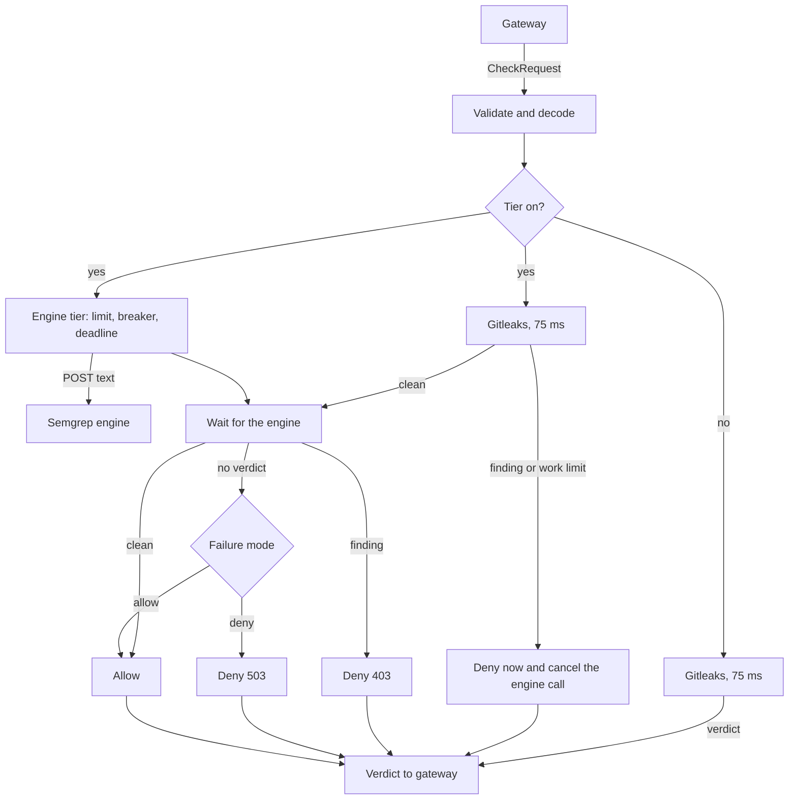
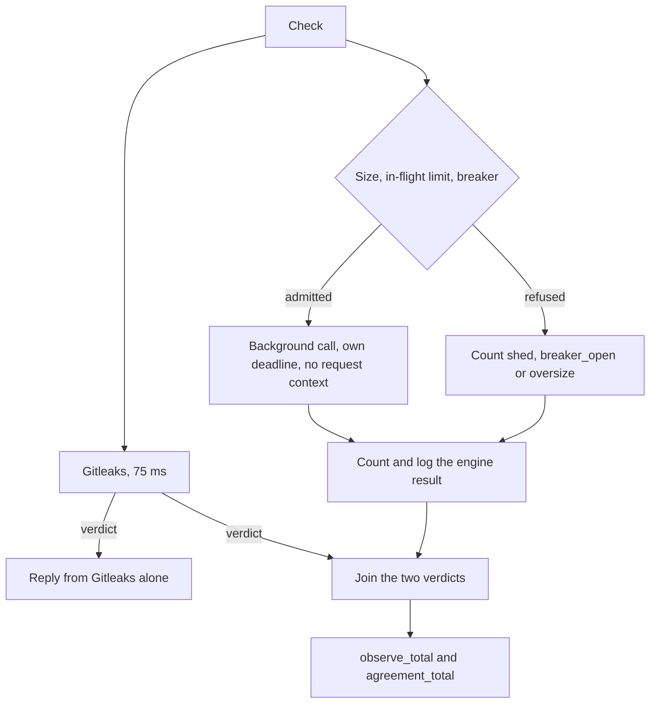

# Egress credential scanner

The scanner is an Envoy External Authorization v3 server. It loads
Gitleaks rules before its gRPC health service reports ready. By default it
uses the Gitleaks rules pinned in `go.mod` that can match HTTP text. Use
`--rules` to load a TOML file from a trusted mount. Operator rules that
require a repository file path fail startup.



Apply the policy to the selected route on agentgateway 1.7.0. Leave
`includeRequestHeaders` unset so the scanner receives all request headers.
Route authorization runs before Substrate injects the upstream credential.
The scanner checks the path, query, headers and UTF-8 JSON or plain text
body. It rejects unsupported encodings and bodies over 512 KiB. Matching
stops at the first finding. The scanner denies requests that exceed its
75 ms scan deadline or exhaust the budget of 64 suppressed matches.

```yaml
policies:
  extAuthz:
    host: egress-scan.ate-system.svc:8080
    protocol:
      grpc: {}
    failureMode: deny
    includeRequestBody:
      maxRequestBytes: 524288
      allowPartialMessage: false
      packAsBytes: true
    policies:
      http:
        requestTimeout: 80ms
```

Admit only the gateway to the scanner's listener. The Hindsight pilot and
its cluster latency check are tracked in
[HOME-729](https://factory-plan.jomcgi.dev/factory/issue/HOME-729).

## Second scan tier (Semgrep engine)

The scanner can send each request's scanned text to a Semgrep engine. The tier
is **off by default**. With the tier off, the scanner, its metrics, the 75 ms
scan deadline, the 80 ms gateway `requestTimeout` and the chart render do not
change.

The tier has two modes (`semgrep.mode`):

| Mode | The engine verdict | The reply waits for the engine | Use |
| --- | --- | --- | --- |
| `enforce` (default) | merged with the Gitleaks verdict. A finding denies. | yes, up to the deadline | steady state |
| `observe` | counted and logged only. It never changes a reply. | no | the first 7 days |

The next sections describe enforce mode. [Observe mode](#observe-mode) comes
after the configuration.



In enforce mode, Gitleaks and the engine run at the same time. A Gitleaks
finding, or a Gitleaks work-limit result, returns at once. It cancels the engine call. The scanner
allows a request only when both tiers have finished and neither denies. The
Gitleaks slot (`--concurrency`) is free as soon as Gitleaks ends. A slow
engine cannot hold the slots that Gitleaks needs.

### What the engine receives and returns

The scanner sends one `POST` with `Content-Length` and the text that Gitleaks
scans: the host, path, query and header lines, then the body, then the decoded
JSON strings. This is at most about 1.1 MiB. The engine contract is the
fork-engine contract in
[`../gvisor-fork/engine/README.md`](../gvisor-fork/engine/README.md): a `.`
progress line, then the Semgrep JSON. The client reads from the first `{`.

| Engine result | Tier result |
| --- | --- |
| Any result | finding. The request is denied (403) whatever the severity or `validation_state`. A key that is invalid or not validated still must not leave. |
| Result with `is_ignored` true | finding. The text is actor-controlled, so an actor can add a `nosemgrep` marker. A suppressed result still denies. |
| No findings, any `errors` entry, at any level | no verdict (`error`): the scan was partial. The CLI reports rule timeouts and out-of-memory at level `warn`. |
| No findings, any entry in `paths.skipped` | no verdict (`error`): the scan was partial. Semgrep skips a target over its default size limit (about 1 MB), and the text can reach about 1.1 MiB. |
| HTTP status other than 200, redirect, no `results` key, not JSON, or text other than dots and white space before the JSON | no verdict (`error`) |
| Response over `--semgrep-max-response` | no verdict (`error`) |

The scanner reads only `check_id`, `start.offset` and `end.offset`. It does not read `extra.lines` or any other field that can
hold the matched text. A log line holds the rule id and the offsets, for
example `aws-key-0@4-24`. It never holds the matched text. The denial that the
actor sees is the same text as for a Gitleaks finding, so the actor learns no
rule name. Rule ids are not metric labels.

### Failure mode

The engine gives no verdict when it is late, fails, is full or is skipped.
The tier then applies the failure mode. Each case is counted and logged. The log
line appears at most once per 10 s for each case.

| Case | Metric outcome | `deny` (default) | `allow` |
| --- | --- | --- | --- |
| Engine passes its deadline | `timeout` | 503 | allow |
| Engine error, bad status, bad or large response | `error` | 503 | allow |
| In-flight limit reached (load shed) | `shed` | 503 | allow |
| Breaker open, engine not called | `breaker_open` | 503 | allow |
| Body over `--semgrep-max-body` | `oversize` | 503 | allow |
| Gitleaks denied first, or the gateway cancelled | `cancelled` | no effect | no effect |

The default is `deny`. It matches the gateway `failureMode: deny` and the
Gitleaks deny on its own deadline. The scanner is a fail-closed control. An
engine that is down must stop traffic, not remove the second tier without a
sign. This is the rule in enforce mode: **an engine outage denies**. A deny from this tier has the metric outcome `engine_unavailable` and the
body `secondary scan unavailable`, so it is easy to tell from a credential
block.

Use `observe` mode, not `allow`, for the first soak: it also keeps the engine
off the request path. Use `allow` (allow and alert) when the second tier must
never block traffic on a failure, but may still deny a finding. Gitleaks still
runs. Each allowed request counts in
`factory_egress_scan_semgrep_failure_mode_total{action="allow"}`. Alert on any
rate above zero.

A breaker stops calls to an engine that keeps failing. After
`breaker.failures` timeouts or errors in a row it refuses calls for
`breaker.cooldown`, so each request does not wait for the full deadline. Then
it lets one probe call through.

### Capacity and sharing

Each scanner pod allows `semgrep.concurrency` engine calls at the same time.
A call holds its slot for at most the deadline. At the defaults, 8 in flight
and 300 ms, one pod handles at most 8 / 0.3 s = about 27 checks per second when
every call takes the full deadline. A faster engine raises this. Above the
limit, the tier sheds: in deny mode the request gets 503, and in allow mode it
passes without the second tier. Each pod has its own limit and its own breaker.

The limit and the breaker are shared by all actors. One actor with slow or
failing calls can use the slots, or open the breaker for 5 s, for every actor
behind that pod. This is inherent to a fail-closed engine that all actors
share. Fairness for each actor (a share of the slots, or a breaker for each
actor) is a possible follow-up.

### Deadline and gateway timeout

The tier has its own deadline. The default is 300 ms. A deployment with more
memory can set 75 ms. Gitleaks keeps its 75 ms.

**The gateway `requestTimeout` and `semgrep.deadline` are coupled.** The
gateway gives the whole check `requestTimeout`. If that is shorter than the
engine deadline, the gateway cancels the check first and the tier deadline and
failure mode never apply.

| `semgrep.enabled` | `semgrep.mode` | Gateway `requestTimeout` |
| --- | --- | --- |
| `false` | any | `80ms`, as in the policy above |
| `true` | `observe` | `80ms` or more. The engine is off the request path. |
| `true` | `enforce` | at least `semgrep.deadline` + 10 ms, for example `310ms` |

Change the mode and the timeout in one PR. The switch from `observe` to
`enforce` raises the timeout. The gateway policy is
[`../resources/egress-scan/gateway-policy.yaml`](../resources/egress-scan/gateway-policy.yaml).
`resources_test.py` fails if the tier is on in enforce mode and
`requestTimeout` is below the deadline + 10 ms, if the tier is on in observe
mode and `requestTimeout` is below 80 ms, or if the tier is off and
`requestTimeout` is not 80 ms.
Regenerate `gateway-patch.yaml` with `render_egress_gateway.py`. Set the
tier values in `helm.valuesObject` of the Application, so the test reads them.

### Configuration

| Flag | Chart value | Default | Meaning |
| --- | --- | --- | --- |
| `--semgrep-enabled` | `semgrep.enabled` | `false` | Turn the tier on |
| `--semgrep-endpoint` | `semgrep.endpoint` | none | Engine URL (`http` or `https`, no credentials). Required when on. |
| `--semgrep-deadline` | `semgrep.deadline` | `300ms` | Engine deadline per request (10 ms to 10 s) |
| `--semgrep-mode` | `semgrep.mode` | `enforce` | `enforce` or `observe`. Any other value fails startup and the render. |
| `--semgrep-failure-mode` | `semgrep.failureMode` | `deny` | `deny` or `allow` when the engine gives no verdict. Observe mode ignores it. |
| `--semgrep-max-body` | `semgrep.maxBodyBytes` | `524288` | Largest body sent. 512 KiB is also the scanner limit. |
| `--semgrep-concurrency` | `semgrep.concurrency` | `8` | In-flight engine calls. More are shed. |
| `--semgrep-max-response` | `semgrep.maxResponseBytes` | `1048576` | Largest engine response |
| `--semgrep-breaker-failures` | `semgrep.breaker.failures` | `5` | Failures in a row that open the breaker. `0` turns it off. |
| `--semgrep-breaker-cooldown` | `semgrep.breaker.cooldown` | `5s` | Time the breaker stays open |

The chart adds these flags only when `semgrep.enabled` is true, and it fails to
render without an endpoint, with a bad failure mode or with a bad mode.

### Metrics

These series exist only when the tier is on. Existing series do not change,
except that in enforce mode the check-duration histogram gets four more buckets
(0.3 to 1 s) and a new outcome `engine_unavailable`. In observe mode the check
series do not change at all, and `failure_mode_total` does not exist.

| Series | Meaning |
| --- | --- |
| `factory_egress_scan_semgrep_requests_total{outcome}` | Calls by outcome: `found`, `clean`, `timeout`, `error`, `shed`, `breaker_open`, `oversize`, `cancelled` |
| `factory_egress_scan_semgrep_duration_seconds{outcome}` | Time in the tier per call |
| `factory_egress_scan_semgrep_failure_mode_total{action}` | Requests that the failure mode decided |
| `factory_egress_scan_semgrep_agreement_total{gitleaks,semgrep}` | Both tiers gave a verdict. `gitleaks="clean",semgrep="found"` is a catch by the engine. In enforce mode a `gitleaks="found"` pair is a lower bound, because Gitleaks answers first. In observe mode the engine call always ends, so the pair is complete. |
| `factory_egress_scan_semgrep_observe_total{result}` | Observe mode only. Per request that Gitleaks decided: `would_deny`, `would_fail` or `no_change`. See [Observe mode](#observe-mode). |
| `factory_egress_scan_semgrep_observe_mode` | Observe mode only. 1 while the tier observes. |
| `factory_egress_scan_semgrep_observe_size_bytes{kind}` | Observe mode only. Histogram of `raw_body` and `engine_text` sizes of each request, in 12 buckets from 512 B to 1 MiB. The label has two fixed values and holds no request data. |
| `factory_egress_scan_semgrep_inflight` | Calls in progress |
| `factory_egress_scan_semgrep_breaker_open` | 1 while the breaker is open |
| `factory_egress_scan_semgrep_deadline_seconds` | Configured deadline |

The dashboard `egress-scanning` has a panel row for these series. No alert
rule exists for the scanner yet. Suggested conditions, for the owner of the
alerts: `rate(..._failure_mode_total{action="allow"}[5m]) > 0`,
`..._breaker_open == 1` for 5 minutes, and a rate of `timeout` and `error`
above 1 % of calls.

### Observe mode



In observe mode the scanner starts the engine call at the same time as
Gitleaks and **returns the Gitleaks verdict as soon as Gitleaks ends**. The
engine call goes on in the background up to `semgrep.deadline`. The engine
verdict, a failure, a hostile response or a panic can never deny a request, and
can never delay the reply.

- The call uses the same in-flight limit (`semgrep.concurrency`), breaker and
  deadline as enforce mode. The scanner takes the slot and checks the breaker
  and the size limit **before** it starts a goroutine. A refused request starts
  no goroutine and copies no body. An admitted call gets one copy of the engine
  text before the goroutine starts, so the goroutine never reads the request
  body after the reply. So the number of background goroutines is
  at most `semgrep.concurrency`, and each ends at the deadline. A slow or hung
  engine cannot pile up calls: it fills the slots, and the rest are counted as
  `shed`.
- The call has no link to the request context. The end of the request does not
  cancel it. A Gitleaks finding does not cancel it either, so the agreement
  counter shows what the engine would have said.
- A finding is logged with the rule id and the offsets only, at most once per
  10 s. The matched text is never logged or used as a label.

| Case | `requests_total` outcome | `observe_total` result | Reply |
| --- | --- | --- | --- |
| Engine finds, Gitleaks clean | `found` | `would_deny` | allow |
| Engine finds, Gitleaks denies | `found` | `no_change` | deny (Gitleaks) |
| Engine clean | `clean` | `no_change` | per Gitleaks |
| Engine passes its deadline | `timeout` | `would_fail` | per Gitleaks |
| Engine error, bad status, bad or large response, panic | `error` | `would_fail` | per Gitleaks |
| In-flight limit reached | `shed` | `would_fail` | per Gitleaks |
| Breaker open | `breaker_open` | `would_fail` | per Gitleaks |
| Body over `--semgrep-max-body` | `oversize` | `would_fail` | per Gitleaks |
| Gitleaks hit its work limit | as the call ends | not counted | 503 (Gitleaks) |

`would_fail` is counted only for a request that Gitleaks allowed. It is what
enforce mode with failure mode `deny` would answer with 503. Gitleaks still
denies on its own findings and its own 75 ms deadline in observe mode.

#### The 7-day observe procedure

Joe decided that the tier runs in observe mode for 7 days before enforce mode
([ARCHITECTURE.md](ARCHITECTURE.md#decided), row 3). Set
`semgrep.enabled: true` and `semgrep.mode: observe` in
`helm.valuesObject` of the Application. Keep the gateway `requestTimeout` at
`80ms`. Add the scanner egress rule and the engine ingress rule first (see
[Security](#security)). Then watch these, on the `egress-scanning` dashboard
row "Observe mode" and in the pod log:

| Look at | Suggested threshold | If not |
| --- | --- | --- |
| Would-deny rate and the findings by rule id (log line `semgrep tier observed a finding`) | Each rule id is a true positive, or a known false positive that you fix in the engine rules before enforce | A rule that fires on normal traffic must be tuned or removed. A false positive in enforce mode is a 403. |
| Engine error and timeout rate (`requests_total{outcome=~"timeout\|error"}`) | below 0.1 % of calls, and no `error` run | Find the cause (a bad response, `errors` or `paths.skipped` from the engine). In enforce mode with failure mode `deny` each one is a 503. |
| Shed and breaker-open rate | none | Raise `semgrep.concurrency`, or fix the engine capacity. |
| Engine latency p95 against `semgrep.deadline` | p95 at most half of the deadline | Raise the deadline (and the gateway timeout with it), or make the engine faster. |
| Request sizes (`observe_size_bytes`, kinds `raw_body` and `engine_text`) | the p99 of `raw_body` and the highest bucket with traffic set `semgrep.maxBodyBytes` (v1 value 32 KiB) | A body over the limit is `oversize` in enforce mode (503 with failure mode `deny`). |
| Observed requests, and `agreement_total` | a stable count each day, with the traffic of all callers | If no `observe_total` series moves, the engine is unreachable (check the network rules). |

The 7 days are Joe's decision. The thresholds in the table, and these exit
criteria, are **suggestions** of the author: 7 days of data, every would-deny
explained, the failure rates in the table met, and the latency p95 within the
deadline. The owner of the switch sets the final values. Then make one values
change in one PR:

```yaml
semgrep:
  mode: enforce     # was observe
```

and raise the gateway `requestTimeout` to at least `semgrep.deadline` + 10 ms
in the same PR. `resources_test.py` fails until both agree. To go back, set
`mode: observe` again and `requestTimeout: 80ms`.

Suggested alert rules, for the owner of the alerts (none exists for the
scanner yet): in observe mode, `rate(..._observe_total{result="would_fail"}[15m])`
above 1 % of observed requests for 15 minutes, and a rise of
`rate(..._observe_total{result="would_deny"}[1h])` above its 7-day level. In
both modes, `..._breaker_open == 1` for 5 minutes.

#### Failure modes by mode

| Case | Observe | Enforce, `failureMode: deny` | Enforce, `failureMode: allow` |
| --- | --- | --- | --- |
| Engine finds a credential Gitleaks missed | allow, counted `would_deny`, logged | deny 403 | deny 403 |
| Engine timeout, error, bad response, panic | allow, counted `would_fail` | deny 503 (an outage denies) | allow, counted in `failure_mode_total` |
| In-flight limit reached | allow, counted `shed` | deny 503 | allow |
| Breaker open | allow, counted `breaker_open` | deny 503 | allow |
| Body over `--semgrep-max-body` | allow, counted `oversize` | deny 503 | allow |
| Engine slow | no added latency | the reply waits up to the deadline | the reply waits up to the deadline |
| Gitleaks finding or work limit | deny, as the Gitleaks verdict | deny now, engine call cancelled | deny now, engine call cancelled |

### Security

- The body is untrusted. The scanner sends it only to the configured URL. The
  client uses no proxy, follows no redirect, has a per-request deadline and
  reads at most `--semgrep-max-response` bytes.
- The client **disables keep-alive**: each call opens a new connection. An
  engine child serves one request and then exits, so a reused connection would
  fail. The DNS lookup and the TCP connect of each call count against the
  deadline (300 ms by default). To remove the DNS lookup, set the endpoint to an
  IP address (`http://10.0.0.5:8080/`). That fits a service with a stable
  address, but not a per-request actor.
- The first version adds **no TLS and no credential**. Reach the engine over
  the cluster or Substrate network only. mTLS is a follow-up (HOME-254).
- **Two network rules are required before the tier is enabled.** The
  cluster-wide `default-deny` policy blocks all egress of every pod except DNS
  (`projects/platform-factory/network-policy/resources/baseline.yaml`). The
  scanner `CiliumNetworkPolicy` has ingress rules only, and this change adds no
  network rule. So the tier needs both:
  1. an egress rule from the scanner to the engine, and
  2. an ingress rule on the engine that admits the scanner.

  If the tier is enabled without them, every engine call fails to connect and
  every check times out and returns 503 in deny mode.
- The engine gets the same text as Gitleaks. This can include header values.
  The credential that the gateway injects upstream is added after the check and
  is never in the text.
- Scanner readiness does not depend on the engine. A down engine never takes
  the gateway down. The failure mode decides each request instead.

### How the scanner reaches an engine

The scanner talks to the `Engine` interface in `semgrep.go`
(`Scan(ctx, body) (Verdict, error)`). The only implementation is an HTTP client
for one URL. A per-request Substrate actor, a warm pool or a direct service
each need only a new `Engine`, or an endpoint that fronts them. Nothing else in
the scanner changes.

The [architecture](ARCHITECTURE.md) designs the endpoint that fronts a warm pool
of forked gVisor children. It is `designed`: nothing in it is enabled.
