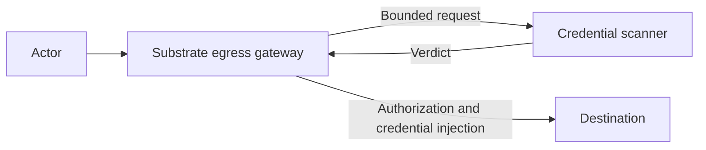
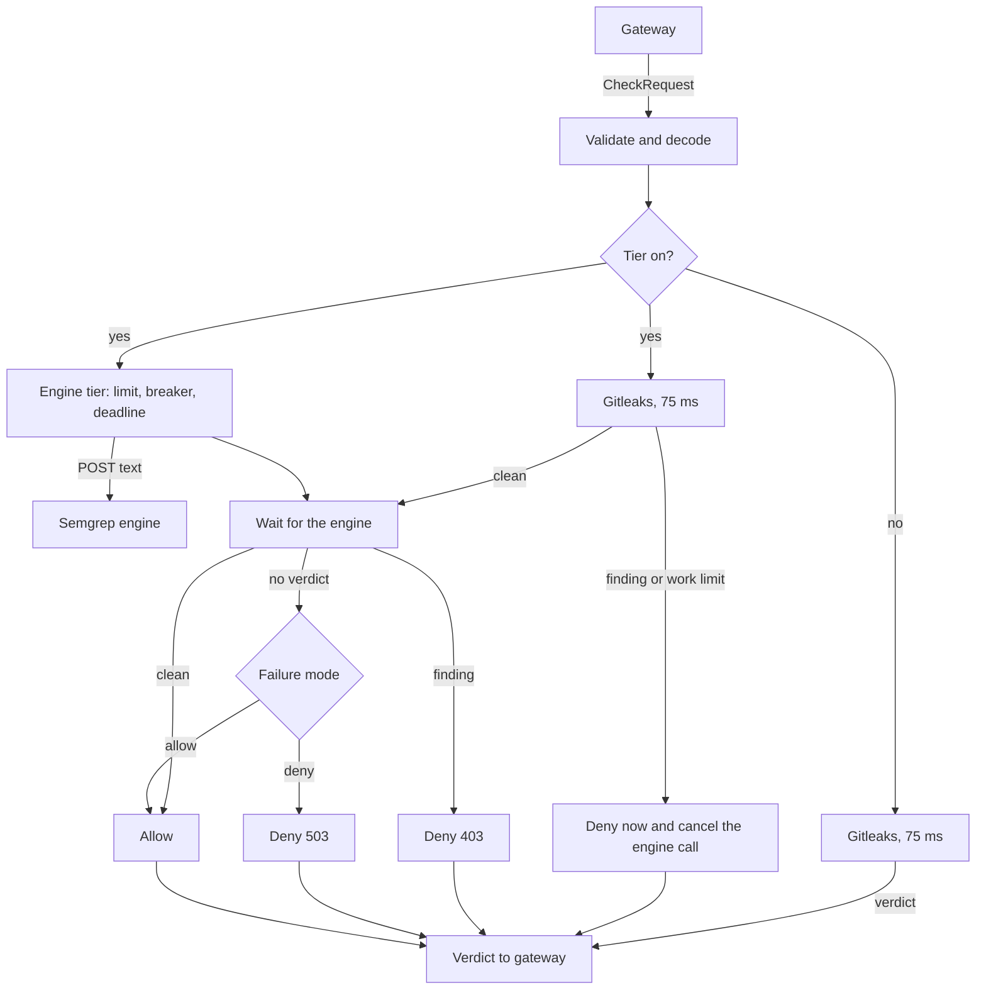

# Egress credential scanner

The scanner is an Envoy External Authorization v3 server. It loads
Gitleaks rules before its gRPC health service reports ready. By default it
uses the Gitleaks rules pinned in `go.mod` that can match HTTP text. Use
`--rules` to load a TOML file from a trusted mount. Operator rules that
require a repository file path fail startup.



Apply the policy to the selected route on agentgateway 1.7.0. Leave
`includeRequestHeaders` unset so the scanner receives all request headers.
Route authorization runs before Substrate injects the upstream credential.
The scanner checks the path, query, headers and UTF-8 JSON or plain text
body. It rejects unsupported encodings and bodies over 512 KiB. Matching
stops at the first finding. The scanner denies requests that exceed its
75 ms scan deadline or exhaust the budget of 64 suppressed matches.

```yaml
policies:
  extAuthz:
    host: egress-scan.ate-system.svc:8080
    protocol:
      grpc: {}
    failureMode: deny
    includeRequestBody:
      maxRequestBytes: 524288
      allowPartialMessage: false
      packAsBytes: true
    policies:
      http:
        requestTimeout: 80ms
```

Admit only the gateway to the scanner's listener. The Hindsight pilot and
its cluster latency check are tracked in
[HOME-729](https://factory-plan.jomcgi.dev/factory/issue/HOME-729).

## Second scan tier (Semgrep engine)

The scanner can send each request's scanned text to a Semgrep engine and merge
the engine verdict with the Gitleaks verdict. The tier is **off by default**.
With the tier off, the scanner, its metrics, the 75 ms scan deadline, the 80 ms
gateway `requestTimeout` and the chart render do not change.



Gitleaks and the engine run at the same time. A Gitleaks finding, or a Gitleaks
work-limit result, returns at once. It cancels the engine call. The scanner
allows a request only when both tiers have finished and neither denies. The
Gitleaks slot (`--concurrency`) is free as soon as Gitleaks ends. A slow
engine cannot hold the slots that Gitleaks needs.

### What the engine receives and returns

The scanner sends one `POST` with `Content-Length` and the text that Gitleaks
scans: the host, path, query and header lines, then the body, then the decoded
JSON strings. This is at most about 1.1 MiB. The engine contract is the
fork-engine contract in
[`../gvisor-fork/engine/README.md`](../gvisor-fork/engine/README.md): a `.`
progress line, then the Semgrep JSON. The client reads from the first `{`.

| Engine result | Tier result |
| --- | --- |
| Any result | finding. The request is denied (403) whatever the severity or `validation_state`. A key that is invalid or not validated still must not leave. |
| Result with `is_ignored` true | finding. The text is actor-controlled, so an actor can add a `nosemgrep` marker. A suppressed result still denies. |
| No findings, `errors` with level `error` | no verdict (`error`): the scan was partial |
| No findings, `errors` with level `warn` or `info` | clean |
| HTTP status other than 200, redirect, no `results` key, not JSON | no verdict (`error`) |
| Response over `--semgrep-max-response` | no verdict (`error`) |

The scanner reads only `check_id`, `start.offset` and `end.offset`. It does not read `extra.lines` or any other field that can
hold the matched text. A log line holds the rule id and the offsets, for
example `aws-key-0@4-24`. It never holds the matched text. The denial that the
actor sees is the same text as for a Gitleaks finding, so the actor learns no
rule name. Rule ids are not metric labels.

### Failure mode

The engine gives no verdict when it is late, fails, is full or is skipped.
The tier then applies the failure mode. Each case is counted and logged. The log
line appears at most once per 10 s for each case.

| Case | Metric outcome | `deny` (default) | `allow` |
| --- | --- | --- | --- |
| Engine passes its deadline | `timeout` | 503 | allow |
| Engine error, bad status, bad or large response | `error` | 503 | allow |
| In-flight limit reached (load shed) | `shed` | 503 | allow |
| Breaker open, engine not called | `breaker_open` | 503 | allow |
| Body over `--semgrep-max-body` | `oversize` | 503 | allow |
| Gitleaks denied first, or the gateway cancelled | `cancelled` | no effect | no effect |

The default is `deny`. It matches the gateway `failureMode: deny` and the
Gitleaks deny on its own deadline. The scanner is a fail-closed control. An
engine that is down must stop traffic, not remove the second tier without a
sign. A deny from this tier has the metric outcome `engine_unavailable` and the
body `secondary scan unavailable`, so it is easy to tell from a credential
block.

Use `allow` (allow and alert) for a soak, or when the second tier must never
block traffic. Gitleaks still runs. Each allowed request counts in
`factory_egress_scan_semgrep_failure_mode_total{action="allow"}`. Alert on any
rate above zero.

A breaker stops calls to an engine that keeps failing. After
`breaker.failures` timeouts or errors in a row it refuses calls for
`breaker.cooldown`, so each request does not wait for the full deadline. Then
it lets one probe call through.

### Deadline and gateway timeout

The tier has its own deadline. The default is 300 ms. A deployment with more
memory can set 75 ms. Gitleaks keeps its 75 ms.

**The gateway `requestTimeout` and `semgrep.deadline` are coupled.** The
gateway gives the whole check `requestTimeout`. If that is shorter than the
engine deadline, the gateway cancels the check first and the tier deadline and
failure mode never apply.

| `semgrep.enabled` | Gateway `requestTimeout` |
| --- | --- |
| `false` | `80ms`, as in the policy above |
| `true` | at least `semgrep.deadline` + 10 ms, for example `310ms` |

Change both in one PR. The gateway policy is
[`../resources/egress-scan/gateway-policy.yaml`](../resources/egress-scan/gateway-policy.yaml).
`resources_test.py` fails if the tier is on and `requestTimeout` is below the
deadline + 10 ms, or if the tier is off and `requestTimeout` is not 80 ms.
Regenerate `gateway-patch.yaml` with `render_egress_gateway.py`. Set the
tier values in `helm.valuesObject` of the Application, so the test reads them.

### Configuration

| Flag | Chart value | Default | Meaning |
| --- | --- | --- | --- |
| `--semgrep-enabled` | `semgrep.enabled` | `false` | Turn the tier on |
| `--semgrep-endpoint` | `semgrep.endpoint` | none | Engine URL (`http` or `https`, no credentials). Required when on. |
| `--semgrep-deadline` | `semgrep.deadline` | `300ms` | Engine deadline per request (10 ms to 10 s) |
| `--semgrep-failure-mode` | `semgrep.failureMode` | `deny` | `deny` or `allow` when the engine gives no verdict |
| `--semgrep-max-body` | `semgrep.maxBodyBytes` | `524288` | Largest body sent. 512 KiB is also the scanner limit. |
| `--semgrep-concurrency` | `semgrep.concurrency` | `8` | In-flight engine calls. More are shed. |
| `--semgrep-max-response` | `semgrep.maxResponseBytes` | `1048576` | Largest engine response |
| `--semgrep-breaker-failures` | `semgrep.breaker.failures` | `5` | Failures in a row that open the breaker. `0` turns it off. |
| `--semgrep-breaker-cooldown` | `semgrep.breaker.cooldown` | `5s` | Time the breaker stays open |

The chart adds these flags only when `semgrep.enabled` is true, and it fails to
render without an endpoint or with a bad failure mode.

### Metrics

These series exist only when the tier is on. Existing series do not change,
except that the check-duration histogram gets four more buckets (0.3 to 1 s)
and a new outcome `engine_unavailable`.

| Series | Meaning |
| --- | --- |
| `factory_egress_scan_semgrep_requests_total{outcome}` | Calls by outcome: `found`, `clean`, `timeout`, `error`, `shed`, `breaker_open`, `oversize`, `cancelled` |
| `factory_egress_scan_semgrep_duration_seconds{outcome}` | Time in the tier per call |
| `factory_egress_scan_semgrep_failure_mode_total{action}` | Requests that the failure mode decided |
| `factory_egress_scan_semgrep_agreement_total{gitleaks,semgrep}` | Both tiers gave a verdict. `gitleaks="clean",semgrep="found"` is a catch by the engine. A `found` pair is a lower bound, because Gitleaks answers first. |
| `factory_egress_scan_semgrep_inflight` | Calls in progress |
| `factory_egress_scan_semgrep_breaker_open` | 1 while the breaker is open |
| `factory_egress_scan_semgrep_deadline_seconds` | Configured deadline |

The dashboard `egress-scanning` has a panel row for these series. No alert
rule exists for the scanner yet. Suggested conditions, for the owner of the
alerts: `rate(..._failure_mode_total{action="allow"}[5m]) > 0`,
`..._breaker_open == 1` for 5 minutes, and a rate of `timeout` and `error`
above 1 % of calls.

### Security

- The body is untrusted. The scanner sends it only to the configured URL. The
  client uses no proxy, follows no redirect, reuses no connection (an engine
  child serves one request), has a per-request deadline and reads at most
  `--semgrep-max-response` bytes.
- The first version adds **no TLS and no credential**. Reach the engine over
  the cluster or Substrate network only. The scanner `CiliumNetworkPolicy`
  has ingress rules only, and this change adds no network rule. Before the tier
  is enabled, admit the scanner in the ingress policy of the engine, and check
  that no egress policy of `ate-system` blocks the scanner. mTLS is a
  follow-up (HOME-254).
- The engine gets the same text as Gitleaks. This can include header values.
  The credential that the gateway injects upstream is added after the check and
  is never in the text.
- Scanner readiness does not depend on the engine. A down engine never takes
  the gateway down. The failure mode decides each request instead.

### How the scanner reaches an engine

The scanner talks to the `Engine` interface in `semgrep.go`
(`Scan(ctx, body) (Verdict, error)`). The only implementation is an HTTP client
for one URL. A per-request Substrate actor, a warm pool or a direct service
each need only a new `Engine`, or an endpoint that fronts them. Nothing else in
the scanner changes.
