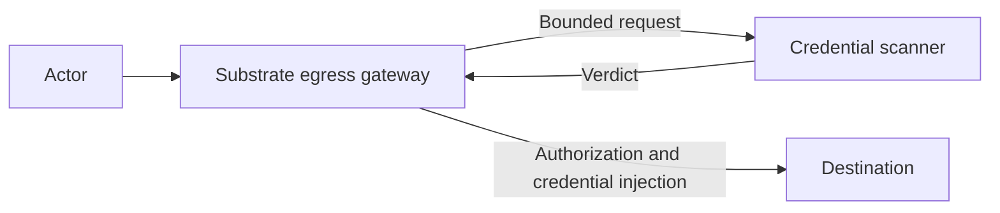

# Egress credential scanner

The scanner is an Envoy External Authorization v3 server. It loads
Gitleaks rules before its gRPC health service reports ready. By default it
uses the Gitleaks rules pinned in `go.mod`. Use `--rules` to load a TOML file
from a trusted mount.



Apply the policy to the selected route on agentgateway 1.7.0. Leave
`includeRequestHeaders` unset so the scanner receives all request headers.
Route authorization runs before Substrate injects the upstream credential.
The scanner checks the path, query, headers and UTF-8 JSON or plain text
body. It rejects unsupported encodings and bodies over 512 KiB.

```yaml
policies:
  extAuthz:
    host: egress-scan.ate-system.svc:8080
    protocol:
      grpc: {}
    failureMode: deny
    includeRequestBody:
      maxRequestBytes: 524288
      allowPartialMessage: false
      packAsBytes: true
    policies:
      http:
        requestTimeout: 80ms
```

Admit only the gateway to the scanner's listener. The Hindsight pilot and
its cluster latency check are tracked in
[HOME-729](https://factory-plan.jomcgi.dev/factory/issue/HOME-729).
