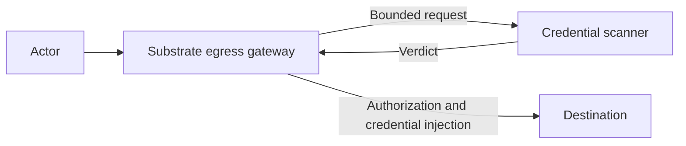

# Egress credential scanner

The scanner is an Envoy External Authorization v3 server. Its second scan tier
(the Semgrep engine) is deferred and removed from the code: see the last section
and [ARCHITECTURE.md](ARCHITECTURE.md) "Decided" 9. It calls one detector
(see "Detectors" below) and loads its rules before its gRPC health service
reports ready. The `gitleaks` detector uses the Gitleaks rules pinned in
`go.mod` that can match HTTP text. Use `--rules` to load a TOML file from a
trusted mount. Operator rules that require a repository file path fail startup.



Apply the policy to the selected route on agentgateway 1.7.0. Leave
`includeRequestHeaders` unset so the scanner receives all request headers.
Route authorization runs before Substrate injects the upstream credential.
The scanner checks the path, query, headers and UTF-8 JSON or plain text
body. It rejects unsupported encodings and bodies over 512 KiB. Matching
stops at the first finding. The scanner denies requests that exceed its
75 ms scan deadline or exhaust the budget of 64 suppressed matches.

```yaml
policies:
  extAuthz:
    host: egress-scan.ate-system.svc:8080
    protocol:
      grpc: {}
    failureMode: deny
    includeRequestBody:
      maxRequestBytes: 524288
      allowPartialMessage: false
      packAsBytes: true
    policies:
      http:
        requestTimeout: 80ms
```

The timeout is 80 ms: the detector scans for at most 75 ms.

Admit only the gateway to the scanner's listener. The Hindsight pilot and
its cluster latency check are tracked in
[HOME-729](https://factory-plan.jomcgi.dev/factory/issue/HOME-729).

## Detectors

The scanner calls exactly one detector for each request. `--detector` (chart
value `detector.name`) selects it by name:

| Name | What it is |
| --- | --- |
| `gitleaks` | The Gitleaks rules pinned in `go.mod`, matched by the scanner's own matcher with a context and a work budget. The chart default, and the revert lever for one release |
| `betterleaks` | The Betterleaks library (`v2.0.0-rc.11`) with its default rules and `detect/betterleaks/extra_rules.toml`. Allow markers off, decode depth 3. The bearer and basic Authorization rules report and do not deny yet (`detect/betterleaks/extra_rules.toml`). The detector of the Application since 2026-11-24 |

The host enforces the same settings for any detector. Each is a flag and a chart
value under `detector`:

| Flag | Default | Meaning |
| --- | --- | --- |
| `--detector-mode` | `enforce` | `enforce`: a finding denies. `observe`: counted, never denies |
| `--detector-failure-mode` | `deny` | What a call without a verdict does: `deny` or `allow` |
| `--detector-deadline` | `75ms` | Time for one request. Keep the gateway `requestTimeout` at least 5 ms above it (a test enforces this) |
| `--detector-max-input-bytes` | `524288` | Largest input of one call. A larger input is a failure, never a skip |
| `--detector-data-path` | empty | Mounted path of the private data of a detector that holds any |
| `--rules` | empty | Operator rule file (the `gitleaks` detector only) |

The interface, the swap procedure and the conformance test are in
`detect/doc.go` and [DESIGN-detectors.md](DESIGN-detectors.md). A private
detector (for example an exact-match index of known private content) joins by a
file `detectors_private.go` in a private build: the public code does not change.

## Metrics

The scanner serves Prometheus metrics on `:9090`. The check and detector
series carry two bounded labels, and no label holds request content (no path,
query, header value, match or actor name):

| Label | Value | Bound |
| --- | --- | --- |
| `route` | The destination `host[:port]` of the request, lower case, no path or query | An allowlist (`--metrics-routes`, chart `metrics.routes`, equal to the hosts the gateway policy scans: a test checks it). Any other value is `other`. With no allowlist, the first `--metrics-max-label-values` (32) distinct values, then `other` |
| `source` | The atespace of the actor (never the actor name) | The same cap. `unknown` when the gateway gives no actor identity |

| Metric | Labels |
| --- | --- |
| `factory_egress_scan_checks_total` | `outcome`, `route`, `source` |
| `factory_egress_scan_check_duration_seconds` | `outcome`, `route` |
| `factory_egress_scan_detector_findings_total` | `detector`, `rule`, `class` (`block` or `report`), `mode`, `route`, `source` |
| `factory_egress_scan_detector_failures_total` | `detector`, `reason` (`timeout`, `budget`, `oversize`, `error`, `panic`), `mode`, `route`, `source` |

**Route.** The Host header comes from the client. When the Host is not on the
list, a check that carries the gateway route name (`context.route`) gets the
route `route:<name>` (`route:hindsight`). Scanned traffic with an unexpected Host
is then visible. A check without a gateway name gets `other`.

**Source.** The scanner reads the atespace from the actor SPIFFE ID
(`spiffe://substrate-actor.local/worker-for-actor/<atespace>/<name>`) in this order:

1. The peer principal of the check.
2. The CEL metadata `actor.spiffe` that the gateway policy sends (`source.spiffeId`).
3. The static route name of the gateway policy (`route:hindsight`).
4. `unknown`.

Agentgateway 1.7.0 knows the actor atespace and name for its own logs
(`ate.atespace`, `ate.actor.name`). It does not give them to CEL or to the
ext_authz request. Sources 1 and 2 therefore depend on the inner TLS session.
Expect `route:hindsight` until upstream gives CEL an actor identity (for example
`source.actor.atespace`). Upstream issue 4289 covers the policy uid and version
only, not this.

## Second scan tier (Semgrep engine): deferred, removed from the code

The scanner had an optional second tier that posted the scanned text to a
Semgrep engine and merged the verdict with Gitleaks. It ran in observe mode on
2026-11-24 and in enforce mode for a few hours that day. Joe deferred it the same
day (ARCHITECTURE.md "Decided" 9) and the Pro engine converges on Mandoline
later. The scanner has one detector path now.

- **Code:** removed from `egress-scan` (`semgrep.go`, `observe.go`, the two-tier
  orchestration, the metrics, the flags and the chart values). It stays in git
  history. The last commit that holds it is `61a15fffb6` on `main`.
- **Design:** ARCHITECTURE.md "Engine path" and the sections after it keep the
  design and its measurements. They are deferred and not built.
- **Service behind it:** `gate/` (engine-gate) keeps its source, tests and
  README. It is not deployed. Its warm pool of single-use fork actors may serve
  tool-call sandboxes later.
- **To bring the tier back:** restore the files from that commit, the chart
  values, the Application values of PR #8648 and the 310 ms gateway timeout, and
  follow `gate/README.md` for the gate.
