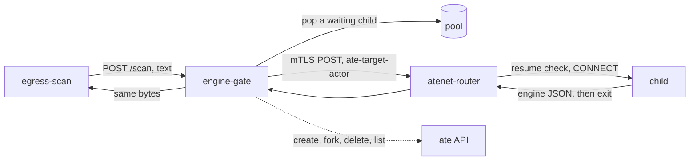

# engine-gate

`engine-gate` is the service behind the Semgrep tier of the egress scanner
(`semgrep.endpoint`, tier merged as #8612, off by default). It keeps a warm pool
of single-use gVisor fork children of the engine template and sends each scan
request to one child. State: **still deployed, no longer called**: the scanner's Semgrep tier is off
since 2026-11-24 (ARCHITECTURE.md "Decided" 9). It ran in enforce mode on that day
(see "Enforce mode" and "Enable steps"). The design is
[`../ARCHITECTURE.md`](../ARCHITECTURE.md), "Engine path" (path B).



## What the scanner sees

One endpoint: `POST /scan` on port 8080. It is the whole contract of
`semgrep.go`.

| Item | Rule |
| --- | --- |
| Request | The text body, `Content-Length` set. At most `--max-body` (1.2 MiB; the tier sends at most about 1.1 MiB). Empty gets 400. A body over the limit gets 413 from `Content-Length` before the gate reads a byte or takes a scan slot. The answer closes the connection, so the gate never reads the rest of the body. A scanner that is still writing can then see a reset or EPIPE instead of the 413. The tier treats both the same: a non-200 status is `errEngineStatus` and a transport error is an engine error, and both end as the outcome `error`, which gets the failure mode (the same as `oversize`, which the tier raises itself above its own `--semgrep-max-body`). The tier limit is below the gate limit, so the gate 413 is a second guard and normally never fires. |
| Deadline | `X-Deadline-Ms` (1 or more, capped at `--max-deadline`), else `--default-deadline` (300 ms). The scanner cancels the request when its own deadline passes. The gate stops at the first of the two. |
| Success | `200`, `Content-Type: application/json`, the engine reply byte for byte: the `.` progress line, then the JSON. The gate never parses it. |
| Failure | Any other status. The body is one word (the outcome), never a detail. The tier counts every non-200 status as `error`. |

| Status | Outcome | Cause |
| --- | --- | --- |
| 200 | `ok` | Engine reply |
| 400 / 413 | `bad_request` / `oversize` | Bad deadline header, empty body, body over the limit |
| 503 | `shed` | All `--max-inflight` slots busy for 25 ms |
| 503 | `pool_empty` | No waiting child, and path A cannot run in the time left or is full |
| 503 | `no_worker` | The last create failed within 5 s, or path A failed |
| 503 | `router_error` | The router is out of reach. The body never left the gate |
| 504 | `deadline` | The deadline passed |
| 503 | `client_gone` | The scanner disconnected |
| 502 | `child_error` | The child died or answered with an error status, after one retry at most |
| 502 | `bad_response` | The engine reply is over `--max-response` |

## Pool

The ate API has no claim operation. The gate owns the pool, so a claim is a pop
under one mutex, and no two requests can get the same child.

| Rule | Why |
| --- | --- |
| Children are named `eg-<pod>-<start epoch>-<n>`. The pod is a StatefulSet pod. | The prefix `eg-<pod>-` finds this pod's children after a restart. The epoch keeps two incarnations apart. |
| On start the gate lists the atespace and deletes every actor with its prefix. Only then does it create children. | A leftover child keeps its booking until it expires. Seeds and other pods' children have other names and stay. |
| It keeps `--target-waiting` (2) fresh children, created and forked in the background (`--create-concurrency` at once, back-off 200 ms to 5 s after a failure). | A request never waits for a create. |
| A claim takes the newest child. | The newest has the most lifetime left. |
| A child that served exits, and the control plane deletes it. The gate does not delete it. A sweep every `--sweep-interval` deletes a child that the gate no longer tracks, after two sightings and `--sweep-grace` after its handout. | A lost exit report must not keep a booking. |
| A waiting child older than `--recycle-after` (600 s) is deleted when fresh ones wait. Old children are replaced one at a time, oldest first, so children made together do not recycle together. No child older than `--hard-after` (780 s) is ever handed out. | The template lifetime is 900 s. The worker reports an expired child as a crash, and a delete is no crash. Old children stay claimable until their replacements wait, so the pool is never empty during a recycle. |
| If the body has not left the gate when the scanner cancels, or the router is out of reach, the child goes back to the pool. | The child is unspent. |
| If the child fails after the body left, the gate deletes it and sends the same body to the next child once, when more than `--retry-min-remaining` (120 ms) is left. | A dead or spent child holds nothing the next one needs. Both children belong to the gate. |
| An empty pool is path A: create and fork now, at most `--max-fallback` (2) at once, only with `--fallback-min-remaining` (200 ms) left. After a failed create, path A is refused for `--fail-fast` (5 s). | One create code path, and no queue of slow creates. |
| On SIGTERM `/readyz` fails first. After `--drain-delay` (5 s) the gate closes the scan listener, finishes the requests in flight (at most `--shutdown-grace`, 10 s) and deletes every child with its prefix. | The Service drops the pod before the listener closes, and no child is left after a normal stop. |
| The stop takes about 15 s (drain delay and shutdown grace) plus the cleanup. | `terminationGracePeriodSeconds` must stay at 30 or more. The manifest sets 30 and `manifests_test.py` asserts it. |

Admission: `--max-inflight` (4) scans at once. A fifth request waits
`--queue-wait` (25 ms) for a slot, then gets 503.

## Isolation

The router checks a client by its SPIFFE ID alone, and an allowed ID can reach
any actor. So this is the only component with that ID, and the scanner (which
parses untrusted bytes) has none.

- **No caller input names an actor.** The handler reads the body and
  `X-Deadline-Ms`. Every other header, the query and the path are dropped. The
  router request is built from fixed parts: the child name comes from the gate's
  own pool, the atespace and the template come from flags.
  `TestCallerCannotNameAnActor` sends forged `ate-target-actor`, port and query
  values.
- **The body goes only to a child the gate created.** The target is always
  `<atespace>/eg-<pod>-...`, and the router URL and its CA are fixed at start.
  The HTTP client uses no proxy and follows no redirect.
- **The reply is bounded and not parsed.** At most `--max-response` (1 MiB) goes
  back, as it came.
- **No body in any log or error.** Logs hold the outcome, sizes and timings.
  Errors name a kind, never the text of a transport error, which can quote
  an address. A rate limit keeps one line per kind in 10 s, so an actor cannot
  flood the log. `TestLogsHoldNoBody` checks this.
- **No secret in the environment.** The only variable is `POD_NAME`. The ate
  API token and the router certificate are projected files that the gate reads
  again when they change.
- **The token never goes to an unverified server.** The gate checks the serving
  certificate of the ate API and the router against the live
  `servicedns.podcert.ate.dev/identity` trust bundle and the expected name
  before it sends a byte. `TestAPIClientVerifiesTheServerBeforeSendingItsToken`
  proves it.
- **The pod has no Kubernetes API access** and no Secret (see
  `manifests/statefulset.yaml`).

Residual: an editor can create templates and egress policies in its atespace
(ARCHITECTURE.md, "Why a separate `engine-gate`"). The compensating alert is
not part of this change.

## Identity and grants

The gate reaches two services.

| Service | How the gate authenticates | Needs |
| --- | --- | --- |
| ate API (`api.ate-system.svc:443`, gRPC) | TLS, checked against the trust bundle. A bearer token: the projected ServiceAccount token, audience `api.ate-system.svc`, read on each call. Every call carries `ate-preview-allowed: true`, because `CreateActor` of a fork template needs it. | The editor role in the atespace |
| atenet-router (`atenet-router.ate-system.svc:443`, HTTPS, pod port 8443) | mTLS. The client certificate is the projected `podCertificate` of signer `podidentity.podcert.ate.dev/identity`. The server is checked against the `servicedns` trust bundle. | An entry in `ingressAllowedSPIFFEIDs` |

The router sends a request to port 80 of the actor, its default actor port. So
**the engine template's child listens on port 80**, as the latency template
does (`gvisor-fork/latency/template.yaml`). gVisor's netstack checks no
privileged-port capability, so uid 65532 can bind it. The router's CONNECT
listener (8444) reaches another port, and this gate does not use it. It is the
fallback only if the live latency Job shows that the wakeup probe on port 80
fails.

**Cluster grants. This change makes none of them.** Each is a separate cluster
change. Joe approved the pool resize (Decided 1), the SPIFFE ID and the
editor role (Decided 2), and, in session on 2026-11-23, the router grant PR, the
X8 waiver and the three grants below (Decided 6). The isolation gates of the
fork README (X1 to X7 and X9, step 9) still run as a safety check; they no
longer gate the merges:

1. `atenet-router.ingressAllowedSPIFFEIDs` in
   `projects/platform-factory/substrate/values/substrate.yaml`: add
   `spiffe://cluster.local/ns/ate-system/sa/engine-gate`. This allows the gate
   to send a request to any actor. The router needs no restart: agentgateway reloads the ConfigMap (observed on 2026-11-23 at 22:01:00Z).
2. As a global owner (`ate-client`): create the atespace `egress-scan-engine`
   and its access policy, with the binding below. An editor cannot create the
   fork template (`can_create_fork_template` needs a global owner), so the
   owner creates the template `engine` too. [`provision/`](provision) does all
   three (see "Enable steps"). The API wants a member as `user:<principal>`, and
   the principal of a ServiceAccount token is `system:serviceaccount:<ns>:<name>`.

   ```yaml
   # Atespace access policy of egress-scan-engine
   bindings:
     - role: editor
       members:
         - user:system:serviceaccount:ate-system:engine-gate
   ```

3. The WorkerPool `gvisor-fork` pinned to the atespace `egress-scan-engine`
   (the pool restarts between atespaces) and the Pro engine image. The pool is
   live (fork steps 5 to 7); the image is published (see "Private image pull").

The template the gate depends on:

| Field | Value | Why |
| --- | --- | --- |
| name, atespace | `engine`, `egress-scan-engine` | Flags `--template` and `--atespace` |
| `forkConfig.mode`, `singleUse` | `FORK_MODE_SEED_AND_FORK`, `true` | One request for each child |
| `forkConfig.maxLifetimeSeconds` | `900` | The recycle times assume it (600 s and 780 s) |
| `forkConfig.egress` | `FORK_EGRESS_NONE` | A child has no egress |
| listens on | port 80, `POST` with `Content-Length`; `/healthz` for the wakeup probe | The router's default actor port |

## Configuration

All values are flags. Defaults suit the design.

| Flag | Default | Meaning |
| --- | --- | --- |
| `--listen`, `--admin-listen` | `:8080`, `:9090` | Scan endpoint. Admin port: `/healthz`, `/readyz`, `/metrics` |
| `--pod-name` | `$POD_NAME` | Prefix of the children. A DNS label of at most 40 characters |
| `--atespace`, `--template` | `egress-scan-engine`, `engine` | Where and what to create |
| `--api-endpoint`, `--api-server-name`, `--api-token-file` | `dns:///api.ate-system.svc:443`, `api.ate-system.svc`, `/var/run/ate/token` | ate API |
| `--router-url`, `--router-server-name`, `--router-cert-file`, `--ca-file` | `https://atenet-router.ate-system.svc:443`, `atenet-router.ate-system.svc`, `/var/run/router/credential-bundle.pem`, `/var/run/router-ca/trust-bundle.pem` | Router and trust |
| `--target-waiting` | 2 | Waiting children |
| `--max-inflight`, `--queue-wait` | 4, 25 ms | Scans at once, and the wait for a slot |
| `--max-fallback`, `--create-concurrency` | 2, 2 | Path A, and background creates, at once |
| `--default-deadline`, `--max-deadline` | 300 ms, 5 s | Request deadline |
| `--fallback-min-remaining`, `--retry-min-remaining`, `--fail-fast` | 200 ms, 120 ms, 5 s | Path A and retry limits |
| `--recycle-after`, `--hard-after` | 600 s, 780 s | Child age limits |
| `--api-call-timeout`, `--sweep-interval`, `--sweep-grace`, `--shutdown-grace` | 10 s, 15 s, 60 s, 10 s | Housekeeping |
| `--max-body`, `--max-response` | 1.2 MiB, 1 MiB | Size limits. The tier sends at most about 1.1 MiB |
| `--drain-delay` | 5 s | On SIGTERM: time between `/readyz` failing and the listener closing |

## Health and metrics

`/healthz` says the process runs. `/readyz` says the startup cleanup is done,
the pool has held a waiting child at least once, and the ate API answered within
two sweep intervals. After the first fill an empty pool does not make the pod
unready, because path A still serves and a burst must not take the only replica
out of the Service. It does turn unready when the pool is empty and creates are failing (the back-off is active), because every request would then get 503. A create that works makes it ready again. While the pod drains, `/readyz` fails.

Series on the admin port. No label holds a request value.

| Series | Meaning |
| --- | --- |
| `factory_engine_gate_children{state}` | `waiting`, `creating`, `inflight` |
| `factory_engine_gate_requests_total{outcome}` | Outcomes in the table above |
| `factory_engine_gate_pool_misses_total`, `..._fallbacks_total{result}` | Empty pool, and path A (`ok`, `failed`, `refused`, `skipped`) |
| `factory_engine_gate_replenish_failures_total{op}` | Failed `list`, `create`, `resume`, `delete` |
| `factory_engine_gate_child_errors_total`, `..._retries_total`, `..._recycled_total` | Child failures, second tries, recycled children |
| `factory_engine_gate_spent_children` | Served children that the last sweep still saw |
| `factory_engine_gate_request_seconds`, `..._claim_seconds` | Whole request, and the claim |
| `factory_engine_gate_create_seconds`, `..._resume_seconds` | `CreateActor`, and the fork (`ResumeActor`) |
| `factory_engine_gate_router_connect_seconds`, `..._send_to_result_seconds` | New router connection, and write to result through the router and the child |

The ARCHITECTURE.md failure table names `engine_ready_children`,
`engine_pool_misses_total`, `engine_shed_total` and `engine_child_errors_total`.
Here they are `children{state="waiting"}`, `pool_misses_total`,
`requests_total{outcome="shed"}` and `child_errors_total`.

## Manifests

[`manifests/`](manifests) holds the StatefulSet (one replica), Service,
ServiceAccount, network rules and admission guards. `manifests/manifests_test.py`
renders them and checks the isolation rules above. `../../resources/resources_test.py`
lists every object that the wired render holds and checks that the image pin
equals the Bazel image digest.

| Item | Choice |
| --- | --- |
| Replicas | 1 in v1. The pool books 8 children, and a second replica needs its own pool. A rollout or a drain is an outage, so there is no PodDisruptionBudget: it would block drains. |
| Service | ClusterIP `engine-gate`, port `scan` (8080). It is also the `serviceName`: the pod needs no stable DNS name. The scanner calls `http://engine-gate.ate-system.svc:8080/scan`. |
| Image | `repository@digest`, pinned in `manifests/kustomization.yaml`. CI pushes the image on main, with a content-stable digest (a digest that is already published is not pushed again). The pin is the one place that is not CI-owned: `resources_test.py` fails when it differs from `//.../gate/image:image.digest`, and its failure shows the new value. A change to the gate's code or its image config updates the pin in the same PR, as for the credential plugin pin (`resources/patches/atelet-image-credentials.yaml`). Packaging the manifests as a Helm chart would let CI own it, and is not done. |
| Resources | Request 50m CPU and 32Mi (it uses 1m and 12Mi). Memory limit 256Mi. The pool pod is another change. |
| Pod | `imagePullSecrets: ghcr-imagepull-secret` and `fsGroup: 65532` (read access to the projected files), as the live scanner and the latency Job. |
| Egress | The ate API on 443 and the router on 8443. DNS is open to every pod by the cluster-wide default-deny. |
| Ingress | The scanner on 8080 (`app: egress-scan`). Prometheus on 9090 (`admin`), by `prometheus-scrape-engine-gate`. |
| Scanner side | `egress-scan-to-engine-gate` lets `app: egress-scan` pods reach `app: engine-gate` on 8080. It is the scanner's only egress rule besides DNS. |
| Prometheus side | `prometheus/resources/network-policy.yaml` lets Prometheus reach `app: engine-gate` on 9090, and `prometheus.yml` has the job `engine-gate` (port name `admin`). |
| Admission | `admission.yaml`: only ArgoCD (and the statefulset-controller that serves its StatefulSet) may create the ServiceAccount, the StatefulSet or a pod that runs as `engine-gate`. Same pattern as `kagent-identity-guard.yaml` (PLAT-5). |

## Alerts

`prometheus/resources/rules.yml`, group `engine-gate`. The alert table is in
`projects/factory-cluster/README.md`, "Alerts".

| Alert | Look at | Usual cause |
| --- | --- | --- |
| `EgressScanSemgrepDenying` | `factory_egress_scan_semgrep_requests_total{outcome}` (`timeout`, `error`, `shed`, `breaker_open`, `oversize`) and the engine-gate alerts | The engine path is down or slow, and in enforce mode Hindsight requests get 503. Fix the gate or the pool first. To stop the denials at once, set `semgrep.mode: observe` and the gateway `requestTimeout: 80ms` in one PR. |
| `EngineGateDown` | `kubectl -n ate-system get pod -l app=engine-gate`, `describe`, `logs` | Pod Pending (node room), image pull, crash. The metrics port is open to Prometheus only. |
| `EngineGateNotReady` | The pod log: the startup cleanup (`startup cleanup failed`), the pool (`creating a waiting child failed`), the ate API | The atespace or the template is missing (run the provisioning), the seed is not ready, the ate API is down, or creates fail with no capacity. |
| `EngineGatePoolEmpty` | `factory_engine_gate_replenish_failures_total{op}`, `factory_engine_gate_children`, the pool worker | The worker has no room (the seed and 8 children book 9 CPU), the seed is rebuilding, or the template was deleted. |
| `EngineGateFailing` | `factory_engine_gate_requests_total{outcome}`: `shed` (raise the scanner and gate limits together), `pool_empty` and `no_worker` (as above), `router_error` (the router or its grant), `child_error` (child crashes: `child_errors_total`), `deadline` (slow engine: `send_to_result_seconds`) | See the outcome table in "What the scanner sees". |

## Before merging the wiring

Read-only checks, with `KUBECONFIG=~/.kube/factory-sessions.yaml`:

- **DONE:** the provisioning Job succeeded at 23:54Z on 2026-11-23: the atespace `egress-scan-engine`, its access policy and the template `engine` exist, and the log has `step=seed result=ready seconds=12.3` (the private engine image pulled, and the worker is pinned to `egress-scan-engine`). Job `-1` ran then. ArgoCD replaced it by `-2` (a no-op re-run), so read the live one: `kubectl -n ate-system logs job/egress-engine-provision-2 | grep '^PROVISION '` ends with `event=summary mode=apply result=ok`.
- Node room for the pod (50m CPU, 32Mi memory): `kubectl describe nodes | grep -A8 'Allocated resources'`. If no node has room the pod stays Pending (`EngineGateDown`).
- No `edit` or `admin` binding reaches `ate-system`, and nobody holds `create` on `serviceaccounts/token`, `pods/exec` or `pods/ephemeralcontainers` there (the admission guard does not cover them).
- The priority class: the router, the ate API and the scanner set none, and the repo has no suitable non-system class. The gate sets none.
- The read login can pull the private engine image (see "Private image pull"), and the gate image exists: `crane manifest ghcr.io/jomcgi/homelab/projects/platform-factory/substrate/egress-scan/gate@sha256:7cb0f51e767b45eb75de72e75d2788eb7d7d1603b525ea807bfb4da6102e0f83` with the same login resolves (the package is private; main's CI pushed the image when the gate image merged, and the digest is the Bazel image digest that `resources_test.py` checks).

## Verify the admission guard

After the merge, two dry runs against the API server run its admission policies and change nothing. Run them as a user that is not ArgoCD. Each must be denied by a policy named `engine-gate-*`, not by RBAC:

```bash
export KUBECONFIG=~/.kube/factory-sessions.yaml
kubectl -n ate-system run guard-test --image=busybox --restart=Never --dry-run=server \
  --overrides='{"spec":{"serviceAccountName":"engine-gate","containers":[{"name":"x","image":"busybox"}]}}'
kubectl -n ate-system create serviceaccount engine-gate --dry-run=server
```

The expected answer is `ValidatingAdmissionPolicy 'engine-gate-pods' with binding 'engine-gate-pods' denied request: Only ArgoCD may create the engine-gate ServiceAccount or run a workload as it` (and `engine-gate-serviceaccount` for the second). The `engine-gate-workloads` policy (a Deployment, DaemonSet, ReplicaSet or Job that names the ServiceAccount) has the same expression shape, and `manifests_test.py` checks it. A `Forbidden` from RBAC instead proves nothing: ask an operator to run them. A dry run that succeeds means the guard is not in force: stop and revert.

## The scanner runs under gVisor

The egress-scan pods set `runtimeClassName: gvisor`. Their network stack is inside
the sandbox. Cilium's default socket load balancer translates a Service address at
`connect()`, and it never sees that call from a gVisor sandbox. Without the fix the
scanner could not reach any ClusterIP, DNS included. Cilium dropped the
untranslated packets as "world".

`projects/platform-factory/cilium/values.yaml` sets `socketLB.hostNamespaceOnly: true`
(#8636). Cilium then translates Service addresses per packet for pods, and by
socket only for host processes. **The scanner reaches the gate only because of that
value.** A revert makes every call to `engine-gate.ate-system.svc` fail. In observe
mode every Semgrep call counts as `error` or `timeout`. In enforce mode with
`failureMode: deny` it would be a 503 on every Hindsight request.

`resources_test.py`
(`test_scanner_reaches_the_gate_only_with_per_packet_service_translation`) fails if
the value goes while the scanner runs under gVisor with the tier on.

## Live check

A live check of the whole path. It changes no object in git and no setting of the cluster (but see the ephemeral containers below). It needs the
break-glass kubeconfig (`~/.kube/factory.yaml`, operators only): `kubectl debug`
adds an ephemeral container, which the sessions identity cannot do, and so does
the metrics proxy of the API server (`kubectl get --raw .../proxy/metrics`).
**An ephemeral container cannot be removed from a pod until the pod restarts.**
It stays in the pod spec, finished, and the pod is Ready as before. Use a pod that
a rollout will replace, and say so in the record of the check.

The fake token is built in two parts in every command below, so that a secret
scanner of this public repository does not match the source. It is not a
credential: the engine must find it (`secrets.services.github_pat`).

**1. The gate, from the scanner's identity.** The ephemeral container shares the
pod's network and its Cilium identity, so it can call what the scanner calls:

```bash
export KUBECONFIG=~/.kube/factory.yaml
POD=$(kubectl -n ate-system get pod -l app=egress-scan -o name | head -1)
kubectl -n ate-system debug "$POD" -i --image=curlimages/curl --target=scanner -- sh -c '
  FAKE=$(printf "ghp_%s" "16C7e42F292c6912E7710c838347Ae178B4a")
  curl -s -m 5 -o /tmp/reply -w "status %{http_code} in %{time_total}s, %{size_download} bytes\n" \
    -H "X-Deadline-Ms: 2000" --data-binary "token=$FAKE" \
    http://engine-gate.ate-system.svc:8080/scan
  grep -o "secrets\.services\.github_pat" /tmp/reply | head -1'
```

Expect status 200 in about 80 to 150 ms (a reply of about 73 KB with the 1586 rules)
and the line `secrets.services.github_pat`. A `Could not resolve host` or a timeout
is the gVisor case above (or the scanner's egress rule to the gate is missing).

**2. The scanner, as the gateway calls it.** The gateway sends an ext_authz
`Check` (gRPC) to the scanner pod. Send one by hand from an ephemeral container on
the atenet-egress pod, which the network rules let reach the scanner on 8080. The
`CheckRequest` is encoded by hand, nested as `attributes` (1), `request` (4) and
`http` (2). The `http` message holds:

| Field | Number | Value |
| --- | --- | --- |
| `method` | 2 | `POST` |
| `headers` | 3 | a map entry: key (1) `content-type`, value (2) `text/plain` |
| `path` | 4 | `/v1/test` |
| `host` | 5 | `example.com` |
| `size` | 9 | the body length (the scanner requires it to match `raw_body`) |
| `raw_body` | 12 | the fake token |

The script is POSIX `sh`. It builds each field in a file, so a length is `wc -c`.
A decoder of its output found each field at the number above (it was not sent to
Envoy):

```bash
export KUBECONFIG=~/.kube/factory.yaml
EG=$(kubectl -n ate-system get pod -l app=atenet-egress -o name | head -1)
SC=$(kubectl -n ate-system get pod -l app=egress-scan -o name | head -1)
IP=$(kubectl -n ate-system get "$SC" -o jsonpath='{.status.podIP}')
kubectl -n ate-system debug "$EG" -i --image=curlimages/curl --target=agentgateway -- env IP="$IP" sh -s <<'SH'
# Build a gRPC frame with an envoy.service.auth.v3.CheckRequest in /tmp/check.bin.
# POSIX sh and printf. Each field is built in a file, so a length is wc -c and a
# byte of 10 or above 127 never passes through a shell variable.
cd /tmp || exit 1
o() { printf '\\%03o' "$1"; }                       # the escape text of one byte
v() { if [ "$1" -lt 128 ]; then o "$1"; else o $(($1 % 128 + 128)); o $(($1 / 128)); fi; }  # varint, below 16384
f() { printf "$(o "$1")"; printf "$(v "$(wc -c < "$2")")"; cat "$2"; }  # f TAG FILE: one length-delimited field
printf '%s' content-type > k; printf '%s' text/plain > t
{ f 10 k; f 18 t; } > hdr                          # map entry: key = 1, value = 2
printf '%s' POST > m; printf '%s' /v1/test > p; printf '%s' example.com > h
printf 'token=ghp_%s' '16C7e42F292c6912E7710c838347Ae178B4a' > body
{ f 18 m; f 26 hdr; f 34 p; f 42 h; printf "$(o 72)$(v "$(wc -c < body)")"; f 98 body; } > http  # method 2, headers 3, path 4, host 5, size 9, raw_body 12
f 18 http > req                                    # Request.http = 2
f 34 req > attr                                    # AttributeContext.request = 4
f 10 attr > msg                                    # CheckRequest.attributes = 1
n=$(wc -c < msg)
{ printf '\000'; printf "$(o $((n >> 24 & 255)))$(o $((n >> 16 & 255)))$(o $((n >> 8 & 255)))$(o $((n & 255)))"; cat msg; } > check.bin
curl -s --http2-prior-knowledge -o /dev/null -D - -H 'content-type: application/grpc' -H 'te: trailers' \
  --data-binary @/tmp/check.bin "http://$IP:8080/envoy.service.auth.v3.Authorization/Check"
SH
```

The reply shows `grpc-status: 0` in the trailers when the call worked. The verdict is
in the binary body, so read it from the counters (step 3).

**3. The counters.** Read them from the scanner pod before and after, through the API
server's proxy (the scanner's metrics port is open to Prometheus only):

```bash
kubectl get --raw "/api/v1/namespaces/ate-system/pods/${SC#pod/}:9090/proxy/metrics" \
  | grep -E '^factory_egress_scan_(checks_total|semgrep_requests_total|semgrep_observe_total|semgrep_agreement_total)'
```

Wait a second or two after step 2 first: in observe mode the engine call runs in
the background, and its counters rise 100 to 150 ms after the `Check` returns.
If the proxy is refused (the scanner's ingress allows Prometheus only, and a call
from the API server's node can be dropped), run `curl -s localhost:9090/metrics` in
an ephemeral container on the scanner pod instead: it shares the network namespace,
so the rule does not apply.

After the check of step 2: `factory_egress_scan_checks_total{outcome="credential_blocked"}`
rose by 1 (Gitleaks matches the token), `factory_egress_scan_semgrep_requests_total{outcome="found"}`
rose by 1 (the engine found it too), and `semgrep_agreement_total{gitleaks="found",semgrep="found"}`
rose by 1. A clean body (no token) raises `outcome="allowed"` and `outcome="clean"`.
`outcome="error"` or `timeout` is the failure to chase. The calls of step 1 reach
the gate only, not the scanner's counters.

## Enable steps

Each step stays off until the one before it is verified. They follow the
rollout in ARCHITECTURE.md (step 7 and after). Every change below is its own
PR. "Cluster effect" is what the cluster does when the PR merges. Joe decided to
skip the X gates for now and to wire the scanner in observe mode
(ARCHITECTURE.md "Decided" 6 and 7), and on 2026-11-24 to skip the observe window and
enforce ("Decided" 8). The X gates still run.

| # | Change | Cluster effect on merge | Joe approves |
| --- | --- | --- | --- |
| 1 | [`provision/`](provision): Jobs that create the atespace, its access policy and the template `engine`, or remove them (teardown) | None when it merged: not wired, suspended | Nothing at merge |
| 2 | Router grant: `spiffe://cluster.local/ns/ate-system/sa/engine-gate` in `atenetRouter.ingressAllowedSPIFFEIDs` (`values/substrate.yaml`) | Added to the router ConfigMap (merged, #8627) | Approved (Joe, 2026-11-23, session; Decided 6) |
| 3 | Wire `provision/` into `resources/` with `egress-engine-provision-2` not suspended (`-1` ran on 2026-11-23; `-2` follows the script nits and re-runs as a no-op: every object exists) | Creates the atespace, the policy and the template, once. The worker pins the atespace at the first seed, so the pool pod must have restarted before | Joe merges it (Decided 6), after the pool restart |
| 4 | Wire the gate (`manifests/`), its image pin, the Prometheus job, rules and egress rule, and the observe-mode switch of the scanner | Starts the gate (one pod, 2 children), its network rules and the admission guard, and rolls the scanner pods (2) with `semgrep.mode=observe`. The scanner calls the gate off the request path. Replies do not change | Yes |
| 5 | Check (below) | None | |

**Order.** Provisioning script hardening (#8631), then step 3, whose Job must
succeed, then step 4. Step 3 comes after the pool pod restart and before step 4:
the gate has nothing to claim until the seed of the template is ready.

**Verify step 3** (read-only):

```bash
export KUBECONFIG=~/.kube/factory-sessions.yaml
kubectl -n ate-system get job egress-engine-provision-2        # COMPLETIONS 1/1
kubectl -n ate-system logs job/egress-engine-provision-2 | grep '^PROVISION '
```

The log shows `step=atespace`, `step=access_policy` and `step=template` (each
`created`, or `exists` on a re-run), then `step=seed result=ready` (about 25 s
after the template, more on the first pull of the private image), then
`event=summary mode=apply result=ok`. A line `event=waiting` every minute names
the worker and seed state. On a failure the log names the call that failed. A
Job's pod template is immutable: to run it again, bump the suffix in the name
(and in `resources_test.py`), and the same for any edit under `provision/`.

**What step 4 does.** ArgoCD applies the `substrate` Application: the admission
guard, the network rules, the ServiceAccount, the Service and the StatefulSet
(the pod pulls the image, deletes its leftovers, creates and forks 2 children, and
turns Ready), and the scanner Deployment rolls to the new arguments
(`--semgrep-enabled`, observe mode, 300 ms, concurrency 2, body limit 64 KiB).
There is no sync-wave order between the guard and the StatefulSet, and none is
needed: the guard exempts ArgoCD and the statefulset-controller. The gateway
timeout stays 80 ms. The scanner and the gate do not wait for each other: until
the gate is Ready, the scanner counts `error` outcomes of the tier and no reply
changes.

The scanner is called by the egress gateway for the Hindsight route only
(`resources/atenet-egress-config.yaml`, `hindsight-api.hindsight.svc:8888`), not
for all egress. So the gate sees the text of Hindsight requests, and the 7 days of
observe data describe that traffic only.

**Reading `would_fail`.** In observe mode `observe_total{result="would_fail"}`
counts every call that gave no verdict, and that includes `shed`: each scanner
pod admits 2 calls, a rolling update runs up to 3 pods (6 slots) against the
gate's 4 in flight, so a roll can shed. Read
`factory_egress_scan_semgrep_requests_total{outcome}` to separate `shed` from
`error` and `timeout` in the 7-day analysis.

**Verify step 4** (read-only):

```bash
export KUBECONFIG=~/.kube/factory-sessions.yaml
kubectl -n ate-system get statefulset engine-gate               # READY 1/1
kubectl -n ate-system get pod -l app=engine-gate -o wide
kubectl -n ate-system logs statefulset/engine-gate | tail -20   # JSON lines, no bodies
kubectl -n ate-system get pod -l app=egress-scan -o jsonpath='{.items[*].spec.containers[0].args}'
```

Then in Prometheus (or Grafana Explore):

- `factory_engine_gate_children{state="waiting"}` is 2 and `up{job="engine-gate"}` is 1.
- `rate(factory_engine_gate_requests_total{outcome="ok"}[5m])` rises with traffic, and the failing outcomes stay near zero.
- `factory_egress_scan_semgrep_observe_total` moves (`no_change` most of the time) and `factory_egress_scan_semgrep_observe_mode` is 1.
- `kubectl -n ate-system get pod -l app=engine-gate` shows no restarts, and the admission dry runs above are denied.

**Rollback.** In one PR: set `semgrep.enabled: false` in
`egress-scan/deploy/application.yaml` (the scanner stops calling the gate and the
render is the old one), remove `../egress-scan/gate/manifests` from
`resources/kustomization.yaml` (ArgoCD prunes the StatefulSet, which deletes its
children on SIGTERM, the Service, the policies and the guard), and remove the
`engine-gate` alert group (`rules.yml`, `rules_test.yml`) and the scrape job
(`prometheus.yml`) with Prometheus's egress rule: with no pod `EngineGateDown`
would fire for good. The atespace, the policy and the template stay until the
teardown Job runs (below). To pause the gate only, set `replicas: 0` in
`manifests/statefulset.yaml` (the alerts then fire, so silence them). Delete the
template only after the scanner stopped calling the gate.

**Restarting the gate.** The admission guard denies `kubectl rollout restart
statefulset/engine-gate` (an update of the StatefulSet) for anyone but ArgoCD.
To restart, delete the pod: `kubectl -n ate-system delete pod engine-gate-0` (the
StatefulSet controller makes it again; the gate deletes its children on SIGTERM
and the new pod cleans up what is left). To change the spec, change git.

**Enforce mode (2026-11-24 only, tier off since).** Joe skipped the 7-day observe window
(ARCHITECTURE.md "Decided" 8). The scanner denies a Hindsight request when the
engine finds a credential, and also when the engine gives no verdict
(`failureMode: deny`). So an outage of the engine path is an outage of Hindsight
writes and reads through the gateway. A restart of the gate, a roll of the
gvisor-fork worker, a rebuild of the seed or a node drain denies Hindsight
requests with 503 until the pool has a waiting child again (1 to 2 minutes for a
roll). Plan those changes for a quiet time, and read `EngineGateNotReady`,
`EngineGatePoolEmpty` and `EgressScanSemgrepDenying` first. The unit tests of the
failure mode cover the behaviour (`TestEngineFailuresApplyTheFailureMode`,
`TestSlowEngineAppliesDeadlineAndFailureMode`, `TestOversizeBodyAppliesTheFailureMode`
in `../semgrep_test.go`); nothing here simulates an outage on the cluster.

**Provisioning Jobs.** `egress-engine-provision-2` runs `provision.py` with
`MODE=apply`. It waits for an ACTIVE worker of the pool, then makes the three
objects, each only if it is not there, and waits for a ready seed. Run it again
at any time: an object that exists is left alone, an access policy without the
editor member gets it added (the other bindings stay), and a template that
differs in any value is an error, because a template is replaced blue/green.

**Teardown.** Stop the gate first (`replicas: 0`: it deletes its children on
SIGTERM). Then list `provision/teardown-job.yaml` in `provision/kustomization.yaml`
and set `suspend: false` in a PR (the file is not listed while it is suspended,
because a suspended Job makes the Application report Suspended). The Job
(`MODE=teardown`) deletes what is left of the actors, then the templates (which
removes the seeds), waits for the seeds to go, then deletes the access policy and
the atespace, which the API refuses to delete while it holds an actor or a
template. It fails if a delete fails. By hand, the same steps are `kubectl ate
delete actor`, `delete actor-template`, `delete access-policy -a egress-scan-engine`
and `delete atespace egress-scan-engine`, as `ate-client`. The pool's worker
keeps the atespace pin until its pod restarts.

**Blue/green rebuild.** A new image is a new template name, for example
`engine-v2`: change `EXPECTED_TEMPLATE` in `provision/provision.py` (it refuses any
other name) in the same change, copy `provision/template.yaml` with the new name and digest, run
the provisioning, wait for its seed, set `--template=engine-v2` on the gate,
drain, then delete `engine` with the teardown steps.

### Private image pull

The template names `engine-pro`, a PRIVATE package
(`ghcr.io/jomcgi-org/homelab/substrate-fork/engine-pro`, anonymous pull
refused). The atelet pulls actor and seed images itself, so a pod
`imagePullSecrets` entry does not apply to it. It already has what it needs, and
**the change is on the GitHub side only**:

- **Where it is configured.** `values/atelet.yaml` (`imageCredentialProviderConfigYAML`)
  runs a kubelet credential plugin for every `ghcr.io` image (HOME-539). The
  plugin reads the login from the Secret `ghcr-imagepull-secret` in
  `ate-system`, mounted at `/run/ghcr-pull` in the atelet container only
  (`resources/patches/atelet-image-credentials.yaml`). The Secret is a
  `OnePasswordItem` (`resources/ghcr-pull-secret.yaml`, item
  `vaults/k8s-homelab/items/ghcr-read-permissions`). The 1Password Operator makes
  it; External Secrets Operator is not involved (it did not run on the cluster
  on 2026-11-18, HOME-67). No SandboxConfig or atelet flag changes.
- **What must be true.** The account of that login can read the package. The
  image has no source label, so the package does not inherit access from the
  public repository, and the login needs its own grant: in GitHub,
  Packages, `homelab/substrate-fork/engine-pro`, Package settings, Manage
  access, give the account (or a team that holds it) the **Read** role. The
  token itself stays a classic token with `read:packages` only (fine-grained
  tokens do not cover GitHub packages). Joe is the package admin and creates
  nothing in the cluster. If the existing login belongs to another account than
  the one that can read `jomcgi-org` packages, Joe adds a 1Password item field
  and the operator syncs it. Joe stated on 2026-11-23, in session, that the login
  should have Read on the package. That is **unverified by `crane`**.
- **Check once, before step 3.** With the read login, `crane manifest
  ghcr.io/jomcgi-org/homelab/substrate-fork/engine-pro:1.186.0-0adcac4b1419`
  must resolve (the workflow checked the push with its own login, not this one).
  If it does not, the seed never becomes ready: `provision.py` times out at the
  seed wait after 600 s (about 10 min), the Job fails, the Application is
  Degraded, and the atelet log shows an `UNAUTHORIZED` pull. Fix the package
  access, then bump the Job suffix to run it again (an edit of the Job's pod
  template is not allowed in place). The plugin caches a login for 5 minutes
  (`defaultCacheDuration`).
- **What it does not need.** No new Secret, namespace or RBAC. The real Semgrep
  token is never in the cluster.

## Packaging

- **Image:** apko plus `rules_apko`, `image/`. The config is the one of
  `projects/factory/alert-relay/image/` with the binary renamed. Its lock file
  has the same package set and its own config checksum, so
  `image_lock_test` checks the pair.
- **Go dependency:** a minimal client in `ateapi/`. It is generated from
  `ateapi/ateapi.proto`, a subset of `api/ateapi/v1/ateapi.proto` at fork commit
  `b6b0ec3e217c` (`jomcgi-org/substrate`, branch `fork/seed-slice1`). It keeps
  the package `substrate.ateapi.v1`, the service `Control`, the five methods
  that the gate calls (`GetActor`, `CreateActor`, `ResumeActor`, `DeleteActor`,
  `ListActors`) and their field numbers, so the wire format is the same.
  The real package is a 12,000-line file in module `go.ate.dev/substrate`, which
  needs Go 1.27 and a whole module graph. The subset needs no `go.mod`,
  `go.sum` or Bazel module change: it uses `grpc` and `protobuf`, which the repo
  already has. Regenerate with `ateapi/generate.sh`. A new field
  in the fork needs a line in the `.proto` file.

## Tests

`bazel test //projects/platform-factory/substrate/egress-scan/gate/...` runs
them, and `go test -race -count=3` passes. No cluster is needed.

- A fake ate API speaks gRPC (`bufconn`), so the real client code runs. It pages
  its list, records the preview header and the bearer token, and fails on
  demand. A fake router and child answer the gate.
- Pool: fill, names, leftover cleanup (and nothing else deleted), start with
  the API down, claim and replenish off the request path, 64 racing claimers
  that never share a child, release, recycle without a gap and one at a time, stale
  children kept while the create fails, readiness after a burst and while
  draining, bounded delete workers, back-off, a failed fork, a slow fork, the sweep,
  shutdown.
- Gate: reply unchanged, forged actor names, limits, deadline header
  (default, cap, overflow, bad values, propagation), early 413 with a full gate, scanner leaving, shed, path A and its
  bounds, the API down, router error, child crash mid-request (retry, no time
  left, both fail), logs without body, log rate limit, probes.
- Transport: a real mTLS server checks the client certificate and the single
  header, an untrusted CA or wrong name is refused before a byte is sent, the
  certificate and the CA rotate in place, and each failure kind is classified.

`BenchmarkGateOverhead` measures the gate on a pool hit with a 16 KiB body, an
instant stub API and an instant fake router. Measured on a 12-thread desktop
CPU (`go test -bench . -benchtime 5000x`):

| Benchmark | p50 | p95 | p99 | Allocations |
| --- | --- | --- | --- | --- |
| In process (`ServeHTTP`) | 15 us | 37 us | 100 us | 55 |
| Loopback HTTP, new connection each time | 143 us | 226 us | 370 us | 183 |

The gate costs about 0.15 ms of the 11 ms that hops 3 and 4 of the latency
budget allow. The router and the child dominate.
