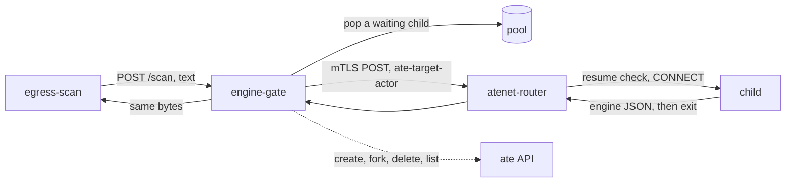

# engine-gate

`engine-gate` is the service behind the Semgrep tier of the egress scanner
(`semgrep.endpoint`, tier merged as #8612, off by default). It keeps a warm pool
of single-use gVisor fork children of the engine template and sends each scan
request to one child. State: **built and staged off**. The StatefulSet has no
replicas and no ArgoCD source lists it. The design is
[`../ARCHITECTURE.md`](../ARCHITECTURE.md), "Engine path" (path B).



## What the scanner sees

One endpoint: `POST /scan` on port 8080. It is the whole contract of
`semgrep.go`.

| Item | Rule |
| --- | --- |
| Request | The text body, `Content-Length` set. At most `--max-body` (1.2 MiB; the tier sends at most about 1.1 MiB). Empty gets 400. A body over the limit gets 413 from `Content-Length` before the gate reads a byte or takes a scan slot. The answer closes the connection, so the gate never reads the rest of the body. A scanner that is still writing can then see a reset or EPIPE instead of the 413. The tier treats both the same: a non-200 status is `errEngineStatus` and a transport error is an engine error, and both end as the outcome `error`, which gets the failure mode (the same as `oversize`, which the tier raises itself above its own `--semgrep-max-body`). The tier limit is below the gate limit, so the gate 413 is a second guard and normally never fires. |
| Deadline | `X-Deadline-Ms` (1 or more, capped at `--max-deadline`), else `--default-deadline` (300 ms). The scanner cancels the request when its own deadline passes. The gate stops at the first of the two. |
| Success | `200`, `Content-Type: application/json`, the engine reply byte for byte: the `.` progress line, then the JSON. The gate never parses it. |
| Failure | Any other status. The body is one word (the outcome), never a detail. The tier counts every non-200 status as `error`. |

| Status | Outcome | Cause |
| --- | --- | --- |
| 200 | `ok` | Engine reply |
| 400 / 413 | `bad_request` / `oversize` | Bad deadline header, empty body, body over the limit |
| 503 | `shed` | All `--max-inflight` slots busy for 25 ms |
| 503 | `pool_empty` | No waiting child, and path A cannot run in the time left or is full |
| 503 | `no_worker` | The last create failed within 5 s, or path A failed |
| 503 | `router_error` | The router is out of reach. The body never left the gate |
| 504 | `deadline` | The deadline passed |
| 503 | `client_gone` | The scanner disconnected |
| 502 | `child_error` | The child died or answered with an error status, after one retry at most |
| 502 | `bad_response` | The engine reply is over `--max-response` |

## Pool

The ate API has no claim operation. The gate owns the pool, so a claim is a pop
under one mutex, and no two requests can get the same child.

| Rule | Why |
| --- | --- |
| Children are named `eg-<pod>-<start epoch>-<n>`. The pod is a StatefulSet pod. | The prefix `eg-<pod>-` finds this pod's children after a restart. The epoch keeps two incarnations apart. |
| On start the gate lists the atespace and deletes every actor with its prefix. Only then does it create children. | A leftover child keeps its booking until it expires. Seeds and other pods' children have other names and stay. |
| It keeps `--target-waiting` (2) fresh children, created and forked in the background (`--create-concurrency` at once, back-off 200 ms to 5 s after a failure). | A request never waits for a create. |
| A claim takes the newest child. | The newest has the most lifetime left. |
| A child that served exits, and the control plane deletes it. The gate does not delete it. A sweep every `--sweep-interval` deletes a child that the gate no longer tracks, after two sightings and `--sweep-grace` after its handout. | A lost exit report must not keep a booking. |
| A waiting child older than `--recycle-after` (600 s) is deleted when fresh ones wait. Old children are replaced one at a time, oldest first, so children made together do not recycle together. No child older than `--hard-after` (780 s) is ever handed out. | The template lifetime is 900 s. The worker reports an expired child as a crash, and a delete is no crash. Old children stay claimable until their replacements wait, so the pool is never empty during a recycle. |
| If the body has not left the gate when the scanner cancels, or the router is out of reach, the child goes back to the pool. | The child is unspent. |
| If the child fails after the body left, the gate deletes it and sends the same body to the next child once, when more than `--retry-min-remaining` (120 ms) is left. | A dead or spent child holds nothing the next one needs. Both children belong to the gate. |
| An empty pool is path A: create and fork now, at most `--max-fallback` (2) at once, only with `--fallback-min-remaining` (200 ms) left. After a failed create, path A is refused for `--fail-fast` (5 s). | One create code path, and no queue of slow creates. |
| On SIGTERM `/readyz` fails first. After `--drain-delay` (5 s) the gate closes the scan listener, finishes the requests in flight (at most `--shutdown-grace`, 10 s) and deletes every child with its prefix. | The Service drops the pod before the listener closes, and no child is left after a normal stop. |
| The stop takes about 15 s (drain delay and shutdown grace) plus the cleanup. | `terminationGracePeriodSeconds` must stay at 30 or more. The manifest sets 30 and `staged_test.py` asserts it. |

Admission: `--max-inflight` (4) scans at once. A fifth request waits
`--queue-wait` (25 ms) for a slot, then gets 503.

## Isolation

The router checks a client by its SPIFFE ID alone, and an allowed ID can reach
any actor. So this is the only component with that ID, and the scanner (which
parses untrusted bytes) has none.

- **No caller input names an actor.** The handler reads the body and
  `X-Deadline-Ms`. Every other header, the query and the path are dropped. The
  router request is built from fixed parts: the child name comes from the gate's
  own pool, the atespace and the template come from flags.
  `TestCallerCannotNameAnActor` sends forged `ate-target-actor`, port and query
  values.
- **The body goes only to a child the gate created.** The target is always
  `<atespace>/eg-<pod>-...`, and the router URL and its CA are fixed at start.
  The HTTP client uses no proxy and follows no redirect.
- **The reply is bounded and not parsed.** At most `--max-response` (1 MiB) goes
  back, as it came.
- **No body in any log or error.** Logs hold the outcome, sizes and timings.
  Errors name a kind, never the text of a transport error, which can quote
  an address. A rate limit keeps one line per kind in 10 s, so an actor cannot
  flood the log. `TestLogsHoldNoBody` checks this.
- **No secret in the environment.** The only variable is `POD_NAME`. The ate
  API token and the router certificate are projected files that the gate reads
  again when they change.
- **The token never goes to an unverified server.** The gate checks the serving
  certificate of the ate API and the router against the live
  `servicedns.podcert.ate.dev/identity` trust bundle and the expected name
  before it sends a byte. `TestAPIClientVerifiesTheServerBeforeSendingItsToken`
  proves it.
- **The pod has no Kubernetes API access** and no Secret (see
  `staged/statefulset.yaml`).

Residual: an editor can create templates and egress policies in its atespace
(ARCHITECTURE.md, "Why a separate `engine-gate`"). The compensating alert is
not part of this change.

## Identity and grants

The gate reaches two services.

| Service | How the gate authenticates | Needs |
| --- | --- | --- |
| ate API (`api.ate-system.svc:443`, gRPC) | TLS, checked against the trust bundle. A bearer token: the projected ServiceAccount token, audience `api.ate-system.svc`, read on each call. Every call carries `ate-preview-allowed: true`, because `CreateActor` of a fork template needs it. | The editor role in the atespace |
| atenet-router (`atenet-router.ate-system.svc:443`, HTTPS, pod port 8443) | mTLS. The client certificate is the projected `podCertificate` of signer `podidentity.podcert.ate.dev/identity`. The server is checked against the `servicedns` trust bundle. | An entry in `ingressAllowedSPIFFEIDs` |

The router sends a request to port 80 of the actor, its default actor port. So
**the engine template's child listens on port 80**, as the latency template
does (`gvisor-fork/latency/template.yaml`). gVisor's netstack checks no
privileged-port capability, so uid 65532 can bind it. The router's CONNECT
listener (8444) reaches another port, and this gate does not use it. It is the
fallback only if the live latency Job shows that the wakeup probe on port 80
fails.

**Cluster grants. This change makes none of them.** Each is a separate cluster
change. Joe approved the pool resize (Decided 1) and the SPIFFE ID and the
editor role (Decided 2) on 2026-11-23 (ARCHITECTURE.md, "Decided"). They are
applied after the isolation gates of the fork README:

1. `atenet-router.ingressAllowedSPIFFEIDs` in
   `projects/platform-factory/substrate/values/substrate.yaml`: add
   `spiffe://cluster.local/ns/ate-system/sa/engine-gate`. This allows the gate
   to send a request to any actor. The change rolls the router.
2. As a global owner (`ate-client`): create the atespace `egress-scan-engine`
   and its access policy, with the binding below. An editor cannot create the
   fork template (`can_create_fork_template` needs a global owner), so the
   owner creates the template `engine` too.

   ```yaml
   # Atespace access policy of egress-scan-engine
   bindings:
     - role: editor
       members:
         - system:serviceaccount:ate-system:engine-gate
   ```

3. The WorkerPool `gvisor-fork` pinned to the atespace `egress-scan-engine`
   (the pool restarts between atespaces) and the Pro engine image. Both are
   other changes.

The template the gate depends on:

| Field | Value | Why |
| --- | --- | --- |
| name, atespace | `engine`, `egress-scan-engine` | Flags `--template` and `--atespace` |
| `forkConfig.mode`, `singleUse` | `FORK_MODE_SEED_AND_FORK`, `true` | One request for each child |
| `forkConfig.maxLifetimeSeconds` | `900` | The recycle times assume it (600 s and 780 s) |
| `forkConfig.egress` | `FORK_EGRESS_NONE` | A child has no egress |
| listens on | port 80, `POST` with `Content-Length`; `/healthz` for the wakeup probe | The router's default actor port |

## Configuration

All values are flags. Defaults suit the design.

| Flag | Default | Meaning |
| --- | --- | --- |
| `--listen`, `--admin-listen` | `:8080`, `:9090` | Scan endpoint. Admin port: `/healthz`, `/readyz`, `/metrics` |
| `--pod-name` | `$POD_NAME` | Prefix of the children. A DNS label of at most 40 characters |
| `--atespace`, `--template` | `egress-scan-engine`, `engine` | Where and what to create |
| `--api-endpoint`, `--api-server-name`, `--api-token-file` | `dns:///api.ate-system.svc:443`, `api.ate-system.svc`, `/var/run/ate/token` | ate API |
| `--router-url`, `--router-server-name`, `--router-cert-file`, `--ca-file` | `https://atenet-router.ate-system.svc:443`, `atenet-router.ate-system.svc`, `/var/run/router/credential-bundle.pem`, `/var/run/router-ca/trust-bundle.pem` | Router and trust |
| `--target-waiting` | 2 | Waiting children |
| `--max-inflight`, `--queue-wait` | 4, 25 ms | Scans at once, and the wait for a slot |
| `--max-fallback`, `--create-concurrency` | 2, 2 | Path A, and background creates, at once |
| `--default-deadline`, `--max-deadline` | 300 ms, 5 s | Request deadline |
| `--fallback-min-remaining`, `--retry-min-remaining`, `--fail-fast` | 200 ms, 120 ms, 5 s | Path A and retry limits |
| `--recycle-after`, `--hard-after` | 600 s, 780 s | Child age limits |
| `--api-call-timeout`, `--sweep-interval`, `--sweep-grace`, `--shutdown-grace` | 10 s, 15 s, 60 s, 10 s | Housekeeping |
| `--max-body`, `--max-response` | 1.2 MiB, 1 MiB | Size limits. The tier sends at most about 1.1 MiB |
| `--drain-delay` | 5 s | On SIGTERM: time between `/readyz` failing and the listener closing |

## Health and metrics

`/healthz` says the process runs. `/readyz` says the startup cleanup is done,
the pool has held a waiting child at least once, and the ate API answered within
two sweep intervals. After the first fill an empty pool does not make the pod
unready, because path A still serves and a burst must not take the only replica
out of the Service. It does turn unready when the pool is empty and creates are failing (the back-off is active), because every request would then get 503. A create that works makes it ready again. While the pod drains, `/readyz` fails.

Series on the admin port. No label holds a request value.

| Series | Meaning |
| --- | --- |
| `factory_engine_gate_children{state}` | `waiting`, `creating`, `inflight` |
| `factory_engine_gate_requests_total{outcome}` | Outcomes in the table above |
| `factory_engine_gate_pool_misses_total`, `..._fallbacks_total{result}` | Empty pool, and path A (`ok`, `failed`, `refused`, `skipped`) |
| `factory_engine_gate_replenish_failures_total{op}` | Failed `list`, `create`, `resume`, `delete` |
| `factory_engine_gate_child_errors_total`, `..._retries_total`, `..._recycled_total` | Child failures, second tries, recycled children |
| `factory_engine_gate_spent_children` | Served children that the last sweep still saw |
| `factory_engine_gate_request_seconds`, `..._claim_seconds` | Whole request, and the claim |
| `factory_engine_gate_create_seconds`, `..._resume_seconds` | `CreateActor`, and the fork (`ResumeActor`) |
| `factory_engine_gate_router_connect_seconds`, `..._send_to_result_seconds` | New router connection, and write to result through the router and the child |

The ARCHITECTURE.md failure table names `engine_ready_children`,
`engine_pool_misses_total`, `engine_shed_total` and `engine_child_errors_total`.
Here they are `children{state="waiting"}`, `pool_misses_total`,
`requests_total{outcome="shed"}` and `child_errors_total`.

## Staged manifests

[`staged/`](staged) holds the StatefulSet (`replicas: 0`), Service,
ServiceAccount, network rules and admission guards. `staged/staged_test.py`
renders them and checks the isolation rules above, and
`../../resources/resources_test.py` fails if the wired kustomization lists them.

| Item | Choice |
| --- | --- |
| Replicas | 1 in v1. The pool books 8 children, and a second replica needs its own pool. A rollout or a drain is an outage, so there is no PodDisruptionBudget: it would block drains. |
| Service | ClusterIP `engine-gate`, port 8080. It is also the `serviceName`: the pod needs no stable DNS name. |
| Resources | Request 100m CPU and 128Mi. Memory limit 256Mi. The pool pod is another change. |
| Pod | `imagePullSecrets: ghcr-imagepull-secret` and `fsGroup: 65532` (read access to the projected files), as the live scanner and the latency Job. |
| Egress | The ate API on 443 and the router on 8443. DNS is open to every pod by the cluster-wide default-deny. |
| Ingress | The scanner on 8080. Prometheus on 9090, by a cluster-wide scrape rule as in `prometheus/resources/scrape-ingress.yaml`. The Prometheus egress rule and the scrape job are **not added** here: they are wiring steps. |
| Admission | `admission.yaml`: only ArgoCD (and the statefulset-controller that serves its StatefulSet) may create the ServiceAccount, the StatefulSet or a pod that runs as `engine-gate`. Same pattern as `kagent-identity-guard.yaml` (PLAT-5). |

## Before enabling

- **Identity.** Any principal who can create a pod as ServiceAccount
  `engine-gate` in `ate-system` gets the router identity and the editor role of
  the atespace. `admission.yaml` blocks that. It must be wired in the same
  change as the StatefulSet, and checked with a denied test pod.
- **What the admission guard does not cover.** It checks the creation of a
  ServiceAccount, a StatefulSet (and other workloads) and a pod. It does not
  cover a TokenRequest (`serviceaccounts/token`) for `engine-gate`, nor
  `pods/exec` and ephemeral containers in a running gate pod. RBAC covers those.
  Before enabling, check that no `edit` or `admin` RoleBinding or
  ClusterRoleBinding reaches `ate-system`, and that nobody holds `create` on
  `serviceaccounts/token`, `pods/exec` or `pods/ephemeralcontainers` there.
- **Changes go through GitOps.** An edit of the gate StatefulSet or pod goes
  through ArgoCD. The guard denies UPDATE for every identity except ArgoCD and
  its controllers, even `system:masters`. For break-glass, remove the binding
  (`engine-gate-workloads` and `engine-gate-pods`), then change the object.
- **Priority.** The router, the ate API and the scanner set no
  `priorityClassName`, and the repo has no suitable non-system class for this
  pod (`homelab-critical` is for the hub). The gate sets none. A class is a
  decision for the wiring change.
- **Node room.** The pod requests 100m CPU and 128Mi. The nodes are about 80%
  requested. Check the room, as the pool resize does.
- **Prometheus.** Add the egress rule for `app: engine-gate` on 9090 in
  `prometheus/resources/network-policy.yaml` and the scrape job.

## Enable steps

Each step stays off until the one before it is verified. They follow the
rollout in ARCHITECTURE.md (step 7 and after).

1. The cluster grants above are made (Decided 1 and 2). The atespace, the
   access policy and the template exist, the pool pod runs and its seed is
   ready.
2. Wiring change: package `staged/` like the egress-scan chart, so that CI pins
   the image as `repository@digest` at build time (never by hand), list it in a
   source that ArgoCD applies, set `replicas: 1`, and add the items of "Before
   enabling".
3. Check: `/readyz` is 200, `children{state="waiting"}` is 2, and a test
   request through `POST /scan` returns the engine JSON.
4. Point `semgrep.endpoint` of the scanner at `http://engine-gate.ate-system.svc:8080/scan`
   with the tier still off, then follow the observe period of ARCHITECTURE.md.

To roll back, set `semgrep.enabled: false`, then `replicas: 0`. The gate
deletes its children on SIGTERM. Delete the template only after that.

## Packaging

- **Image:** apko plus `rules_apko`, `image/`. The config is the one of
  `projects/factory/alert-relay/image/` with the binary renamed. Its lock file
  has the same package set and its own config checksum, so
  `image_lock_test` checks the pair.
- **Go dependency:** a minimal client in `ateapi/`. It is generated from
  `ateapi/ateapi.proto`, a subset of `api/ateapi/v1/ateapi.proto` at fork commit
  `b6b0ec3e217c` (`jomcgi-org/substrate`, branch `fork/seed-slice1`). It keeps
  the package `substrate.ateapi.v1`, the service `Control`, the five methods
  that the gate calls (`GetActor`, `CreateActor`, `ResumeActor`, `DeleteActor`,
  `ListActors`) and their field numbers, so the wire format is the same.
  The real package is a 12,000-line file in module `go.ate.dev/substrate`, which
  needs Go 1.27 and a whole module graph. The subset needs no `go.mod`,
  `go.sum` or Bazel module change: it uses `grpc` and `protobuf`, which the repo
  already has. Regenerate with `ateapi/generate.sh`. A new field
  in the fork needs a line in the `.proto` file.

## Tests

`bazel test //projects/platform-factory/substrate/egress-scan/gate/...` runs
them, and `go test -race -count=3` passes. No cluster is needed.

- A fake ate API speaks gRPC (`bufconn`), so the real client code runs. It pages
  its list, records the preview header and the bearer token, and fails on
  demand. A fake router and child answer the gate.
- Pool: fill, names, leftover cleanup (and nothing else deleted), start with
  the API down, claim and replenish off the request path, 64 racing claimers
  that never share a child, release, recycle without a gap and one at a time, stale
  children kept while the create fails, readiness after a burst and while
  draining, bounded delete workers, back-off, a failed fork, a slow fork, the sweep,
  shutdown.
- Gate: reply unchanged, forged actor names, limits, deadline header
  (default, cap, overflow, bad values, propagation), early 413 with a full gate, scanner leaving, shed, path A and its
  bounds, the API down, router error, child crash mid-request (retry, no time
  left, both fail), logs without body, log rate limit, probes.
- Transport: a real mTLS server checks the client certificate and the single
  header, an untrusted CA or wrong name is refused before a byte is sent, the
  certificate and the CA rotate in place, and each failure kind is classified.

`BenchmarkGateOverhead` measures the gate on a pool hit with a 16 KiB body, an
instant stub API and an instant fake router. Measured on a 12-thread desktop
CPU (`go test -bench . -benchtime 5000x`):

| Benchmark | p50 | p95 | p99 | Allocations |
| --- | --- | --- | --- | --- |
| In process (`ServeHTTP`) | 15 us | 37 us | 100 us | 55 |
| Loopback HTTP, new connection each time | 143 us | 226 us | 370 us | 183 |

The gate costs about 0.15 ms of the 11 ms that hops 3 and 4 of the latency
budget allow. The router and the child dominate.
