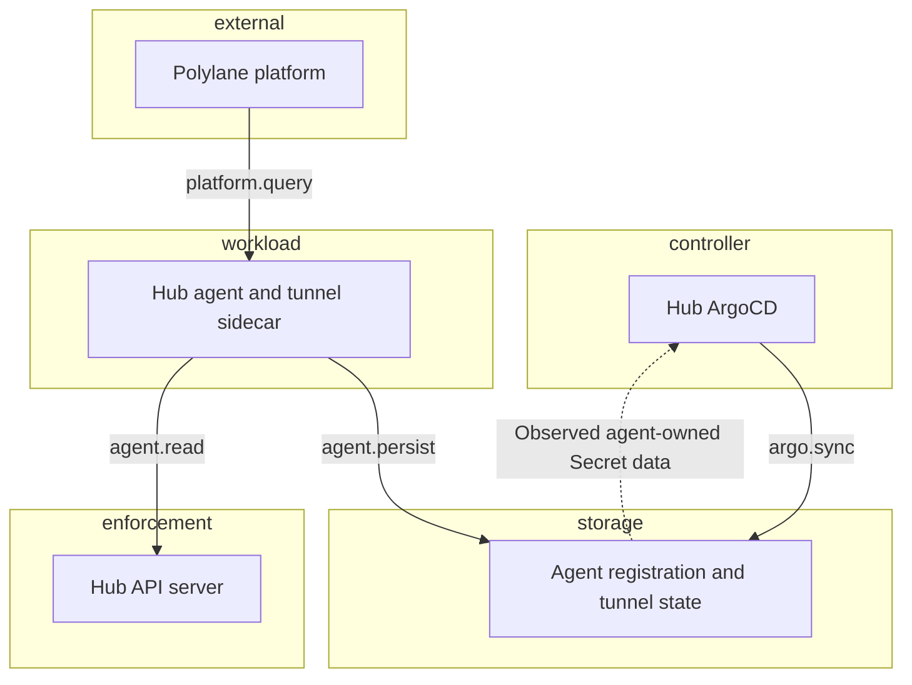

# STPA Control Analysis: Polylane hub agent

_security @ d27644169_

_Auto-generated STPA safety model: unsafe states this system can reach and control actions that get it there. Single or multiple lenses: logic (mission failure), security (deliberate attack), governance (data safety)._

<b>How to read this</b>: STPA primer and diagram legend

**STPA** (System-Theoretic Process Analysis, Leveson) treats the system as controllers issuing control actions to controlled processes, with feedback flowing back. Instead of "what component fails," it asks "what control action, given or withheld at the wrong time, drives the system into an unsafe state?" Unsafe means a violation of this system's reason to exist. Multiple lenses (logic, security, governance) analyze the same control structure for different safety questions: mission failure, deliberate attack, data-processing violations. A finding appearing in multiple lenses is expected and correct.

Read top-down: Losses are outcomes we must prevent; Hazards are states leading to loss; diagrams show control structure (solid = control action, dashed = feedback); Unsafe Control Actions table is the core; Unsafe Feedback covers data channels (absent, stale, corrupted, spoofed). Every claim cites path:line; unbuilt elements are marked. Semantic stable IDs mean regenerating changes only findings that changed.

## Control structure

### Logical view

### Physical view

_No physical control structure modeled._

## Control actions

| ID | View | Control action | Controller → Process | Maturity | Evidence |
|----|----|----|----|----|----|
| `agent.persist` | logical | Update registration and tunnel state | `agent` → `state` | built | projects/platform/polylane/charts/polylane-k8s-0.2.3.tgz (templates/role.yaml: resourceNames) |
| `agent.read` | logical | Read topology and pods/log | `agent` → `api` | built | projects/platform/polylane/charts/polylane-k8s-0.2.3.tgz (templates/clusterrole.yaml: verbs: [get, list]) |
| `argo.sync` | logical | Reconcile the chart-owned Secret manifest | `argo` → `state` | built | projects/platform-gke/polylane/application.yaml:46 |
| `platform.query` | logical | Query the shim through the outbound tunnel | `platform` → `agent` | built | projects/platform/polylane/values.yaml:48 |

## Lens: security

**Scope.** The third-party platform queries the hub through an outbound cloudflared tunnel. Cluster topology and pod logs cross the cluster boundary in responses. The permitted reads include ConfigMaps and pod logs across namespaces, so their contents enter the third-party trust boundary.

Maturity detail

- **Built:** The hub Application installs the wrapper in polylane. The chart binds the agent identity to enumerated cluster reads and a separate namespaced state Secret grant.

### Losses

| ID | Loss |
|----|------|
| `L.cluster-authority` | An external observation session gains unauthorized access to hub data or identity. |

### Hazards

| ID | View | Hazard (unsafe state) | → Losses | Maturity | Status | Issue |
|----|----|----|----|----|----|----|
| `excess-authority` | logical | The observation path reaches resources or credentials outside the agent grant. | L.cluster-authority | built | enforced-prod | HOME-89 |

### Unsafe control actions

| ID | View | Control action | Guideword | Unsafe condition | Severity | → Hazards | Status | Issue | Evidence |
|----|----|----|----|----|----|----|----|----|----|
| `agent.persist.provided` | logical | `agent.persist` | provided | A write to another Secret would change another identity. The Role grants get, update and patch on the named state Secret. | high | excess-authority | enforced-prod | HOME-89 | projects/platform/polylane/charts/polylane-k8s-0.2.3.tgz (templates/role.yaml: resourceNames) |
| `agent.read.provided` | logical | `agent.read` | provided | Serving a request beyond the observation grant would disclose unrelated data. The ClusterRole enumerates resources and limits verbs to get and list. | high | excess-authority | enforced-prod | HOME-89 | projects/platform/polylane/charts/polylane-k8s-0.2.3.tgz (templates/clusterrole.yaml: verbs: [get, list]) |
| `argo.sync.provided` | logical | `argo.sync` | provided | Replacing agent-owned state during sync would invalidate tunnel registration. Server-side apply leaves the data field with its writer. | high | excess-authority | enforced-prod | HOME-89 | projects/platform-gke/polylane/application.yaml:46 |
| `platform.query.provided` | logical | `platform.query` | provided | Direct pod ingress to the shim would add another caller path. The shim uses loopback and the enabled NetworkPolicy admits only operations ports. | high | excess-authority | enforced-prod | HOME-89 | projects/platform/polylane/values.yaml:48 |

### Unsafe feedback

*Data channels (absent, stale, corrupted, spoofed) whose failure drives a controller into a hazard.*

| ID | View | Channel | Guideword | Unsafe condition | Severity | → Hazards | Status | Issue | Evidence |
|----|----|----|----|----|----|----|----|----|----|
| `state-feedback.stale` | logical | `state` → `argo`: Observed agent-owned Secret data | stale | Treating runtime registration as drift could trigger reconciliation of stale state. The Application excludes /data for the named Secret from comparison. | high | excess-authority | enforced-prod | HOME-89 | projects/platform-gke/polylane/application.yaml:46 |
