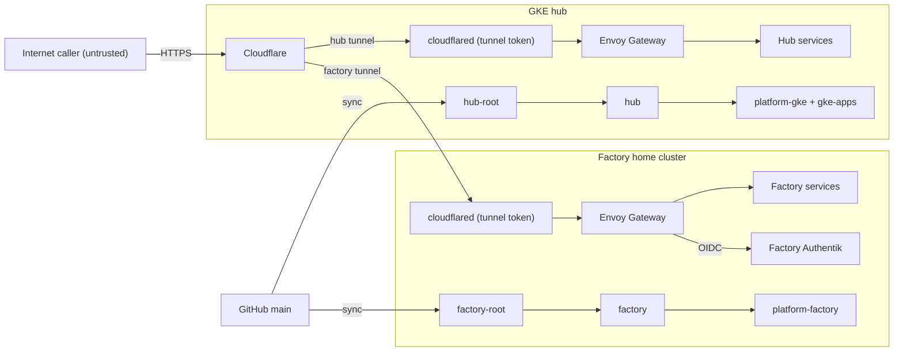

# Platform architecture

The factory home cluster runs the software factory, including kagent and the itsaplan issue tracker, on three k3s servers. The GKE hub serves the monolith and its public and agent tiers, the Scotland connector, inference and Context Forge. Each cluster has its own ingress and its own ArgoCD installation that reconciles the platform and workloads from Git.

| Component | Role | Code | Pin | Untrusted input | Credentials held |
| --- | --- | --- | --- | --- | --- |
| Hub ArgoCD | Reconciles hub Applications | [Parent](../gke-cluster/hub-root-application.yaml) | [Chart dependency](argocd/Chart.yaml) | Manifests and charts | Hub reconciliation service account |
| Factory ArgoCD | Reconciles factory Applications | [Parent](../factory-cluster/factory-root-application.yaml) | [Application source](../platform-factory/argocd/application.yaml) | Manifests and charts | Factory reconciliation service account |
| Hub ingress | Routes public and trusted requests | [Cloudflare gateway](cloudflare-gateway/) | [Chart dependencies](cloudflare-gateway/Chart.yaml) | HTTP requests | Hub tunnel credential |
| Factory ingress | Publishes factory hostnames and routes requests | [Factory edge](../platform-factory/factory-edge/) | [Factory inventory](../factory-cluster/ARCHITECTURE.md#ingress-and-identity) | HTTP requests and identity tokens | Factory tunnel credential and Envoy OIDC client secret |

## 1. Clusters

On each cluster, the bootstrap parent watches a directory containing the root Application. A change to the root can therefore sync even if its previous configuration pointed at the wrong tree. The hub root selects two inventories, one for shared controllers and one for workloads. EmberVM is retired, but its Applications are still listed during removal. [Hub root](../gke-cluster/kustomization.yaml) · [Platform inventory](../platform-gke/kustomization.yaml) · [Workload inventory](../gke-apps/kustomization.yaml) · [Retirement decision](https://github.com/jomcgi-org/homelab/issues/7817#issuecomment-6893155810)

On the factory home cluster, the root reconciles the [platform-factory inventory](../platform-factory/kustomization.yaml), including the [software-factory Application](../factory/deploy/application.yaml) that deploys kagent and itsaplan. Hindsight and the operator landing page run alongside them. Node bootstrap, ingress routes, pins and recovery procedures live with that cluster. [Factory root](../factory-cluster/kustomization.yaml) · [Factory cluster guide](../factory-cluster/README.md)

See the [factory cluster architecture](../factory-cluster/ARCHITECTURE.md) for the Cloudflare-to-pod request path and the layout of etcd, Garage and database backups.

## 2. Ingress and traffic on the hub and factory home cluster

On the hub, two cloudflared connectors forward traffic to Envoy Gateway. HTTPRoutes select the service by hostname and path. Public routes admit anonymous requests. Trusted routes use Cloudflare Access or a route-specific Authentik policy. [Hub gateway values](cloudflare-gateway/values-gke.yaml)

At home, cfgate reconciles the factory tunnel and DNS records. Envoy in the edge namespace routes browser traffic through the factory's own Authentik. The Kubernetes API route checks a bearer token, and the API server applies RBAC. [Factory ingress and route inventory](../factory-cluster/ARCHITECTURE.md#ingress-and-identity)

## 3. Network and CNI on the hub and factory home cluster

The hub uses GKE Dataplane V2 and Kubernetes NetworkPolicy. The factory home cluster bootstraps its own Cilium installation and reconciles a default-deny baseline and namespace allowlists from Git. [Factory network policies](../platform-factory/network-policy/)

## 4. GitOps and delivery

Hub platform Applications track their Git sources. For hub workloads enrolled in Kargo, CI publishes the versioned chart to OCI, Kargo promotes its revision and ArgoCD syncs the Application. Each pipeline controls when its workload receives a published chart. [Hub Kargo](../platform-gke/kargo/) · [Hub workload Applications](../gke-apps/)

For the software factory itself, CI writes the published OCI chart version to the [software-factory Application](../factory/deploy/application.yaml), and the home cluster’s ArgoCD syncs that revision. The factory home cluster also runs Kargo. Its bootstrap sequence brings up the controllers ArgoCD needs to reconcile the rest of the tree. [Factory bootstrap](../factory-cluster/README.md) · [Factory Kargo](../platform-factory/kargo/)

## 5. Storage on the hub and factory home cluster

Hub PVCs use GCE persistent disks. CloudNativePG manages PostgreSQL for the monolith, Authentik and Context Forge. The monolith stores blobs in Cloudflare R2 and archives PostgreSQL backups to GCS. [Hub CloudNativePG](../platform-gke/cloudnative-pg/) · [Monolith hub values](../monolith/deploy/values-gke.yaml)

At home, CloudNativePG manages the factory, kagent and Authentik databases. Garage stores workload objects and PostgreSQL archives on the home nodes, so those archives share the cluster's failure domain. [Factory storage and recovery](../factory-cluster/ARCHITECTURE.md#state-and-recovery)

## 6. Scheduling and capacity on the hub and factory home cluster

The hub separates ordinary workloads on the on-demand core pool from workloads tolerating the Spot brick pool's taint. Priority classes give critical pods precedence under resource pressure. The factory schedules across its three home servers and provides a gVisor RuntimeClass for agent workspaces. [Hub priority classes](../platform-gke/priority-classes/) · [Factory node inventory](../factory-cluster/ARCHITECTURE.md#nodes-and-sandboxing)

## 7. Observability on the hub and factory home cluster

The hub OpenTelemetry Collector exports to Honeycomb. Polylane provides read-only access to hub Kubernetes state. At home the collector tags telemetry with the factory cluster name, and operators use Grafana to query Prometheus. [Hub collector](../platform-gke/otel-collector/) · [Hub Polylane](../platform-gke/polylane/) · [Factory monitoring](../platform-factory/)

## 8. Security and policy on the hub and factory home cluster

On the hub, 1Password Connect supplies external secrets. Kyverno audits resource requests and copies selected secrets to workflow jobs. SPIRE issues workload identities for the EmberVM and monolith namespaces. [Hub security controllers](../platform-gke/kustomization.yaml)

The factory has separate Authentik and 1Password installations. Its admission policies restrict who can expose routes and where edge resources can be created. [Factory edge policies](../platform-factory/edge-admission/) · [Factory identity and bootstrap secrets](../factory-cluster/README.md)

## 9. Maintenance automation on the hub and factory home cluster

Argo Workflows executes the hub monolith's scheduled jobs. The hub Renovate and apko lock maintenance CronWorkflows are configured with their schedules suspended. The factory home cluster declares a separate suspended Renovate CronJob. [Hub maintenance](../platform-gke/renovate/) · [Factory maintenance](../platform-factory/renovate/)

## Direction

The [repository direction table](../../README.md#today-and-direction) records the deployment and identity decisions for these HOME issues.

| Direction | Tracks | State |
| --- | --- | --- |
| Extend Kargo promotion to factory applications and close the corresponding HOME issue on verified Freight. Bootstrap controllers stay on ArgoCD | [HOME-116](https://factory-plan.jomcgi.dev/factory/issue/HOME-116) | Designed |
| Give factory workloads SPIFFE identities for pod-to-pod authentication | [HOME-254](https://factory-plan.jomcgi.dev/factory/issue/HOME-254) | Designed |

## Decision history

Earlier platform decisions, including the choice of hub node pools and promotion model, are indexed in the [previous ADR table](https://github.com/jomcgi-org/homelab/blob/3e0f7bd85f4f6f7ce4af1a483c8d75d26ea6b1ff/projects/platform/ARCHITECTURE.md#decision-history).

| Decision | Date | Record |
| --- | --- | --- |
| Retire the former home Longhorn installation that provided replicated block storage | 2026-10-10 | [Former longhorn configuration](https://github.com/jomcgi-org/homelab/tree/b8582e5d2b9858c8b4e86d4fabdf8e4ddff894ae/projects/platform/longhorn) · [Retirement](https://github.com/jomcgi-org/homelab/issues/6914) |
| Retire KEDA on the former home cluster. It had no ScaledObjects or ScaledJobs | 2026-10-10 | [Former keda configuration](https://github.com/jomcgi-org/homelab/tree/b8582e5d2b9858c8b4e86d4fabdf8e4ddff894ae/projects/platform/keda) · [Retirement](https://github.com/jomcgi-org/homelab/issues/6914) |
| Retire the GPU operator that managed the driver on the former home's RTX 4090 node | 2026-10-10 | [Former nvidia-gpu-operator configuration](https://github.com/jomcgi-org/homelab/tree/b8582e5d2b9858c8b4e86d4fabdf8e4ddff894ae/projects/platform/nvidia-gpu-operator) · [Retirement](https://github.com/jomcgi-org/homelab/issues/6914) |
| Retire the former home's node-traffic-shaper. Cilium’s tcx attachment processed ingress before the CAKE filter could shape it | 2026-10-10 | [Former node-traffic-shaper configuration](https://github.com/jomcgi-org/homelab/tree/b8582e5d2b9858c8b4e86d4fabdf8e4ddff894ae/projects/platform/node-traffic-shaper) · [Retirement](https://github.com/jomcgi-org/homelab/issues/6914) |
| Retire the former home Cilium chart that replaced Linkerd and provided policy enforcement, WireGuard encryption and Hubble flow logs | 2026-10-10 | [Former cilium configuration](https://github.com/jomcgi-org/homelab/tree/b8582e5d2b9858c8b4e86d4fabdf8e4ddff894ae/projects/platform/cilium) · [Retirement](https://github.com/jomcgi-org/homelab/issues/6914) |
| Retire the generated home GitOps root (`projects/home-cluster/`). No live cluster ran the home configuration after #4964 and #5485 closed | 2026-10-10 | [Former home root](https://github.com/jomcgi-org/homelab/tree/b8582e5d2b9858c8b4e86d4fabdf8e4ddff894ae/projects/home-cluster) · [Retirement](https://github.com/jomcgi-org/homelab/issues/6914) |
| Retire the former home OpenTelemetry Operator chart. It is deployed nowhere, and Kyverno's OTel environment-variable injection is off | 2026-10-10 | [Former opentelemetry-operator configuration](https://github.com/jomcgi-org/homelab/tree/b8582e5d2b9858c8b4e86d4fabdf8e4ddff894ae/projects/platform/opentelemetry-operator) · [Retirement](https://github.com/jomcgi-org/homelab/issues/6914) |
| Retire the former home's nightly dev-database refresh. The hub has no dev lane | 2026-10-10 | [Former dev refresh workflow](https://github.com/jomcgi-org/homelab/blob/b8582e5d2b9858c8b4e86d4fabdf8e4ddff894ae/projects/monolith/chart/templates/cnpg-dev-refresh-cronworkflow.yaml) · [Retirement](https://github.com/jomcgi-org/homelab/issues/6914) |
| Bootstrap the factory on the rebuilt home nodes with its own GitOps root | 2026-11-13 | [Factory cluster decision](https://github.com/jomcgi-org/homelab/issues/7817) |
| Describe both clusters as they run today. The template fit and the hub-claim check are accepted as reviewed, with no further audit | 2026-11-18 | [Joe's decision](https://factory-plan.jomcgi.dev/factory/issue/HOME-268#comment-3938) |
