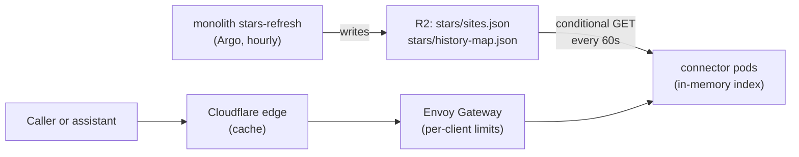

# Scotland connector architecture

A public, read-only, free API and MCP endpoint answering Scottish outdoor
questions, starting with where and when the sky will be dark and clear.
Tracking issue: #7240. Current as of the first chart (0.1.0): built, not yet
registered on the hub (#7242), public route off until the hostname is chosen
(#7243).

## Shape

One Go binary, `cmd/connector`, in its own `scotland-connector` namespace.
It serves two surfaces on port 8080 and nothing else:

- `GET /v1/dark-sky-windows`, `GET /v1/places/resolve`, `/v1/openapi.json`
  (the published contract) and `/v1/method`.
- `POST /mcp`: tools `dark_sky_windows` and `resolve_place`.

Health (`/healthz`), readiness (`/readyz`) and Prometheus metrics
(`/metrics`) are on an admin listener, port 9090, that no Service or route
exposes.

Both surfaces call the same `internal/connector` functions, which validate
parameters, apply the caps, query the dataset and wrap the answer in the
provenance envelope. `internal/httpapi` and `internal/mcp` only translate
transport.

**Why.** A separate service rather than more routes on `monolith-public`: the
connector takes unauthenticated traffic whose volume is set by assistants,
not by people browsing, so it needs to scale on its own and fail on its
own. Its own namespace holds nothing else, so a compromise reaches one
read-only R2 key. Go because every request is an in-memory lookup and the
binary is the whole runtime: no interpreter, small image, fast start for the
HPA.

## Data: R2 snapshots held in memory

Each pod loads the two objects the monolith's stars-refresh job already
materializes (`projects/monolith/stars/materialize.py`), parses them into an
immutable `stars.Dataset` with a 0.25 degree spatial grid, and swaps it in
with one atomic pointer store. A poller re-checks both ETags every 60
seconds; an unchanged pair is two `304`s. A new pair is parsed in full
before the swap, so a broken or half-written upload never replaces a good
one, and an R2 outage leaves every pod serving its last good copy.

Readiness means a dataset has loaded. Failing readiness on staleness would
take every pod out at once during an R2 outage and turn stale answers into
no answers. Freshness is reported instead, in
`meta.forecast_fetched_at` and the `scotland_connector_forecast_age_seconds`
gauge.

Night bucketing (Europe/London, noon to noon) is computed per hour at parse
time, and queries keep a bounded top-k rather than sorting every candidate.
Distances use a mid-latitude equirectangular approximation with
precomputed cosines, which within the 150 km cap is well under 0.1 km from
haversine. A worst-case query (150 km, 7 nights, 10 results) over a grid
three times the real site density runs in about 0.6 ms on one core
(`BenchmarkWindows`).

**Why.** Reading Postgres would put a database credential and an egress path
to CNPG in the namespace that takes public traffic, and make the database's
load a function of the replica count. The snapshots already exist, are a few
MB, and change hourly, so loading them into memory costs nothing to keep in
sync. The cost is that the snapshot caps each site's hour list at 25, so
later nights can be undercounted. Answers flag this as
`forecast_hours_truncated`, and #7246 adds an uncapped snapshot.

## Contract

Every response is `{data, meta}`. `meta` carries `api_version`,
`generated_at`, `as_of` (the top of the hour the answer is computed for),
`forecast_fetched_at`, `data_version` (both R2 ETags), `method_url`, and
`sources` with attribution and licence for MET Norway, Copernicus CERRA,
OpenStreetMap and Natural Earth. The light-pollution render is not
attributed until its licence is confirmed (#7253).

Caps live in `internal/connector` and are mirrored in `openapi.json` and the
MCP input schemas; tests fail if any copy drifts. Results at most 10, radius
at most 150 km, nights at most 7, queries at most 100 characters,
coordinates inside Scotland only. There is no listing endpoint.
Coordinates are rounded to 0.01 degrees so equal questions share an ETag.

Answers carry `Cache-Control: public, max-age=60, s-maxage=600,
stale-while-revalidate=3600, stale-if-error=86400` and a strong ETag over
the dataset version, the as-of hour and the canonical parameters.

## MCP: dual-era and stateless

`internal/mcp` implements Streamable HTTP by hand, with every response a
single JSON object:

- **2026-07-28** requests carry `io.modelcontextprotocol/protocolVersion`
  and `clientCapabilities` in `params._meta`. The `MCP-Protocol-Version`,
  `Mcp-Method` and `Mcp-Name` headers must match the body (`-32020`
  otherwise), an unknown version gets `-32022` with the supported list, and
  `server/discover` is served.
- **2025-03-26 to 2025-11-25** clients open with `initialize` and are then
  served statelessly. No `Mcp-Session-Id` is ever minted, which those
  revisions allow.
- GET and DELETE return 405; batches are refused; a present `Origin` must be
  on `MCP_ALLOWED_ORIGINS`.

Tool argument errors come back as `isError` results so the model can
correct itself; unknown argument names are rejected rather than ignored.
Every tool has a title and `readOnlyHint: true`.

**Why.** The tool surface is two read-only functions. An SDK would add a
dependency, version churn and session machinery to a server whose whole
point is to need none, and the stateless revision is what lets any replica
answer any request.

## Isolation and scaling

- Namespace with Pod Security `restricted` enforced; pod runs as 65532 with
  a read-only root, no capabilities and no service account token.
- Ingress NetworkPolicy admits only the Envoy Gateway data plane
  (`envoy-gateway-system`, the `cloudflare-ingress` owning-gateway labels)
  on 8080. Egress allow-list (DNS, then 443 to public addresses only) is
  rendered but staged off until the hub's resolver address is validated
  (#7248), as the monolith's is.
- HPA 2 to 10 on container CPU at 60%, scaling up by up to 100% every 30
  seconds and down by one pod a minute; PDB `maxUnavailable: 1`; replicas
  spread across nodes. A new pod is ready after two R2 GETs.
- The route (`route.enabled`, off) matches only `/v1/` and `/mcp`, with
  per-client limits keyed on `CF-Connecting-IP` in the shape
  `projects/monolith-public` proves (a fail-safe bucket for missing or
  malformed identities, a Distinct bucket per valid address), and Cloudflare
  Worker subrequests denied. The shared assistant bucket is #7244.

**Why.** The pods hold no state and start in seconds, so the cheapest
protection against a burst is more pods, and the cheapest protection
against a node loss is two of them. Scale-down is slow because a pod costs
little and flapping costs cache warmth at the edge.

## Meter

`internal/meter` counts every call by tool, surface (`api`, `mcp`), client
class and outcome. Client class comes from `CF-Connecting-IP` against
Anthropic's published MCP egress ranges, then User-Agent for OpenAI, else
`direct`; a malformed identity is `unknown`. The class is a label, never an
authorization input. Edge cache hits never reach the origin, so the hit
ratio is Cloudflare's to report. Export to Honeycomb and the zero-priced
unit table are #7245.

## Not here yet

`walk_windows` is withheld until the walk corpus licensing is resolved
(#7252). `resolve_place` runs on a curated seed of about 50 places
(`internal/places/seed.json`, approximate centroids); the full gazetteer is
#7247.

## Direction

Decided and not yet built, each with the issue that tracks it. A row leaves
this table when the work ships or the issue closes without it.

| Direction | Tracks | State |
| --- | --- | --- |
| Hub Application with Kargo promotion | #7242 | after the first chart publish |
| Product name, hostname, public route, Cloudflare cache rule | #7243 | decision for Joe |
| Shared assistant rate-limit bucket and Envoy acceptance test | #7244 | not started |
| Meter export to Honeycomb, unit price table | #7245 | not started |
| Uncapped connector snapshot from the materializer | #7246 | not started |
| Full gazetteer from an open dataset | #7247 | not started |
| Egress NetworkPolicy enabled | #7248 | staged off |
