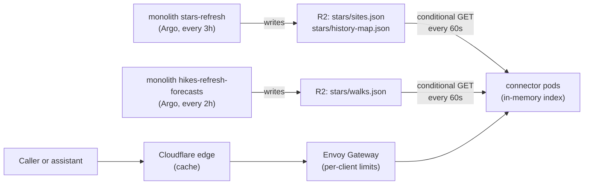

# Scotland connector architecture

A public, read-only, free API and MCP endpoint for planning and checking
Scottish trips: which walks fit the weather and where the night sky will be
dark and clear, each with a go, marginal, no or unknown verdict.
Tracking issue: #7240. Deployed on the hub through Kargo
(`projects/gke-apps/scotland-connector/`, pipeline `scotland-connector` in
`projects/platform/kargo/values.yaml`), served publicly at
`https://jomcgi.dev/scotland/mcp` and `https://jomcgi.dev/scotland/v1/...`.

## Shape



One Go binary, `cmd/connector`, in its own `scotland-connector` namespace.
It serves two surfaces on port 8080 and nothing else:

- `GET /v1/plan`, `POST /v1/check`, `/v1/openapi.json` (the published
  contract) and `/v1/method`.
- `POST /mcp`: tools `plan` and `check`.

Health (`/healthz`), readiness (`/readyz`) and Prometheus metrics
(`/metrics`) are on an admin listener, port 9090, that no Service or route
exposes.

Both surfaces call the same `internal/connector` functions, which validate
parameters, apply the caps, query the dataset and wrap the answer in the
provenance envelope. `internal/httpapi` and `internal/mcp` only translate
transport.

## Tools: plan and check

The two tools are the two questions a person brings to a trip. `plan` is
"what should I do near here": for each day from `from` to `to` (at most a
week, starting no later than 13 days out), sunrise, sunset and the moon at
the point, the walks within the radius that fit the weather and the night's
best dark-sky sites, at most `limit` of each. `check` is "is my plan on": for
up to ten items, each a walk (by `walk_name` or `walk_id`) on a date or
stargazing at a point on a night, the verdict with its timing, the other
forecast days that suit it, and up to two better options nearby the same
day. An item that cannot be resolved carries an item `error` and the rest
still answer.

Every walk and night leads with a verdict from `internal/verdict`: `go`,
`marginal`, `no`, or `unknown` when the hourly forecast does not reach far
enough to say, and a one-line `why`. The rules are in `internal/walks`
(`Assess`) and `internal/stars` (`AssessNight`), and `/v1/method` states
them. A plan keeps only go and marginal options and says why when a day has
none.

**Why.** The first two tools (`dark_sky_windows`, `walk_windows`) mirrored
the engines: ranked sites and walks with counts of good hours, which left
the assistant to work out whether a day was any good and to stitch walks and
nights together. Real questions are a plan ("what can we do around Skye this
weekend") or a check ("is Ben Nevis on Saturday, and if not, when"), and the
answer a person wants is a verdict with a reason and a time. Deciding the
verdict here, with one rule set, keeps every assistant's answer the same and
the answers short. The connector had no users when this changed, so the old
tools were removed rather than kept beside the new ones.

**Why.** Agents get the context to judge the weather themselves. Each slot
carries its wettest hour and its wet hours, and a check returns it hour by
hour. `max_rain_mm_h`, `max_wind_kmh` and `min_temp_c` let an agent apply
what the person will put up with ("no rain at all", "nothing too breezy", "a
bit of rain is fine") before the verdict is reached, rather than
second-guessing a `go`. There is no gust or rain-chance limit: MET Norway's
`complete` forecast gives those only within its Nordic model, which in
Scotland covers Shetland alone, and a limit that silently passed every
mainland walk would mislead.
The default good-hour test stays the hikes app's, so the two never disagree
without being asked to. Plans leave the hours out to stay compact: a plan is
the wide question, and a check is the close look.

**Why.** `check` is a POST with a JSON body over REST because its input is a
list of items. Its answers are not cached (`no-store`); `plan`, the open
question an assistant asks first, is a GET and caches at the edge. A CORS
preflight answer lets browser callers POST.

**Why.** No live weather call: every answer comes from the in-memory
snapshots. Point weather from MET Norway per request would put the
connector's traffic, set by assistants, onto MET's API under this service's
identity, and add a failure mode the snapshots avoid. Weather between walk
starts and dark-sky sites is not answered.

**Why.** A path on the apex rather than its own hostname: the apex already
resolves through the tunnel and carries the Cloudflare cache rule, so going
public needed no DNS or dashboard change, at the cost of one prefix
(`/scotland`) that is part of every connector URL and so cannot move once
published. The public-tier rule that the apex has no `/api` concerns
`monolith-public`'s own backend; this is a separate service on its own route.

**Why.** A separate service rather than more routes on `monolith-public`: the
connector takes unauthenticated traffic whose volume is set by assistants,
not by people browsing, so it needs to scale on its own and fail on its
own. Its own namespace holds nothing else, so a compromise reaches one
read-only R2 key. Go because every request is an in-memory lookup and the
binary is the whole runtime: no interpreter, small image, fast start for the
HPA.

## Data: R2 snapshots held in memory

Each pod loads the two objects the monolith's stars-refresh job already
materializes (`projects/monolith/stars/materialize.py`), parses them into an
immutable `stars.Dataset` with a 0.25 degree spatial grid, and swaps it in
with one atomic pointer store. A poller re-checks both ETags every 60
seconds; an unchanged pair is two `304`s. A new pair is parsed in full
before the swap, so a broken or half-written upload never replaces a good
one, and an R2 outage leaves every pod serving its last good copy.

Readiness means a dataset has loaded. Failing readiness on staleness would
take every pod out at once during an R2 outage and turn stale answers into
no answers. Freshness is reported instead, in
`meta.forecast_fetched_at` and the `scotland_connector_forecast_age_seconds`
gauge. Nothing collects that gauge yet (the hub runs no scraper for pod
metrics); the Honeycomb export in #7245 is what turns it into an alert.

Night bucketing (Europe/London, noon to noon) is computed per hour at parse
time. "Tonight" is the night in progress until 09:00 local, after the last
possible Scottish twilight-dark hour, and the coming evening's after that,
so a morning query never leads with a night that has already ended. Until
09:00 that night carries yesterday's date, so plan and check accept it, and
a plan that covers stargazing starts on it. Queries keep a bounded top-k
rather than sorting every candidate.

The stars job keeps MET Norway's 6-hourly tail as well as the hourly steps,
so a listed hour says nothing about how far the hourly forecast reaches: the
stars dataset horizon is the newest fetch plus 48 hours, never extended by
listed hours. Each site's coverage stops at the earlier of that horizon and
its own `forecast_fetched_at` plus 48 hours.
Distances use a mid-latitude equirectangular approximation with
precomputed cosines, which within the 100 km cap is well under 0.1 km from
haversine. Over a grid three times the real site density and 3000 walks
(`internal/connector/bench_test.go`), on one core, a default plan (30 km,
three days) takes about 0.9 ms, the widest (100 km, seven days, five options
each) about 5 ms and a ten-item check about 2 ms. A plan ranks walks on their
verdict alone and builds the full answer only for the ones it returns.

**Why.** Reading Postgres would put a database credential and an egress path
to CNPG in the namespace that takes public traffic, and make the database's
load a function of the replica count. The existing snapshots change every three
hours and can be refreshed independently of the database. Their full-grid size
and refresh-memory cost need the capacity checks below. The public snapshot
caps each site's hour list at 25, so
later nights can be undercounted. A night past a capped site's last listed
hour is `unknown` unless it is already a go. The separate connector snapshot
below removes that display cap when explicitly enabled.

### Uncapped snapshot is staged off

The materializer accepts `STARS_CONNECTOR_SITES_S3_KEY`, empty or unset by
default. When enabled, the shared builder loads scalar site metadata and
upcoming forecast rows once, emits all clear-twilight hours to the separate
object, then trims the same hour lists to 25 before public serialization.
Counts, ordering, entity fetch timestamps and zero-hour sites are shared.
The public `sites.json`, `map.json` and `history-map.json` bytes and cache
contracts are unchanged. The materializer still returns the public body length.
Disabled runs build capped lists and write only the original three objects.
If the connector upload fails, the materializer logs the error, releases the
connector body and trims the tree, then writes all three public objects before
raising the upload error. Public freshness survives that failure while the run
still reports failure; the connector continues serving its last-good snapshot.
An enabled key matching a public, map, history, grid, climatology or walks key
is rejected before database or storage I/O.

**Why.** One upcoming scalar load avoids a second database scan and historical
ORM hydration. Serializing the connector body first and releasing it before
public serialization avoids retaining two site trees or two large bodies.
The connector retains its 64 MiB object bound, last-good snapshot pair and
legacy truncation guard. Uncapped hours do not extend the conservative 48-hour
hourly horizon or a site's own successful-fetch coverage. Sparse later rows
remain unknown in a seven-day plan/check request. This is the repository-only
2026-10-24 scope of #7246; production acceptance is outstanding.

Before activation, resolve the object-size and consumer-memory shortfall below
under #7246. Keep both settings at their defaults until that precondition has
evidence. After separate authorization, activation needs these two GitOps changes:

- Set `stars.connectorSitesKey: connector-sites.json` in
  `projects/monolith/deploy/values.yaml`. The shared S3 block in
  `chart/templates/cronworkflows.yaml` carries it as
  `STARS_CONNECTOR_SITES_S3_KEY` into the real `stars-refresh` container.
  `app/jobs_main.py::stars_refresh` refreshes forecasts and invokes
  `stars.materialize.materialize_handler` there. A web-pod-only environment
  change does not enable this job.
- Once normal scheduled publication is observed, set
  `config.sitesKey: connector-sites.json` in
  `projects/scotland-connector/deploy/values.yaml`. Existing deployment
  plumbing sets `STARS_SITES_KEY`; runtime and store select that object.
  The connector's chart/runtime default remains `sites.json`.

Operational checks remain on #7246: chart publication/write-back and deployed
revisions; normal scheduled publication with compatible public objects; real
plan/check truncation and per-entity coverage; actual object size, materializer
peak memory and connector pod memory after switching `config.sitesKey`, with
site/hour counts and the observation method. No manual job trigger is needed.

### Grid-scale capacity is a pre-activation condition

The offline fixture defaults to 14,000 sites, matching the documented grid in
`projects/monolith/stars/jobs.py` (`REFRESH_BATCH_SIZE` and `refresh_handler`).
Each site has 89 input rows (1,246,000 total), 88 upcoming rows (1,232,000 total),
and 55 qualifying clear-twilight hours. Public output retains 25 hours/site
(350,000 total); connector output retains 55 (770,000 total). The profile uses
72 hourly steps from 2026-10-19 08:00 UTC and a sparse six-hourly tail at offsets
78 through 168. Three 16-hour winter nights include twilight boundaries and one
cloudy hour; the tail adds eight qualifying rows. Uniform clear weather across
the grid stresses the output volume. This is a synthetic winter-clear-spell
scenario with daylight/cloudy exclusions. Longer nights, additional qualifying
rows and larger site metadata can increase it; it is not an upper bound.

Measurements on Linux amd64, CPython 3.12.15, from the correction to #7323:

| Run | sites.json B | map.json B | history-map.json B | connector-sites.json B | Python allocation peak B | Process max RSS MiB |
| --- | ---: | ---: | ---: | ---: | ---: | ---: |
| Baseline materialize.py at 925d9cd18, current router.py | 29,162,112 | 1,428,092 | 12 | absent | 362,842,546 | 416.69 |
| Staged path disabled | 29,162,112 | 1,428,092 | 12 | absent | 362,844,236 | 416.29 |
| Staged path enabled | 29,162,112 | 1,428,092 | 12 | 60,704,112 | 471,428,706 | 529.55 |

The original three objects have identical SHA-256 digests in all runs. Each
allocation peak comes from a fresh traced process; RSS comes from a separate
untraced process via Linux `getrusage().ru_maxrss`. Tracing raises RSS and must
be disabled for the deployment comparison. The producer's 529.55 MiB max RSS
is below the 1 GiB `stars-refresh` job limit, but excludes real database/storage
drivers, populated climatology and the preceding forecast-refresh work.

The consumer benchmark uses the actual `Store.Refresh`, an initial resident
snapshot, a fresh replacement body and a reader retaining the old dataset.
Its local-file getter uses the same bounded `io.ReadAll` as `r2.Client.Get`.
It samples `HeapInuse` and `Sys - HeapReleased` every millisecond; process RSS
comes from `/usr/bin/time -v` around the compiled test binary. Fresh processes,
Go 1.26.9, `GOMEMLIMIT=220MiB`, one replacement each:

| Selected object | Peak HeapInuse MiB | Peak Go-managed memory MiB | Process max RSS MiB |
| --- | ---: | ---: | ---: |
| Capped sites.json | 166.88 | 173.95 | 175.11 |
| Uncapped connector-sites.json | 224.20 | 231.22 | 232.45 |

**Activation is blocked on capacity evidence.** The 57.89 MiB connector object
uses 90.46% of the 64 MiB bound, leaving 6.11 MiB (roughly six more hours/site at
this encoding). A larger valid snapshot can be rejected, leaving last-good data
to become stale. The consumer exceeds the 220 MiB Go memory target and has only
23.55 MiB RSS margin below the 256 MiB container limit even without HTTP/TLS,
walks, populated history or query-serving load. These synthetic results do not
establish safe production headroom. Before enabling either setting, demonstrate
representative worst-case size and replacement-memory headroom, or deliver and
validate a separately scoped capacity/representation change. Keep the 64 MiB,
220 MiB and 256 MiB limits unchanged in this staged change. After authorized
activation, record production object size and both producer and connector pod
memory separately from these measurements.

For reproducible offline measurements, run each command in a fresh Linux
Python process from the repository root, with the monolith dependencies:

```sh
git rev-parse HEAD
PYTHONPATH=projects/monolith python -m stars.snapshot_fixture --baseline-revision 925d9cd18
PYTHONPATH=projects/monolith python -m stars.snapshot_fixture
PYTHONPATH=projects/monolith python -m stars.snapshot_fixture --enabled
# Repeat each with --no-tracemalloc for process RSS. Save local consumer input:
PYTHONPATH=projects/monolith python -m stars.snapshot_fixture --enabled --no-tracemalloc --output-dir /tmp/stars-grid-fixture
go test -c -o /tmp/stars-store.test ./projects/scotland-connector/internal/store
GOMEMLIMIT=220MiB STARS_BENCH_SNAPSHOT=/tmp/stars-grid-fixture/sites.json /usr/bin/time -v /tmp/stars-store.test -test.run='^$' -test.bench='^BenchmarkSnapshotRefresh$' -test.benchtime=1x
GOMEMLIMIT=220MiB STARS_BENCH_SNAPSHOT=/tmp/stars-grid-fixture/connector-sites.json /usr/bin/time -v /tmp/stars-store.test -test.run='^$' -test.bench='^BenchmarkSnapshotRefresh$' -test.benchtime=1x
```

The helper exercises materialization and JSON serialization with mocked scalar
selects and object writes, tracing from before the load until after serialization.
The sink retains only lengths/digests; `--output-dir` also writes local files.
Climatology is empty. The baseline loads only the old `materialize.py`, with
the current `router.py` and its unchanged default hour limit. Record the exact
tested head in the PR. No weather requests or live storage calls are made.
The small checked-in consumer fixture is regenerated by
`python -m stars.snapshot_fixture --fixture` with the same `PYTHONPATH`.
`stars/router_test.py` checks it against actual producer bytes.

## Walks

Walk answers read `walks.json`, which the monolith's
`hikes-refresh-forecasts` job writes to the same bucket every two hours
(`projects/monolith/hikes/materialize.py`) after it stores new forecast
hours. Each walk carries its Walkhighlands URL, start point, length, ascent,
estimated time and its daylight forecast hours. Schema version 1 holds only
the hours that pass the hikes app's test (at most 2 mm of rain, wind at most
80 km/h); version 2 holds every daylight hour with fog and low cloud, as
`[unix, temp_c, precip_mm, wind_kmh, cloud_pct, fog_pct, low_cloud_pct]`,
so limits can loosen as well as tighten and a bad hour's weather is known.
The connector reads both, and a looser limit on version 1 data is refused as
not available yet. A row of any other width rejects the snapshot, and the
store keeps serving the last one that parsed. That is in memory only, so a
connector from before this layout cannot be rolled back to while
the hikes job writes version 2: its new pods would start with no walks.
Rolling back below it needs the hikes job back on `SCHEMA_VERSION = 1` first.
The hikes producer and connector count only complete hours from sunrise through
sunset, excluding the final fractional hour. The connector applies the same gate
when loading older snapshots. **Why.** The integer-hour slot format otherwise
credits time after sunset (#7277). Today's cutoff also cannot push a normal
walk's finish beyond sunset; the existing explicit dark-shoulder allowance
remains separate.
Only a tightening limit makes a day "limited" for the dark-credit rule:
loosening rules no daylight out.
`internal/walks` buckets those hours into UK days at load time and applies
the hikes app's doable-day rule (`projects/monolith/hikes/router.py`); its
tests replay the hikes router's cases. A separate `WalkStore` loads the
object, so a missing or broken `walks.json` takes out walk answers alone:
readiness still depends only on the stars snapshot. A plan then answers its
stargazing with a `walk_note`, and a check gives its walk items an item
error; only a walks-only question is a 503. A row missing a name,
URL or positive duration is skipped, never fatal: the scrape has stored a
0 h walk. `scotland_connector_walks_forecast_age_seconds` reports the
snapshot's age.

**Why.** The walks come from Walkhighlands (decided on #7252). Answers carry
facts and a link to each walk's page, never the route description, maps or
GPX, so the route itself stays on Walkhighlands. The snapshot leaves out the
scraped `summary` prose for the same reason.

**Why.** Forecasts are at each walk's start, because that is what the hikes
job fetches. Every answer says so in `meta.notes`, since summit conditions
are colder and windier than the car park.

**Why.** Days past the hourly forecast are `unknown`, never `no`. The hikes
job keeps MET Norway's hourly steps only, which reach about two and a half
days, so a later day has no hours at all. Reporting it as not doable would
tell an assistant the weather is bad when there is no forecast. The dataset
horizon is the later of the newest fetch plus 48 hours and the last hour in
the snapshot. Each walk's coverage stops at the earlier of that horizon and
its own `forecast_fetched_at` plus 48 hours. Missing entity metadata means
unknown. Late observed hours cannot extend an entity's coverage.

**Why.** Successful forecasts can contain zero retained hours. Walks and sites
store their nullable last-success time independently of hour rows, in the same
transaction that replaces a successful forecast. Failed fetches leave both
untouched. Scraping, grid metadata refresh and hour pruning preserve that time.
Snapshots include zero-hour entities and derive dataset freshness from the
entity times, including an all-empty successful refresh. Legacy rows remain
unknown until a successful fetch; there is no inferred backfill (#7274).

Today counts only hours that have not begun, so a slot under way is shorter
by the hour in progress and the start window never lies in the past. The
slot rule follows the hikes app's `_longest_good_run`, including its
restart at a second gap (#7275).

## Moon

`internal/astro` computes the moon's altitude and lit fraction from
truncated lunar and solar series after Meeus; its tests hold it to PyEphem
within 0.4 degrees and 0.01 (over 300 random Scottish samples the worst
case was 0.28 degrees). The moon's sky position is computed once per hour
per query and shared across sites. Each night reports the lit fraction and
moonless clear-dark hours. A night's dark score weighs each clear-dark hour
by the moon: a moonless hour counts 1 and a moonlit one 1 minus the lit
fraction, so a long night under a thin crescent still beats one moonless
hour. A score of 3 is a go. `internal/astro` also gives sunrise and sunset
(NOAA equations, matching the hikes app to two seconds) for every plan day
and check item.

**Why.** Moonlight decides a stargazing night as much as cloud, and a
computed moon needs no data source or licence.

## Contract

Every response is `{data, meta}`. `meta` carries `api_version`,
`generated_at`, `as_of` (the top of the hour the answer is computed for),
`forecast_fetched_at` (the older fetch when an answer draws on both
snapshots), `data_version` (the R2 ETags behind the answer), `method_url`,
and `sources` with attribution and licence for MET Norway, Walkhighlands,
Copernicus CERRA, OpenStreetMap and Natural Earth, as the answer uses them. The light-pollution render is not
attributed until its licence is confirmed (#7253).

Caps live in `internal/connector` and are mirrored in `openapi.json` and the
MCP input schemas; tests fail if any copy drifts. A plan covers at most 7
days with at most 5 options of each activity a day, within at most 100 km;
a check takes at most 10 items; dates reach at most 13 days ahead; and
coordinates must be inside Scotland. There is no listing endpoint.
Coordinates are rounded to 0.01 degrees and walk names normalized so equal
questions share an ETag.

**Why.** Queries take coordinates, with no place-name lookup. The calling
assistant already knows where Glencoe or Skye is, to well within the search
radius, and can search for anything obscure. A gazetteer here would be a
dataset to license and maintain, and the 50-place seed it replaced answered
"Skye" with nothing, which reads to a model as "not covered".

plan answers carry `Cache-Control: public, max-age=60, s-maxage=600,
stale-while-revalidate=3600, stale-if-error=86400` plus
`Cloudflare-CDN-Cache-Control: public, max-age=600, stale-while-revalidate=3600,
stale-if-error=86400`, and a strong ETag over the dataset version, the as-of
hour and the canonical parameters. The second header follows the public-tier
cache contract (`docs/runbooks/public-tier-checklist.md`): Cloudflare treats
`s-maxage` as `proxy-revalidate`, which would switch off serving stale through
an origin outage, so the edge lifetime reaches it as `max-age`. check
answers are `no-store`.

## MCP: dual-era and stateless

`internal/mcp` implements Streamable HTTP by hand, with every response a
single JSON object:

- **2026-07-28** requests carry `io.modelcontextprotocol/protocolVersion`
  and `clientCapabilities` in `params._meta`. The `MCP-Protocol-Version`,
  `Mcp-Method` and `Mcp-Name` headers must match the body (`-32020`
  otherwise), an unknown version gets `-32022` with the supported list, and
  `server/discover` is served.
- **2025-03-26 to 2025-11-25** clients open with `initialize` and are then
  served statelessly. No `Mcp-Session-Id` is ever minted, which those
  revisions allow.
- GET and DELETE return 405; batches are refused; a present `Origin` must be
  on `MCP_ALLOWED_ORIGINS`.

Tool argument errors come back as `isError` results so the model can
correct itself; unknown argument names are rejected rather than ignored.
Every tool has a title and `readOnlyHint: true`.

**Why.** The tool surface is two read-only functions. An SDK would add a
dependency, version churn and session machinery to a server whose whole
point is to need none, and the stateless revision is what lets any replica
answer any request.

## Isolation and scaling

- Namespace with Pod Security `restricted` enforced; pod runs as 65532 with
  a read-only root, no capabilities and no service account token.
- Ingress NetworkPolicy admits only the Envoy Gateway data plane
  (`envoy-gateway-system`, the `cloudflare-ingress` owning-gateway labels)
  on 8080. Egress allow-list (DNS, then 443 to public addresses only) is
  rendered but staged off until the hub's resolver address is validated
  (#7248), as the monolith's is.
- HPA 2 to 10 on container CPU at 60%, scaling up by up to 100% every 30
  seconds and down by one pod a minute; PDB `maxUnavailable: 1`; replicas
  spread across nodes. A new pod is ready after two R2 GETs.
- The route shares the `jomcgi.dev` apex with `monolith-public` under
  `route.pathPrefix` `/scotland`: it matches only `/scotland/v1` and
  `/scotland/mcp`, rewrites each back to `/v1` and `/mcp`, and wins over the
  apex catch-all `/` by Gateway API longest-path precedence. It carries
  per-client limits keyed on `CF-Connecting-IP` in the shape
  `projects/monolith-public` proves (a fail-safe bucket for missing or
  malformed identities, a Distinct bucket per valid address), and Cloudflare
  Worker subrequests denied. The gateway raises the route's
  `max_dynamic_descriptors` to 10,000 (`publicRateLimitRoutes` in
  `projects/platform/cloudflare-gateway/values.yaml`) so busy client buckets
  are not evicted.
- Assistant egress gets one shared bucket (`route.assistantBucket`, 12,000
  a minute). Envoy Gateway keeps separate buckets per route rule
  (`/scotland/v1` and `/scotland/mcp` each) and per Envoy replica (two on
  the hub), so MCP calls alone can reach 24,000 a minute, about 400 a second
  on average; the per-IP and fail-safe buckets split the same way. Buckets
  refill once a minute, so a full budget can arrive as a burst. All rules
  must share one unit: Envoy Gateway 1.8.3 silently drops the route's whole
  local rate limit when they mix units, which the acceptance test caught and
  the template now refuses to render. Connector calls come
  from the assistant's servers, so a per-IP limit would make every user of
  Claude share a 120-a-minute budget per Anthropic address. Addresses in
  Anthropic's published ranges (160.79.104.0/23, 2607:6bc0::/48) match the
  shared bucket and are excluded from the per-IP rule with an inverted
  match, so they never spend both. `rate_limit_acceptance_test.py` proves all
  four buckets (per-IP, shared assistant, fail-safe, Worker deny) against the
  pinned Envoy Gateway translator and Envoy, and keeps the pattern equal to
  `internal/meter`'s list. OpenAI publishes no comparable list yet; its
  traffic is per-IP.

**Why.** A worst-case query costs about 0.8 ms of one core and the default
one about 0.2 ms (measured through the HTTP handler on a production-sized
grid before the moon added about 13%), so the full assistant MCP budget across both Envoy replicas, about
400 requests a second on average, is a fraction of one core; a burst of the
whole minute's budget queues briefly rather than failing. The ceiling is the shared
hub (one core node, two Envoy replicas, the tunnel), not this service, and
REST answers are edge-cached; MCP calls are POSTs and always reach the
origin.

**Why.** The pods hold no state and start in seconds, so the cheapest
protection against a burst is more pods, and the cheapest protection
against a node loss is two of them. Scale-down is slow because a pod costs
little and flapping costs cache warmth at the edge.

## Meter

`internal/meter` counts every call by tool, surface (`api`, `mcp`), client
class and outcome. Client class comes from `CF-Connecting-IP` against
Anthropic's published MCP egress ranges, then User-Agent for OpenAI, else
`direct`; a malformed identity is `unknown`. The class is a label, never an
authorization input. Edge cache hits never reach the origin, so the hit
ratio is Cloudflare's to report. The counters are exposed on the admin port
only and nothing collects them yet: export to Honeycomb and the zero-priced
unit table are #7245.

## Listings

`plugin/` is the Claude Code and OpenAI plugin: the MCP URL for each
client, one shared skill on when to use `plan` and `check`, light and dark
icons, and the directory listing links to `jomcgi.dev/scotland/privacy`,
`/terms` and `/support`. It stays in this repository. Anthropic's directory
takes it by path (`projects/scotland-connector/plugin` on `main`), OpenAI's
by a ZIP of the folder, and Claude Code users add the marketplace served at
`jomcgi.dev/scotland/marketplace.json`, whose `git-subdir` entry checks out
only this folder. `plugin_test.py` keeps the two manifests and both MCP
configs in step. The privacy page describes what this service and the
gateway log, so a change to either updates it.

**Why.** The plugin carries no tools of its own, only the URL, so tool
changes ship by deploying the connector; a plugin release is needed only
when the skill or the listing text changes. Serving the marketplace as a
file keeps it in the monorepo without users cloning the monorepo to add it.

## Not here yet

Aurora is #7256.

## Direction

Decided and not yet built, each with the issue that tracks it. A row leaves
this table when the work ships or the issue closes without it.

| Direction                                         | Tracks | State       |
| ------------------------------------------------- | ------ | ----------- |
| Meter export to Honeycomb, unit price table       | #7245  | not started |
| Uncapped connector snapshot from the materializer | #7246  | staged off, live acceptance pending |
| Egress NetworkPolicy enabled                      | #7248  | staged off  |
| Per-walk and per-site forecast fetch times        | #7274  | staged, live acceptance pending |
| Slot rule slides past a second gap                | #7275  | not started |
| Directory listings                                | #7255  | staged      |
