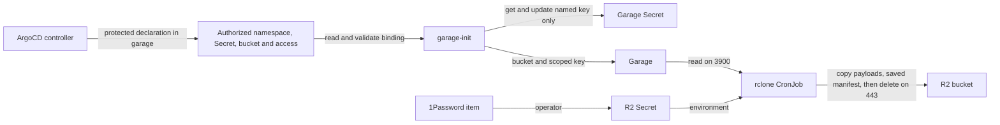
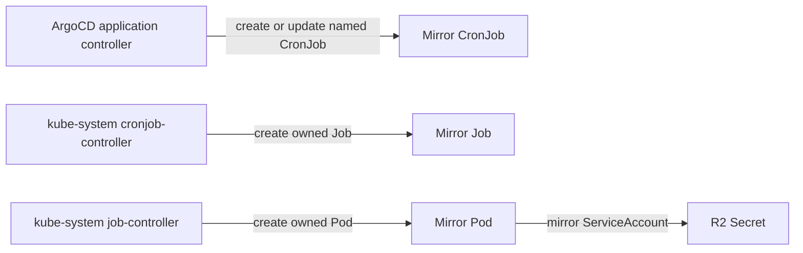
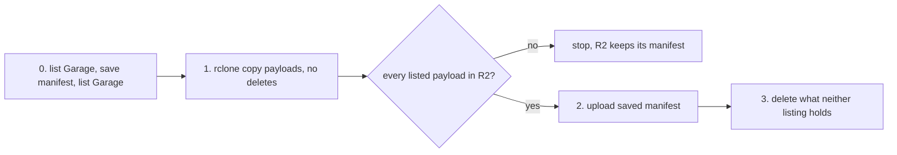
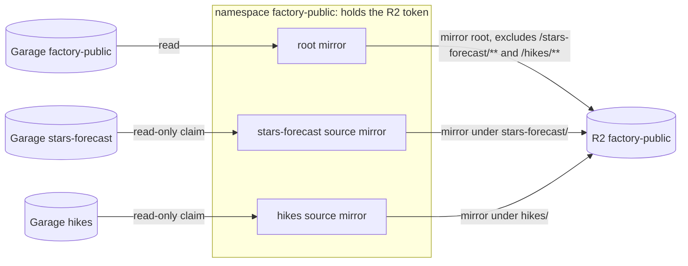

# Factory Helm library

`factory-library` is a library chart for the factory cluster. It renders
Deployment, CronJob, Job, Service, CiliumNetworkPolicy, ServiceAccount and secret
resources. Bucket entries add Garage keys and optional R2 mirrors. It does not
render routes or namespaces. The first consumer is `projects/factory-landing/chart` (Refs HOME-69).

## Wiring a chart

Add this dependency to a service chart's `Chart.yaml`:

```yaml
dependencies:
  - name: factory-library
    version: "0.1.0"
    repository: "file://../../shared/helm/factory-library/chart"
```

Adjust the relative path for deeper charts. Put this in `templates/workloads.yaml`:

```gotemplate
{{ include "factory-library.all" . }}
```

Run `helm dependency update <consumer-chart>` and commit `Chart.lock` and
`charts/factory-library-*.tgz`. Bazel's `helm_chart` packages that archive;
`ci regen` checks and refreshes its contents against the library source. The
library version and each consumer version remain under CI's versioning rules.

Keep `helm_chart(images = {"image": "//projects/<service>:image.info"})` for a
single image, or map `workloads.<name>.image` for multiple images. Packaging
injects the repository and digest. Source renders must supply a digest explicitly.
The landing chart shows how its lint and overlay tests consume the generated
image values without a tag fallback or a committed production digest.

The named templates `factory-library.deployment`, `factory-library.cronjob`,
`factory-library.job` and `factory-library.service` accept
`(dict "root" . "name" $name "workload" $values)`. Each workload template also
renders its policy, optional Service and optional ServiceAccount. Use `all` for
ordinary charts; it validates the entire exception list and also renders secrets.
Workload names are stable Kubernetes DNS labels, not release-prefixed names.
Do not reuse them in another release in the same namespace.

## Values reference

```yaml
image:
  repository: ghcr.io/jomcgi/homelab/projects/example
  digest: "" # Supplied by helm_chart(images), or explicitly for a local render.

workloads:
  example:
    kind: Deployment
    replicas: 2
    containerName: web
    ports:
      - name: http
        containerPort: 8080
    resources:
      requests: { cpu: 10m, memory: 32Mi }
      limits: { memory: 128Mi }
    writablePaths:
      - name: tmp
        mountPath: /tmp
        sizeLimit: 16Mi
    readinessProbe:
      httpGet: { path: /, port: http }
    service:
      ports:
        - { name: http, port: 8080, targetPort: http }
    network:
      ingress:
        - { peer: edge, port: 8080 }
      egress:
        - { peer: garage, port: 3900 }
        - { peer: github-api, fqdn: api.github.com, port: 443 }

secrets: {}
exceptions: []
```

| Value | Behaviour |
| --- | --- |
| `image` | Optional shared image; each workload can instead set `image`. A repository without a tag and a `sha256:` digest with 64 lowercase hex digits are required. An injected `tag` is ignored. |
| `workloads.<name>.kind` | `Deployment` (default), `CronJob` or `Job`. |
| `containerName` | Defaults to the workload name. One container per workload. |
| `replicas` | Deployment replicas, default 1; zero is preserved. |
| `schedule`, `concurrencyPolicy` | CronJob schedule is required. Concurrency defaults to `Forbid`; `Allow` and `Replace` are also accepted. |
| `backoffLimit` | Job and CronJob retry count, default 3; zero is preserved. |
| `hook` | Jobs only: `Sync` or `PostSync`. Renders the Job as an Argo CD hook with `BeforeHookCreation,HookSucceeded` deletion, so it runs on every sync. Use it for a Job whose spec changes each release, such as a deploy or a post-deploy check; a plain Job's spec is immutable. |
| `hookWave` | Optional integer for a Job hook's Argo CD sync wave. Higher waves wait for lower waves in the same phase to finish. |
| `resources` | Kubernetes resource map. CPU and memory requests and a memory limit are mandatory. |
| `command`, `args`, `env`, `ports` | Standard Kubernetes container fields. Secret environment variables use `valueFrom.secretKeyRef`. |
| `readinessProbe`, `livenessProbe`, `startupProbe` | Standard Kubernetes probes; no probe is invented. |
| `writablePaths` | List of `name`, `mountPath`, optional `sizeLimit` and `medium`. Each becomes an `emptyDir` and a mount. No host paths, arbitrary volumes or extra containers. |
| `kubernetesApi` | Boolean, default false. True sets pod token automount and creates a dedicated ServiceAccount with the workload's name. It grants no RBAC. Declare API egress separately. |
| `service.ports` | Standard Service ports; supplying `service` renders a ClusterIP Service selecting this workload. |
| `network.ingress`, `network.egress` | Lists of `{peer, port, protocol?}`. Protocol defaults to TCP; UDP and SCTP are accepted. Every rule requires a numeric port from 1 to 65535. |
| `secrets` | Named references or generated secrets, described below. |
| `exceptions` | The single list of reviewed departures from defaults. |

Every pod runs as non-root UID/GID 65532 with `RuntimeDefault` seccomp. Every
container drops all capabilities, disallows privilege escalation and has a
read-only root filesystem. Jobs restart with `Never`. Images under
`ghcr.io/jomcgi/` automatically name `ghcr-imagepull-secret`; provision that
Secret in the same namespace, normally through the OnePasswordItem below.

Raw pod, container security, volume and network selector overrides are rejected.
Image digests, required resources, non-root execution, capability dropping,
seccomp and privilege escalation protection cannot be waived by this API.

## Peer catalogue

Each workload gets a policy with `enableDefaultDeny.ingress` and `.egress` true.
An empty list allows no traffic in that direction. Cilium allow policies are
additive: the factory's cluster-wide baseline still allows DNS to CoreDNS;
the library does not expand that allowance. An ingress declaration grants only
the receiving side; a remote peer may also need an egress rule, and vice versa.

The selectors below are fixed in `chart/templates/_peers.tpl`, copied from the
factory and platform-factory policies. Consumers cannot replace their labels.
`namespace` means `k8s:io.kubernetes.pod.namespace`; name, instance and component
mean the corresponding `app.kubernetes.io/*` labels.

| Peer | Namespace | Other selector labels |
| --- | --- | --- |
| `edge` | `edge` | `gateway.envoyproxy.io/owning-gateway-name=edge`, `gateway.envoyproxy.io/owning-gateway-namespace=edge` |
| `garage` | `garage` | name=`garage` |
| `itsaplan-api` | `factory` | name=`factory-itsaplan`, instance=`factory`, component=`api` |
| `itsaplan-web` | `factory` | name=`factory-itsaplan`, instance=`factory`, component=`web` |
| `itsaplan-worker` | `factory` | name=`factory-itsaplan`, instance=`factory`, component=`worker` |
| `kagent-controller` | `kagent` | name=`kagent`, instance=`factory`, component=`controller` |
| `kagent-ui` | `kagent` | name=`kagent`, instance=`factory`, component=`ui` |
| `broker` | `factory` | name=`factory-broker`, instance=`factory` |
| `connector` | `factory` | name=`factory-connector` |
| `reviewer` | `factory` | name=`factory-reviewer`, instance=`factory` |
| `factory-db` | `factory-db` | `cnpg.io/cluster=factory-db` |
| `kagent-postgres` | `kagent-pg` | `cnpg.io/cluster=kagent-pg` |
| `substrate-api` | `ate-system` | `app=ate-api-server` |
| `substrate-idp` | `ate-system` | `app=ate-idp-server` |
| `substrate-router` | `ate-system` | `app=atenet-router` |
| `substrate-egress` | `ate-system` | `app=atenet-egress` |
| `kube-apiserver` | Cilium entity | Egress only, requires `kubernetesApi: true`; use backend port 6443 on the factory's k3s cluster. |

An external peer has its own explicit name, exact `fqdn` and port, for example
`{peer: github-api, fqdn: api.github.com, port: 443}`. FQDN peers are egress only
and cannot reuse a catalogue or broad peer name. Unknown names without an FQDN
fail. `world`, `0.0.0.0/0`, `::/0` and wildcard FQDNs require exact exceptions.
Add a new internal peer centrally, with a test and the current policy's labels.

## Secrets

```yaml
secrets:
  ghcr-imagepull-secret:
    workload: example
    onePassword:
      itemPath: vaults/k8s-homelab/items/ghcr-read-permissions
      type: kubernetes.io/dockerconfigjson
  example-token:
    workload: example
    generated:
      keys:
        token: 32 # Random entropy bytes, 16–128 per key; never a literal value.
      image:
        repository: ghcr.io/jomcgi/homelab/projects/python-runtime
        digest: "" # Supply the digest of an image providing Python 3 + CA roots.
      resources:
        requests: { cpu: 10m, memory: 32Mi }
        limits: { memory: 128Mi }
```

The Python runtime repository above is illustrative; supply an actual built
image. Map `secrets.<name>.generated.image` in `helm_chart(images)` if using a
repository-built runtime.

`onePassword` accepts only `itemPath` (`vaults/<vault>/items/<item>`) and optional
Secret `type` (default `Opaque`). It renders a OnePasswordItem in the release
namespace at sync wave -2.

`generated` accepts only key entropy sizes, image and resources. It renders an
empty Opaque Secret with `Prune=false,Delete=false` and
`helm.sh/resource-policy: keep`, and a restricted Python initialization Job. No
secret material appears in values or offline renders. There is no `data`,
`stringData`, literal-value, template-evaluation or Helm random-value interface.

The Job runs as an ArgoCD Sync hook at wave -1, after its wave -2 Secret,
ServiceAccount, Role, RoleBinding and Cilium policy. It can only get and patch
that named Secret and reach the API server on port 6443. It fills missing keys
using Python's cryptographic random generator. A JSON Patch resource-version
test makes concurrent initializers retry without overwriting the winner; existing
keys are never replaced. A later sync recreates the hook, rechecks the Secret
and exits without rotation. Deleting a key deliberately allows it to regenerate;
removing a key from values does not erase it from the kept Secret.

For generated Secrets, the consuming ArgoCD Application must ignore `/data` on
the named Secret, with `RespectIgnoreDifferences=true` and server-side apply.
This avoids treating the runtime-owned data as Git drift. The library cannot
configure its parent Application. Keep these settings and keep annotations
when changing or retiring a service. Plain `helm template` verifies manifests;
the sync hook lifecycle is designed for ArgoCD.

## Buckets and public mirrors

A chart declares its buckets once. Every workload in that chart gets Garage
egress on port 3900. Secret initializer Jobs keep only their API egress.

```yaml
buckets:
  - name: factory-public
    access: write # read, write or readwrite; never owner
    public:
      r2Bucket: factory-public
      itemPath: vaults/k8s-homelab/items/factory-r2-public-mirror
      # schedule: "* * * * *"
      # suspend: true  # Stage the mirror while verifying its destination.
      # sources:  # Garage buckets of other charts, each under its own prefix.
      #   - {bucket: stars-forecast, r2Prefix: stars-forecast, manifestName: latest.json, suspend: true}
```

Each entry creates a kept Secret named RELEASE-BUCKET-s3. Its fields are
AWS_ACCESS_KEY_ID, AWS_SECRET_ACCESS_KEY, AWS_ENDPOINT_URL, AWS_REGION and BUCKET.
Consumers reference those fields through their workload env declarations.
The ArgoCD Application must ignore /data for each claim Secret and set
RespectIgnoreDifferences=true and ServerSideApply=true.

Garage provisioning uses the HOME-137 garage-init fallback. Each bucket entry
also renders a credential-free authorization ConfigMap in the `garage` namespace.
Its data binds the consumer namespace, Secret name, bucket and access. Its name
is `garage-claim-` followed by the SHA-256 of `NAMESPACE/SECRET`; reconciliation
checks that binding before granting access. The chart's ArgoCD project must allow
resources in both the consumer and `garage` namespaces.

The Garage application installs `garage-claim-authorizations`, a kept admission
policy and Deny binding. Only the authenticated ArgoCD application controller may
create, update or delete these declarations. The guard matches the reserved name
prefix and old/new claim labels, so stripping labels cannot bypass it.
The Kubernetes garbage collector has one exception: it may remove the
`foregroundDeletion` finalizer from a declaration that is already being deleted.
That update must remove only `foregroundDeletion` and keep the other finalizers
in their order. Name, data, binaryData, immutable, labels, annotations and
ownerReferences must stay the same. ArgoCD prunes with foreground propagation,
so the API server keeps a pruned declaration until the garbage collector removes
its `foregroundDeletion` finalizer. Without the exception, the declaration and
the ArgoCD sync wait forever.
Consumer namespace writers cannot edit this trusted declaration; choosing a
ServiceAccount on a Pod does not change the authenticated caller.

Discovery lists ConfigMaps only in `garage`, with no namespace enumeration or
consumer ConfigMap access. Consumer ConfigMaps and Secret labels are never grant
inputs. Consumers grant only get/update on their named Garage Secrets. Garage-init
cannot write authorizations, list Secrets or read the mirror R2 Secret. Install the
Garage guard before the first consumer; ArgoCD and cluster administrators remain
trusted to approve access through reviewed Git changes.

Reconciliation runs after Garage syncs and every ten minutes. No credentials
are generated during Helm rendering. Existing keys survive retries and Garage
rebuilds. Narrower access revokes unwanted rights without rotating the key.
Retiring a kept claim requires explicit Garage key revocation; deleting the
chart does not revoke the key.

Adding public creates a separate read-only Garage key, a OnePasswordItem and
a mirror CronJob. Its default schedule is every minute with Forbid concurrency, its own
ServiceAccount and no mounted token. It uses the stock rclone/rclone image at
the 1.76.0 multi-platform digest. The optional public.image accepts only the
stock repository and a SHA-256 digest; tags fail rendering.
Set public.suspend to true while checking a destination. Verify its bucket,
prefix, credential scope and endpoint before you enable the mirror.

The digest comes from the
[upstream 1.76.0 package](https://github.com/rclone/rclone/pkgs/container/rclone/1515701921?tag=1.76.0).
The [upstream image workflow](https://github.com/rclone/rclone/blob/v1.76.0/.github/workflows/build_publish_docker_image.yml)
publishes the same manifest to Docker Hub and GHCR.



The item supplies access-key-id, secret-access-key and s3-api-endpoint.
Only RCLONE_CONFIG_* environment variables configure remotes; no rclone config
file or credential bytes enter the chart. Garage uses Other with path-style
addressing; R2 uses Cloudflare with region auto and path-style addressing.

The policy allows Garage:3900, DNS to CoreDNS, and the existing account's exact
R2 hostname on 443. The script rejects an endpoint that differs from that host.
A new R2 account requires a reviewed change to factory-library.r2Host.
No wildcard R2 egress is rendered.

Three kept ValidatingAdmissionPolicies and Deny bindings guard the R2 Secret
and reserved mirror ServiceAccount. They check volumes, projected volumes,
env, envFrom, imagePullSecrets, init containers and ephemeral containers.
The rules check authenticated API callers and the controller ownership chain:



A Pod creator cannot opt into this chain by choosing a ServiceAccount or
forging owner references. Job and CronJob creation are also guarded, so those
controllers cannot be used to obtain the credential indirectly. Ephemeral
container updates to mirror Pods are denied. The Job controller may update
its Jobs; only ArgoCD may change the CronJob, including its suspension.
The garbage collector may update metadata only, preserving the entire spec.

These checks require the factory cluster's per-controller ServiceAccounts
(kube-controller-manager --use-service-account-credentials). The identities
are fixed in the template. Verify them before enabling a new cluster; an
unrecognized controller fails closed. The existing Substrate identity guard
uses the same cluster convention. Cluster administrators, ArgoCD, the two
controllers and principals that can impersonate them remain trusted.
Direct Secret reads and exec access require separate RBAC; these policies do
not grant either capability. The mirror ServiceAccount has no API permissions.

Each run has four steps. A step starts only after the previous step
succeeds. Thus a stop at any point leaves the R2 manifest naming only objects
that R2 holds. The payload listings, the copy and the delete leave out the
manifest, the `copyKeys` and the `public.sources` prefixes.



0. The run lists Garage, saves the manifest to a local file, and lists Garage
   again. A writer puts each payload before the manifest that names it, and
   keeps it as the writer rule below requires. Thus the two listings hold
   every payload that the saved manifest names.
1. `rclone copy` uploads the payloads with Cache-Control: public,
   max-age=31536000, immutable. It deletes nothing. Then the run lists R2. If
   a listed payload is not in R2, the writer removed it before the copy. The
   run then stops before the manifest, and the next run saves a new one.
2. The run uploads the saved manifest with Cache-Control: public, max-age=60.
   If Garage had no manifest, the run removes the R2 manifest.
3. `rclone delete --files-from-raw` removes the R2 payloads that neither
   Garage listing holds. The saved manifest names none of them, also when the
   writer removes payloads during the run. The next run deletes those.

A failed copy or listing stops publication.

Each mirror Job has `activeDeadlineSeconds: 900`. The deadline counts from
the start of the Job and includes its retry pod. At the deadline, Kubernetes
stops the pod within the default 30-second termination grace period. A stop
at the deadline is like a stop at any other point.

Set `public.manifestName: latest.json` for static-page writers. The default is
`manifest.json` for existing publishers.

`public.copyKeys` lists keys that another bucket of the same chart holds, for
example `[{bucket: factory-health, key: health.json}]`. The writer of that key
then needs no access to the mirrored bucket. Each key is a root `*.json` name
other than the manifest. The mirror gets a separate read-only Garage key for
each named bucket. The listings, the copy and the delete leave these keys
out. After the manifest step, each key is copied from its bucket with the
manifest's 60-second cache, or removed from R2 when its bucket lacks it.

The publisher must write each immutable payload before the manifest that
names it. It must not remove a payload that its current manifest names, or
one that it wrote less than a minute before. After its manifest stops naming
a payload, it must keep that payload for at least the mirror deadline plus
90 seconds: 30 seconds of termination grace and 60 seconds of manifest cache.
A mirror pod stops within the deadline plus the grace, so the second listing
holds every payload of the saved manifest that the first listing missed.
Thus the writer can publish and remove payloads at any step of a mirror run.
R2 loses a payload one run after Garage loses it.

### One public R2 bucket

R2 bucket `factory-public` is public at `https://factory-data.jomcgi.dev`.
Its token in `vaults/k8s-homelab/items/factory-r2-public-mirror` can write
and delete every object in the bucket. A prefix in a mirror command is not a
boundary for that token. Thus only the `factory-public` release in namespace
`factory-public` holds the token and runs mirrors into the bucket (HOME-492).
A writer chart declares its own Garage bucket without `public` and holds no
R2 credential.



The root mirror's `public.sources` lists the Garage buckets of other charts.
Each entry takes `bucket`, `r2Prefix`, and optional `manifestName`,
`schedule` and `suspend`. The prefix is one path segment of lowercase
letters, digits and `-`, and other values fail rendering. Each bucket and
each prefix occurs once, and the bucket is not the root mirror's own bucket.
Admission policy names contain the namespace, release and prefix, and must
fit in 63 characters. Thus a prefix in release `factory-public` has at most
14 characters.

Each source gets its own CronJob, named `RELEASE-PREFIX-mirror`, with the
root mirror's image, R2 bucket and 1Password item. It gets its own
OnePasswordItem, admission guard and read-only Garage claim on the source
bucket. Garage-init grants that claim like any other: the claim in the
`garage` namespace binds the reading namespace, Secret, bucket and `read`.
The source mirror has no `copyKeys`.

A source mirror's copy, R2 listing, manifest upload and deletes name
`R2:<r2Bucket>/<r2Prefix>`, so they stay under that prefix. Readers get
`https://factory-data.jomcgi.dev/<r2Prefix>/<key>`.

The root sync adds `--exclude '/<r2Prefix>/**'` for each source. rclone does
not delete excluded objects. The library derives these excludes in the same
render, so a source prefix that the root sync does not exclude cannot exist.
`public.r2Prefix` and `public.excludePrefixes` are unsupported fields. One
chart pin controls the excludes and the source mirrors together. The
Garage writer of the root bucket must not use a source prefix as a key
prefix: the root sync leaves those keys out.

Content rule `rule_public_r2` checks the render of every factory application.
Outside namespace `factory-public`, it refuses a OnePasswordItem for the
token's item and a container with `R2_BUCKET=factory-public` (invariant
LIB-8). The library tests prove the derived excludes and the prefix
confinement (invariant LIB-7).

## Delivery split for HOME-137

This PR delivers the reusable library, Garage provisioning and their security
tests. The first production consumer, chart publication, ArgoCD Application,
deployment-specific tests and rollout guide are deferred to a separate PR.
Their previous source is preserved in
[commit 3db765152](https://github.com/jomcgi-org/homelab/tree/3db7651527f911e78ef74d21e658377a600360a2/projects/factory-public).
No production mirror is registered by this part of the change.

The [admission chart](admission/testdata/chart/values.yaml) is a render-only fixture
with no publication target or Application. The full Pod, Job, CronJob, Garage RBAC
and claim-authorization matrix remains in
[admission_test.go](admission/admission_test.go). PR CI runs
`//projects/shared/helm/factory-library/admission:admission_test` against a private
Kubernetes API server.

Provisioning uses the garage-init fallback. The operator's connectTo chart rendered
locally, but pulling release 0.9.0 failed because ghcr.io did not resolve, and no
live cluster connection was available. This establishes no operator defect; the
fallback retains the existing layout and key ownership without an operator rollout.

HOME-137's live criterion remains open for the deployment PR: verify the 1Password
item and dedicated R2 inventory, then record delivery within two minutes, payload
and manifest Cache-Control, and removal from R2 after Garage deletion. Neither the
production prerequisites nor live acceptance are established by this library PR.

## Exceptions

Each entry requires an existing workload name, an exact default name and a
nonblank reason. Duplicate entries, unknown defaults and unknown workloads fail.

```yaml
exceptions:
  - workload: example
    default: runAsUser
    value: 1000
    reason: The upstream image owns its application files as UID 1000.
  - workload: example
    default: network.fqdn:*.example.com
    reason: The upstream API assigns a hostname to each tenant.
```

| Default name | Effect |
| --- | --- |
| `runAsUser`, `runAsGroup` | Set `value` to a positive numeric UID/GID; root remains prohibited. |
| `readOnlyRootFilesystem` | Sets this field to false. Prefer a declared `emptyDir` when possible. |
| `network.world`, `network.0.0.0.0/0`, `network.::/0` | Allows that exact peer, still with an explicit port. |
| `network.fqdn:<pattern>` | Allows only that exact wildcard FQDN pattern, still named and port-scoped. |
| `network.defaultDeny` | Omits `enableDefaultDeny`, relying on the factory's kept cluster-wide baseline. Reserved for migrations that must preserve an existing policy's spec. It does not create an allow rule. |

Only UID/GID exceptions accept `value`. Exceptions do not grant network access
without a corresponding peer declaration and do not affect other workloads.
The complete list for a workload appears as JSON in
`factory.jomcgi.dev/exceptions` on its objects and pod template. This makes each
reason visible in the rendered manifest.

Factory-landing uses `network.defaultDeny` to retain its existing policy exactly,
including the absence of `egress`. Its current cluster baseline supplies deny
in both directions and DNS. No pod security exception is needed.

## Validation

```bash
ci lint
ci regen
ci ratchet
HELM_BIN="$(command -v helm)" python3 -m pytest \
  projects/shared/helm/factory-library/library_test.py \
  projects/factory-landing/chart/landing_test.py
```

Golden objects cover all three workload types, mandatory hardening, public and
private images, ServiceAccounts, writable paths, services, peers, exceptions and
both secret modes. Refusal goldens pin error messages. The initializer tests
exercise preservation and optimistic-concurrency conflicts without a cluster.
The landing test retains its original assertions and compares the whole render
to `chart/testdata/before.json`, ignoring only annotations.

For the PR body, render both revisions with the same test digest and print their
canonical diff (resource order and YAML formatting are normalized):

```bash
HELM_BIN="$(command -v helm)" python3 \
  projects/shared/helm/factory-library/render_landing_diff.py
```
