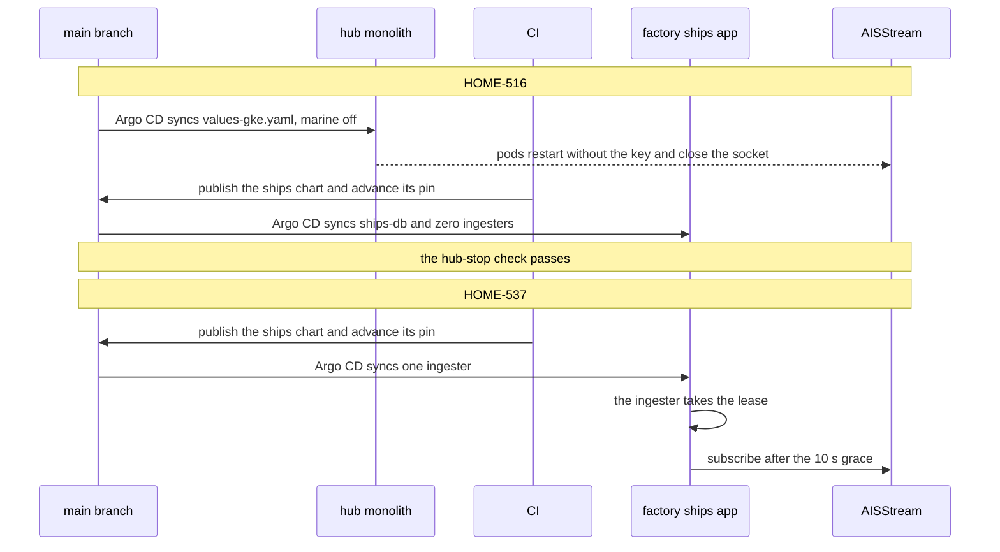
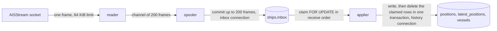
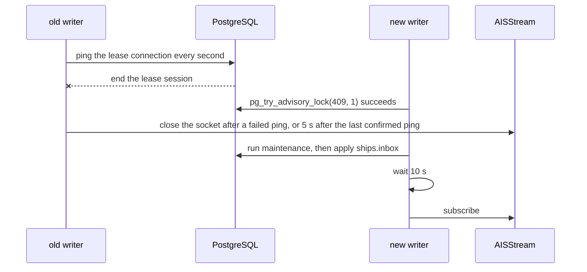

# Ships on the factory cluster

HOME-256 follows [Joe's decision of 2026-11-18](https://factory-plan.jomcgi.dev/factory/issue/HOME-178#comment-2358): Ships moves factory-native, and its data leaves the cluster through the cluster to R2 sink. A live app may get its own subdomain. This plan keeps the Pacific Northwest subscription and the MapLibre page at `jomcgi.dev/app/ships` as a section of the Astryx site. Its only runtime dependency will be reads of precomputed objects. A separate application origin would add routing and break existing shared map links without isolating any server workload.

## Ingest and capacity

Run one Go process on factory. A typed WebSocket decoder and bounded channels let the reader and batched PostgreSQL writer overlap without allocating an unbounded backlog. Go fits the repository's existing build and image pipeline. Back off on disconnect, count dropped or malformed reports, and record the last successful commit time. Use the hub's subscription box and message filters. Guard the subscription with a PostgreSQL advisory lock during rolling updates.

Keep PostgreSQL. Track history and all-time heat need durable state across reconnects, deployments and partition expiry. Port the hub's deduplication, latest-position and vessel metadata upserts. Keep daily position partitions for seven days. Bank each expired day's distinct vessel counts by cell and drop its partition in one transaction. Import historical heat separately from live partitions and reconcile their UTC day boundary before enabling retention. The hub implementation defines the parity target. [Ingest and serving code](../monolith/ships/)

HOME-256 reports a roughly 2.9 MB snapshot every 120 seconds. That measures page payload.

Hub resource use, measured in Honeycomb (`metrics` dataset, hub containers) for the 24 hours to 2026-11-18 22:36 UTC:

| Hub container | CPU p50 / p95 / peak (cores) | Working set p95 / peak |
| --- | --- | --- |
| monolith `backend` (ingest shares it with other modules) | 0.26 / 0.61 / 0.98 | 544 MiB / 626 MiB |
| monolith `postgres` (all monolith databases) | 0.33 / 1.04 / 1.46 | 897 MiB / 956 MiB |

These are shared-container totals, so they bound the ingest cost from above. The hub emits no ingest telemetry. [Joe's decision of 2026-11-19](https://factory-plan.jomcgi.dev/factory/issue/HOME-516#comment-5531) skips a hub baseline. HOME-516 sets generous starting budgets at zero replicas. [HOME-537](https://factory-plan.jomcgi.dev/factory/issue/HOME-537) gives the ingester its replica, and factory metrics size it later.

HOME-516 sets these starting budgets in `chart/values.yaml`:

| Workload | Requests | Limits | Storage |
| --- | --- | --- | --- |
| `ships-ingester`, one pod from HOME-537 | 250m CPU, 512 MiB | 1 CPU, 1 GiB | none |
| `ships-db`, each of three instances | 100m CPU, 512 MiB | 1 GiB memory | 20 GiB local-path |

These values keep wide headroom, because no measurement sets them. [HOME-526](https://factory-plan.jomcgi.dev/factory/issue/HOME-526) right-sizes them after 24 to 48 hours of factory Prometheus metrics. It reads pod CPU and memory from the `kubelet-resource` job and the size of the `ships` database. local-path volumes do not expand, so the first storage size errs high. Retention stays off, so every day of `ships.positions` stays on disk until retention is enabled.

## Publication contract

AISStream.io publishes no terms of service or data license (checked 2026-11-18). Its site links only a [privacy policy](https://aisstream.io/privacypolicy), which says nothing about redistribution. Its [documentation](https://aisstream.io/documentation#limits) sets only operational limits, and tells apps to serve clients through their own server with only the data each client needs. So no published grant covers public position files. With no terms to link, this plan links the pages checked ([decision](https://factory-plan.jomcgi.dev/factory/issue/HOME-256#comment-4186)). An inquiry in AISStream’s issue tracker asks specifically about public redistribution. Another reports that the usual terms URLs returned 404. Both are requests from users of the service. Neither supplies a license. [Redistribution inquiry](https://github.com/aisstream/issues/issues/223) · [Terms lookup report](https://github.com/aisstream/issues/issues/299)

Keep all three products in private Garage storage until the applicable terms or written permission covers the intended redistribution. Serve private data only to authorized readers through an authenticated endpoint with private, no-store caching. Keep the public static page in an unavailable state in that mode. Do not assume aggregation or delay grants redistribution rights. [AISStream](https://aisstream.io/)

If cleared, copy only the approved prefix through the HOME-137 Garage-to-R2 mirror. The following sizes are uncompressed JSON planning targets, except for the reported snapshot size. Measure actual byte distributions before cutover.

| Key under ships/v1/ | Contents and size | Publish interval | Public Cache-Control |
| --- | --- | --- | --- |
| snapshot.json | Latest position and metadata per vessel, roughly 2.9 MB | 120 seconds | public, max-age=0, s-maxage=120 |
| heat.json | Occupied cells, live plus banked vessel-days and legend stops, target 1 MB | Hourly after rollup | public, max-age=300, s-maxage=3600 |
| tracks/{mmsi}.json | Latest 1,000 retained points in map order, target 150 KB per vessel | Changed tracks every 120 seconds | public, max-age=0, s-maxage=120 |

Public rollout requires a change to the HOME-137 mirror. Its [upload template](../shared/helm/factory-library/chart/templates/_mirror.tpl) currently gives every payload except the root manifest a one-year immutable lifetime. Add opt-in per-key header rules for the three mutable Ships keys. Before routing readers to R2, replace a fixture at each kind of key, read it through the edge with an existing browser cache, and verify both the table’s Cache-Control value and that the replacement becomes visible within its TTL.

Replace each key with a complete object and include a generation timestamp. Publish changed tracks before the snapshot, retry failed copies with the same body, and propagate expiry of tracks that age out even when no new reports arrive. Verify headers and ETags at the public edge. Keep bucket listing disabled. The browser fetches the snapshot on load and revalidates every two minutes, fetches heat on entering heat mode and one track on marker selection. Preserve map state and display the last successful timestamp on a failed refresh. A missing track leaves the selected vessel visible. Allow reads from the site origin if the mirror uses a separate hostname.

## Follow-up HOME issues

The slices are filed under [HOME-178](https://factory-plan.jomcgi.dev/factory/issue/HOME-178) in dependency order. Each issue carries the numbered Done when criteria below ([record](https://factory-plan.jomcgi.dev/factory/issue/HOME-256#comment-4186)).

### Factory AIS ingester

Tracked in [HOME-409](https://factory-plan.jomcgi.dev/factory/issue/HOME-409).

Done when

1. A replay that CI runs shows that snapshot, track and heat match the hub on shared input, including duplicates, out-of-order reports and a UTC partition rollover. The factory database starts from the factory bootstrap SQL, not the hub migrations.
2. A restart during a write keeps memory bounded, one active socket, durable history and the latest position. AISStream does not resend a report, so a report is durable once it is in the inbox:
   - every valid report committed to the inbox reaches history exactly once after a restart, including a restart during a blocked history write and a lost lease connection during an apply;
   - reports the hub also refuses (dated more than 5 minutes ahead, or rejected by PostgreSQL) are dropped and counted, not stored;
   - the reports that can be lost are only those still in the bounded in-memory queue, whose size [Factory deployment](#factory-deployment) states;
   - an older report never replaces a newer latest position.
   Tests cover each case.
3. The chart deploys the ingester with zero replicas, with a chart test, and this document names HOME-483 as the step that sizes the ingester and gives it a replica.

### Cutover and activation

Tracked in [HOME-516](https://factory-plan.jomcgi.dev/factory/issue/HOME-516) and [HOME-537](https://factory-plan.jomcgi.dev/factory/issue/HOME-537). Joe chose a direct cutover on the same AISStream key, with no overlap and no hub baseline ([decision](https://factory-plan.jomcgi.dev/factory/issue/HOME-516#comment-5531)). The requirement is that the key never has two concurrent AISStream subscriptions. The factory app can sync a published chart before the hub rollout finishes, so the cutover has two steps:

1. HOME-516 sets `marine.enabled=false` in the hub values. In this chart it sets the starting budgets and storage, and keeps `enabled=false`. Argo CD syncs the hub values from Git at merge. The factory app syncs after CI publishes this chart and advances the pin in `deploy/application.yaml`. CNPG then creates `ships-db`, and the ingester has zero replicas.
2. HOME-537 sets `enabled=true`, which gives the ingester one replica. It merges only after the hub-stop check and the freshness check below both pass.



History has a gap between the hub stop and the first factory subscription, which Joe accepted. Positions from both ingesters can share a UTC date, but their subscriptions never overlap. The hub keeps serving its stored Ships data until HOME-411 and HOME-412.

**Hub-stop check (HOME-516).** The primary check reads the hub's pods. A hub backend pod whose database writes stall could still hold its AISStream socket, so data freshness alone cannot prove the socket closed. Run this against the hub (`homelab-hub`) after the hub backend rollout:

```sh
kubectl -n monolith get pods -l app.kubernetes.io/name=monolith,app.kubernetes.io/component=app -o json | python3 -c '
import json, sys
pods = json.load(sys.stdin)["items"]
for p in pods:
    env = [e["name"] for c in p["spec"]["containers"] for e in c.get("env", [])]
    print(p["metadata"]["name"], p["metadata"]["ownerReferences"][0]["name"], p["status"]["phase"], "AISSTREAM_API_KEY" in env)
'
kubectl -n monolith get rs -l app.kubernetes.io/name=monolith,app.kubernetes.io/component=app
```

The hub has stopped when every listed backend pod prints `False` (no `AISSTREAM_API_KEY`), all of them belong to the newest ReplicaSet, and no older ReplicaSet has a ready or terminating pod. Before the cutover, at 22:24Z on 2026-11-19, both pods of ReplicaSet `monolith-6cdbb5f47d` still had `AISSTREAM_API_KEY`.

**Freshness check (supplement).** After the pod check passes, the public page confirms that no hub process still writes positions. The Cloudflare cache can serve a stale page for up to 24 hours (`stale-if-error=86400`), so a unique query string bypasses it. The script prints the age of the newest vessel `updated_at` at or before now. It also prints the count of vessels updated in the last 10 minutes.

```sh
curl -fsS "https://jomcgi.dev/app/ships?check=$(date +%s)" | python3 -c '
import re, sys
from datetime import datetime, timedelta, timezone
now = datetime.now(timezone.utc)
found = re.findall(r"updated_at:\"([^\"]+)\"", sys.stdin.read())
past = [t for t in map(datetime.fromisoformat, found) if t <= now]
print("newest age:", now - max(past))
print("updated in 10 min:", sum(t > now - timedelta(minutes=10) for t in past))
'
```

Both checks pass when, in addition, the newest age is more than 10 minutes and the count is 0. Before the cutover, at 22:13Z on 2026-11-19, the newest was 12 s old and 441 vessels updated in the last 10 minutes.

**Factory checks (HOME-537).** Run these with `KUBECONFIG=~/.kube/factory.yaml` after the factory app syncs one ingester:

1. **Pod Ready.** `kubectl -n ships wait --for=condition=Ready pod -l app=ships-ingester --timeout=5m` succeeds.
2. **One subscription.** `kubectl -n ships logs deploy/ships-ingester` shows `subscribed to AISStream` exactly once and no `ingest session ended` line. The writer logs that line after it sends the subscription.
3. **Positions arrive.** On the `ships-db` primary (`-l cnpg.io/cluster=ships-db,cnpg.io/instanceRole=primary`, container `postgres`), run `psql -d ships -Atc "select count(*), max(received_at) from ships.positions"` twice, 5 minutes apart. The count grows, and `max(received_at)` is less than 5 minutes old.

To roll back, confirm that no `ships-ingester` pod runs before the hub ingest starts again. After HOME-537, first set `enabled=false` or lower the pin. Then set `marine.enabled=true` in the hub values. The key then never has two sockets.

### Garage sink and R2 mirror

Tracked in [HOME-410](https://factory-plan.jomcgi.dev/factory/issue/HOME-410).

Done when

1. Record the dated terms permalink and redistribution grant or implement the private delivery path. Verify anonymous access matches that decision for every product.
2. Measure bytes and object writes per cycle and verify schema, timestamps, freshness, headers and expiry at the reader endpoint.
3. Interrupt a copy and verify readers retain complete objects and the mirror catches up after recovery.

### Ships page

Tracked in [HOME-411](https://factory-plan.jomcgi.dev/factory/issue/HOME-411).

Done when

1. Serve the existing map URL from the site and preserve shared heat and vessel selections.
2. Verify snapshot polling, lazy heat and track reads, stale timestamps and missing tracks in a browser against the sink.
3. Exercise the selected access mode and confirm the public build contains no provider or storage credentials.

### Cutover

Tracked in [HOME-412](https://factory-plan.jomcgi.dev/factory/issue/HOME-412).

Done when

1. Compare a day of hub and factory output including vessel coverage, track chronology, banked heat and freshness. Resolve discrepancies before switching.
2. Route the Ships paths to the site, exercise old links and verify rollback to the hub before retiring its feed.
3. Observe one retention rollover and mirror recovery on factory and record route ownership for HOME-261.

### Hub code removal

Tracked in [HOME-413](https://factory-plan.jomcgi.dev/factory/issue/HOME-413).

Done when

1. After cutover acceptance, archive required history and verify a restore including historical heat.
2. Remove hub subscription, credentials references, partition jobs, routes and superseded frontend code. Retire hub tables after restore verification and the agreed rollback window.
3. Verify factory freshness with the hub disabled and run the affected monolith and site checks.

## Factory deployment

| Component | Responsibility |
| --- | --- |
| cmd | Holds the database lease on its own connection, and commits received frames to `ships.inbox` on a second connection. A third connection claims them, applies them to history, latest positions and vessels, and runs partition maintenance and the heat refresh. |



The chart runs one ingester replica when `enabled` is true and none when it is false. The default stays false until HOME-537. `chart/ingester_test.py` asserts both cases and the starting budgets in [Ingest and capacity](#ingest-and-capacity). CNPG creates the three-instance database from `chart/sql/bootstrap.sql` as the `ships` owner. The ingester connects with the owner URI from the `ships-db-app` Secret. Enable retention separately after importing and reconciling historical heat at a UTC boundary.

A session subscribes only while it holds the PostgreSQL advisory lock `(409, 1)`. The lease connection holds that lock and runs nothing else. The writer pings it every second. A ping that succeeds confirms the lease for 5 seconds from the moment the writer sent it. If a ping fails or the confirmation expires, the writer closes its AISStream socket at once. A timer does the close at expiry, so a ping that hangs on a dead connection cannot delay it. The reader also drops each frame that it reads after the confirmation expires.

After a writer takes the lock, it runs maintenance and applies the frames that `ships.inbox` still holds. It then waits 10 seconds (`leaseGrace` in `cmd/main.go`) before it subscribes. A writer that lost the lock sent its last confirmed ping before the loss, so it closes its socket less than 5 seconds after the loss. Thus at most one socket is open at any instant, also when PostgreSQL ends the lease session without notice. A database row cannot close a socket on AISStream, so this time bound is the fence. A stopped process cannot close its socket. When it resumes, its reader drops each frame that it reads after the deadline, so no report reaches the inbox from both sockets.



The inbox connection commits received frames to `ships.inbox`. The applier uses a third connection, so a blocked history write does not stop inbox commits. The spooler commits a batch every 2 seconds or 200 frames. The applier then applies the inbox in receive order. A crash during the apply leaves the frames in `ships.inbox` for the next session. When the spooler stops, the session closes its socket before it waits for the applier.

The applier claims each chunk with `SELECT ... FOR UPDATE` and deletes the claimed rows in the transaction that applies them. If PostgreSQL ends only the lease session, the old apply transaction can still commit after a standby takes the lease. The standby waits on the claimed rows. It skips the rows that the old transaction deleted and applies the rows that it rolled back, so each report reaches history once. The delete must remove every claimed row, or the transaction rolls back. While the history write is blocked, the inbox grows on disk. After SIGTERM the writer closes its socket and has 10 seconds to commit the frames it received.

AISStream does not resend a report, so a report is durable when its inbox commit completes. Before that commit, a report waits in memory: the frame that the reader holds, up to 200 frames in the reader channel and up to 200 in the spooler batch. A crash or a lost lease can lose only these 401 frames. If the inbox write blocks, the reader stops at the full channel and does not read the socket.

The writer ports the hub's deduplication and upserts. An older report joins the history and keeps the newer latest position. The reader drops a report dated more than 5 minutes after its frame arrived, so a bad timestamp cannot hold the latest position. It checks before the inbox write, so a delayed apply cannot change the result. The hub persister applies the same two rules when it persists a batch, a few seconds after it receives the frames. Both read a timestamp without an offset as UTC. The applier drops a report that PostgreSQL refuses and keeps the rest of its chunk. The reader counts each future report in the `ahead` log field when it drops the report. The applier counts each refused report once, after its apply commits, in the `refused` log field. It logs these fields every hour and at the end of each session. Maintenance moves default-partition rows into a new day partition before it attaches that partition.

`replay_test.py` runs in CI against PostgreSQL. It sends the same frames to the hub persister and the Go writer, then compares the hub's snapshot, track and heat responses for both databases. The input has duplicates, an out-of-order report, a timestamp without an offset, a UTC partition rollover and an expired day. Both sides bank and drop the expired day, and a retry banks nothing new. A second case blocks the history write and sends a report during the stall. It then blocks the inbox write, floods the socket and kills the writer. The standby must keep one socket, apply both spooled reports and keep the newer latest position. A third case blocks the history write, stops the writer and ends only its lease session. The standby must wait on the claimed inbox row, and each report must reach history once. After its lease expires, the feed sends the stopped writer a valid report, and sends another when the writer resumes. After the row is released, the resumed writer must close its socket before the standby subscribes. Neither late report reaches the inbox or history, and the standby's report does. A fourth case ends only the lease session of a running writer with an empty inbox. The writer must close its socket before the next lease holder subscribes. The fake feed counts its open subscribed sockets, and each case fails if the count reaches two. A fifth case checks that the writer drops and counts a future report and a report PostgreSQL refuses, and logs one subscription. A sixth case blocks the history write for over a minute. A report 6 minutes ahead of its arrival is dropped and counted, and a report 4 minutes ahead reaches history.
