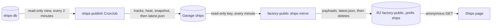
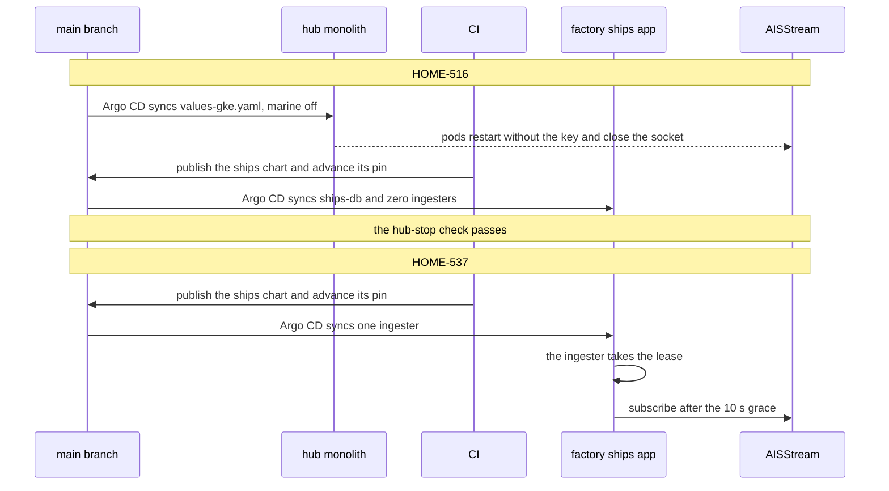

# Ships on the factory cluster

HOME-256 follows [Joe's decision of 2026-11-18](https://factory-plan.jomcgi.dev/factory/issue/HOME-178#comment-2358): Ships moves factory-native, and its data leaves the cluster through the cluster to R2 sink. A live app may get its own subdomain. This plan keeps the Pacific Northwest subscription and the MapLibre page at `jomcgi.dev/app/ships` as a section of the Astryx site. Its only runtime dependency will be reads of precomputed objects. A separate application origin would add routing and break existing shared map links without isolating any server workload.

## Ingest and capacity

Run one Go process on factory. A typed WebSocket decoder and bounded channels let the reader and batched PostgreSQL writer overlap without allocating an unbounded backlog. Go fits the repository's existing build and image pipeline. Back off on disconnect, count dropped or malformed reports, and record the last successful commit time. Use the hub's subscription box and message filters. Guard the subscription with a PostgreSQL advisory lock during rolling updates.

Keep PostgreSQL. Track history and all-time heat need durable state across reconnects, deployments and partition expiry. Port the hub's deduplication, latest-position and vessel metadata upserts. Keep daily position partitions for seven days. Bank each expired day's distinct vessel counts by cell and drop its partition in one transaction. Import historical heat separately from live partitions and reconcile their UTC day boundary before enabling retention. The hub implementation defines the parity target. [Ingest and serving code](../monolith/ships/)

HOME-256 reports a roughly 2.9 MB snapshot every 120 seconds. That measures page payload.

Hub resource use, measured in Honeycomb (`metrics` dataset, hub containers) for the 24 hours to 2026-11-18 22:36 UTC:

| Hub container | CPU p50 / p95 / peak (cores) | Working set p95 / peak |
| --- | --- | --- |
| monolith `backend` (ingest shares it with other modules) | 0.26 / 0.61 / 0.98 | 544 MiB / 626 MiB |
| monolith `postgres` (all monolith databases) | 0.33 / 1.04 / 1.46 | 897 MiB / 956 MiB |

These are shared-container totals, so they bound the ingest cost from above. The hub emits no ingest telemetry. [Joe's decision of 2026-11-19](https://factory-plan.jomcgi.dev/factory/issue/HOME-516#comment-5531) skips a hub baseline. HOME-516 sets generous starting budgets at zero replicas. [HOME-537](https://factory-plan.jomcgi.dev/factory/issue/HOME-537) gives the ingester its replica, and factory metrics size it later.

HOME-516 sets these starting budgets in `chart/values.yaml`:

| Workload | Requests | Limits | Storage |
| --- | --- | --- | --- |
| `ships-ingester`, one pod from HOME-537 | 250m CPU, 512 MiB | 1 CPU, 1 GiB | none |
| `ships-db`, each of three instances | 100m CPU, 512 MiB | 1 GiB memory | 20 GiB local-path |

These values keep wide headroom, because no measurement sets them. [HOME-526](https://factory-plan.jomcgi.dev/factory/issue/HOME-526) right-sizes them after 24 to 48 hours of factory Prometheus metrics. It reads pod CPU and memory from the `kubelet-resource` job and the size of the `ships` database. local-path volumes do not expand, so the first storage size errs high. Retention stays off, so every day of `ships.positions` stays on disk until retention is enabled.

## Publication contract

Ships data is public. [Joe decided](https://factory-plan.jomcgi.dev/factory/issue/HOME-256#comment-4484) that the factory publishes the snapshot, heat and track products as public files through the cluster to R2 sink. This replaces the earlier plan to keep them in private storage until a license covered redistribution. Anonymous readers get every product under `https://factory-data.jomcgi.dev/ships/`. No product has a private copy or an authenticated endpoint.

AISStream.io publishes no terms of service or data license (checked 2026-11-18). Its site links only a [privacy policy](https://aisstream.io/privacypolicy), which says nothing about redistribution, and its [documentation](https://aisstream.io/documentation#limits) sets only operational limits. Two user reports in its issue tracker ask about redistribution and the missing terms. Neither supplies a license. [Redistribution inquiry](https://github.com/aisstream/issues/issues/223) · [Terms lookup report](https://github.com/aisstream/issues/issues/299)



| Key under `ships/` | Contents | Changes when | Cache-Control |
| --- | --- | --- | --- |
| `latest.json` | `schema_version`, `generated_at` and the keys of the snapshot and heat grid | Every run | `public, max-age=60` |
| `snapshot-<sha256>.json` | `schema_version`, `generated_at` and the hub snapshot fields of each vessel. Each vessel adds `track`: its track key, or null without retained history | Every run | `public, max-age=31536000, immutable` |
| `tracks/<mmsi>-<sha256>.json` | The hub track: up to 1,000 retained positions, newest first | A newer report, or the hourly rebuild | `public, max-age=31536000, immutable` |
| `heat-<sha256>.json` | The hub heat grid and colour stops, and `computed_at` of the newest rollup | An hourly rollup | `public, max-age=31536000, immutable` |

A reader fetches `latest.json` and the snapshot it names. It fetches the heat grid when it enters heat mode and one track when it selects a marker. It resolves each key `k` as `https://factory-data.jomcgi.dev/ships/k`. Timestamps use the hub format: UTC, ISO 8601 and `+00:00`. The page reads from a different host than the site, so HOME-411 checks that R2 allows reads from the site origin.

The `ships-publish` CronJob runs `ships publish` every 2 minutes. It reads the database in one read-only REPEATABLE READ transaction, so the products come from one view. `generated_at` is the time of that view. It connects as `ships_publisher`, a login with SELECT on the five tables it reads and no other privilege. `chart/sql/bootstrap.sql` creates the role and its grants, and CloudNativePG sets its password from the `ships-publisher-login` Secret, which a sync hook fills once. HOME-516 created `ships-db` before the role existed, so its bootstrap ran no grants. CloudNativePG creates the role from `managed.roles`, and the ingester's maintenance (`cmd/maintenance.sql`) gives it the same grants at each lease and every hour. The publisher never gets the owner credential `ships-db-app`. Its network policies allow only Garage on 3900 and the database on 5432.

The publisher rebuilds the track of each vessel whose latest position changed after the previous generation. A 2-minute margin covers an ingester transaction that committed after that view. The first run of each UTC hour rebuilds every track. That run picks up a report older than the latest position, and history that retention dropped. A payload key holds the SHA-256 of its bytes, so the publisher skips a key that the bucket already holds. It writes tracks, heat and the snapshot, then `latest.json` last.

A payload stays in Garage for 30 minutes after it retires: the first committed generation that does not name it. This includes a track whose vessel has no track after retention. After each manifest write, the publisher records the retirement time of each unnamed payload in `publisher-state.json` and deletes the payloads that retired 30 minutes before. A payload without a recorded time, such as an orphan of a failed run, retires at that run. A lost or unreadable state restarts the 30 minutes for every unnamed payload, so it never deletes one early. The mirror also copies the state object to R2, where readers ignore it. The mirror deletes a payload from R2 after Garage loses it.

If a run or a mirror copy stops part way, `latest.json` still names the previous generation, and every object it names is complete. The publisher writes the manifest last. The mirror copies the payloads without deletes, then the manifest, and only then deletes what Garage no longer holds. So at every step the public `latest.json` names only objects that R2 holds, also after a mirror outage longer than 30 minutes. The next run catches up. After such an outage, a reader that cached the old manifest can miss its objects for up to a minute. `publish/publish_test.go` and `projects/factory-public/chart/public_test.py` test these cases, the second with a stop at every mirror step. `publish_test.py` compares each product with the hub API on the same database.

Each run logs one line with `vessels`, `tracks`, `rebuilt`, `full`, `puts`, `put_bytes`, `deletes` and `retired`: the bytes and object writes of the cycle, and the payloads in their grace period. The hub page on 2026-11-19 had 7,843 vessels in a 2.7 MB snapshot. 135 of them had a report in the 2 minutes before the read, and 1,234 in the 7 days before it. So a run writes about 135 tracks, the snapshot, the manifest and the state. HOME-410 replaces these estimates with measurements.

The CronJob and the `factory-public` source `ships` stay suspended, so the publisher and its network policies are staged off. After HOME-537 turns the ingester on, HOME-410 sets `publisher.suspend: false` in `chart/values.yaml` and `suspend: false` on the source. It then checks schema, timestamps, freshness, headers and expiry at the reader endpoint.

## Follow-up HOME issues

The slices are filed under [HOME-178](https://factory-plan.jomcgi.dev/factory/issue/HOME-178) in dependency order. Each issue carries the numbered Done when criteria below ([record](https://factory-plan.jomcgi.dev/factory/issue/HOME-256#comment-4186)).

### Factory AIS ingester

Tracked in [HOME-409](https://factory-plan.jomcgi.dev/factory/issue/HOME-409).

Done when

1. A replay that CI runs shows that snapshot, track and heat match the hub on shared input, including duplicates, out-of-order reports and a UTC partition rollover. The factory database starts from the factory bootstrap SQL, not the hub migrations.
2. A restart during a write keeps memory bounded, one active socket, durable history and the latest position. AISStream does not resend a report, so a report is durable once it is in the inbox:
   - every valid report committed to the inbox reaches history exactly once after a restart, including a restart during a blocked history write and a lost lease connection during an apply;
   - reports the hub also refuses (dated more than 5 minutes ahead, or rejected by PostgreSQL) are dropped and counted, not stored;
   - the reports that can be lost are only those still in the bounded in-memory queue, whose size [Factory deployment](#factory-deployment) states;
   - an older report never replaces a newer latest position.
   Tests cover each case.
3. The chart deploys the ingester with zero replicas, with a chart test, and this document names HOME-483 as the step that sizes the ingester and gives it a replica.

### Cutover and activation

Tracked in [HOME-516](https://factory-plan.jomcgi.dev/factory/issue/HOME-516) and [HOME-537](https://factory-plan.jomcgi.dev/factory/issue/HOME-537). Joe chose a direct cutover on the same AISStream key, with no overlap and no hub baseline ([decision](https://factory-plan.jomcgi.dev/factory/issue/HOME-516#comment-5531)). The requirement is that the key never has two concurrent AISStream subscriptions. The factory app can sync a published chart before the hub rollout finishes, so the cutover has two steps:

1. HOME-516 sets `marine.enabled=false` in the hub values. In this chart it sets the starting budgets and storage, and keeps `enabled=false`. Argo CD syncs the hub values from Git at merge. The factory app syncs after CI publishes this chart and advances the pin in `deploy/application.yaml`. CNPG then creates `ships-db`, and the ingester has zero replicas.
2. HOME-537 sets `enabled=true`, which gives the ingester one replica. It merges only after the hub-stop check and the freshness check below both pass.



History has a gap between the hub stop and the first factory subscription, which Joe accepted. Positions from both ingesters can share a UTC date, but their subscriptions never overlap. The hub keeps serving its stored Ships data until HOME-411 and HOME-412.

**Hub-stop check (HOME-516).** The primary check reads the hub's pods. A hub backend pod whose database writes stall could still hold its AISStream socket, so data freshness alone cannot prove the socket closed. Run this against the hub (`homelab-hub`) after the hub backend rollout:

```sh
kubectl -n monolith get pods -l app.kubernetes.io/name=monolith,app.kubernetes.io/component=app -o json | python3 -c '
import json, sys
pods = json.load(sys.stdin)["items"]
for p in pods:
    env = [e["name"] for c in p["spec"]["containers"] for e in c.get("env", [])]
    print(p["metadata"]["name"], p["metadata"]["ownerReferences"][0]["name"], p["status"]["phase"], "AISSTREAM_API_KEY" in env)
'
kubectl -n monolith get rs -l app.kubernetes.io/name=monolith,app.kubernetes.io/component=app
```

The hub has stopped when every listed backend pod prints `False` (no `AISSTREAM_API_KEY`), all of them belong to the newest ReplicaSet, and no older ReplicaSet has a ready or terminating pod.

**Freshness check (supplement).** After the pod check passes, the public page confirms that no hub process still writes positions. The Cloudflare cache can serve a stale page for up to 24 hours (`stale-if-error=86400`), so a unique query string bypasses it. The script prints the age of the newest vessel `updated_at` at or before now. It also prints the count of vessels updated in the last 10 minutes.

```sh
curl -fsS "https://jomcgi.dev/app/ships?check=$(date +%s)" | python3 -c '
import re, sys
from datetime import datetime, timedelta, timezone
now = datetime.now(timezone.utc)
found = re.findall(r"updated_at:\"([^\"]+)\"", sys.stdin.read())
past = [t for t in map(datetime.fromisoformat, found) if t <= now]
print("newest age:", now - max(past))
print("updated in 10 min:", sum(t > now - timedelta(minutes=10) for t in past))
'
```

Both checks pass when, in addition, the newest age is more than 10 minutes and the count is 0.

**Cutover record.** Before the cutover, at 22:24Z on 2026-11-19, both pods of ReplicaSet `monolith-6cdbb5f47d` still had `AISSTREAM_API_KEY`, and at 22:13Z the newest vessel was 12 s old with 441 updated in 10 minutes. Both checks passed at 2026-11-19 23:16:23Z, before HOME-537 gave the factory ingester its replica. The ReplicaSet listing is filtered to ReplicaSets with desired or current pods. Every other hub backend ReplicaSet had 0 desired and 0 current:

```text
$ <freshness check>                          # 2026-11-19T23:16:23Z
vessels: 7844
newest: 2026-11-19T23:05:51+00:00 age: 0:10:31.991372
updated in 10 min: 0
$ <pod check>                                # 2026-11-19T23:16:24Z
monolith-f9d468948-l4bpq monolith-f9d468948 Running False
monolith-f9d468948-nmjj7 monolith-f9d468948 Running False
$ kubectl -n monolith get rs -l app.kubernetes.io/name=monolith,app.kubernetes.io/component=app --no-headers | awk '$2>0||$3>0'
monolith-f9d468948    2     2     2     10m
```

**Factory checks (HOME-537).** Run these with `KUBECONFIG=~/.kube/factory.yaml` after the factory app syncs one ingester:

1. **Pod Ready.** `kubectl -n ships wait --for=condition=Ready pod -l app=ships-ingester --timeout=5m` succeeds.
2. **One subscription.** `kubectl -n ships logs deploy/ships-ingester` shows `subscribed to AISStream` exactly once and no `ingest session ended` line. The writer logs that line after it sends the subscription.
3. **Positions arrive.** On the `ships-db` primary (`-l cnpg.io/cluster=ships-db,cnpg.io/instanceRole=primary`, container `postgres`), run `psql -d ships -Atc "select count(*), max(received_at) from ships.positions"` twice, 5 minutes apart. The count grows, and `max(received_at)` is less than 5 minutes old.

To roll back, confirm that no `ships-ingester` pod runs before the hub ingest starts again. After HOME-537, first set `enabled=false` or lower the pin. Then set `marine.enabled=true` in the hub values. The key then never has two sockets.

### Garage sink and R2 mirror

Tracked in [HOME-410](https://factory-plan.jomcgi.dev/factory/issue/HOME-410). The publisher, its Garage bucket and the suspended `factory-public` source `ships` are in place ([Publication contract](#publication-contract)).

Done when

1. The redistribution decision is linked, and anonymous access matches it for every product.
2. After HOME-537 turns the ingester on: bytes and object writes per cycle are measured, and schema, timestamps, freshness, headers and expiry are correct at the reader endpoint.
3. An interrupted copy leaves readers with complete objects, and the mirror catches up after recovery.

### Ships page

Tracked in [HOME-411](https://factory-plan.jomcgi.dev/factory/issue/HOME-411).

Done when

1. Serve the existing map URL from the site and preserve shared heat and vessel selections.
2. Verify snapshot polling, lazy heat and track reads, stale timestamps and missing tracks in a browser against the sink.
3. Exercise the selected access mode and confirm the public build contains no provider or storage credentials.

### Cutover

Tracked in [HOME-412](https://factory-plan.jomcgi.dev/factory/issue/HOME-412).

Done when

1. Compare a day of hub and factory output including vessel coverage, track chronology, banked heat and freshness. Resolve discrepancies before switching.
2. Route the Ships paths to the site, exercise old links and verify rollback to the hub before retiring its feed.
3. Observe one retention rollover and mirror recovery on factory and record route ownership for HOME-261.

### Hub code removal

Tracked in [HOME-413](https://factory-plan.jomcgi.dev/factory/issue/HOME-413).

Done when

1. After cutover acceptance, archive required history and verify a restore including historical heat.
2. Remove hub subscription, credentials references, partition jobs, routes and superseded frontend code. Retire hub tables after restore verification and the agreed rollback window.
3. Verify factory freshness with the hub disabled and run the affected monolith and site checks.

## Factory deployment

| Component | Responsibility |
| --- | --- |
| cmd | Holds the database lease on its own connection, and commits received frames to `ships.inbox` on a second connection. A third connection claims them, applies them to history, latest positions and vessels, and runs partition maintenance and the heat refresh. |
| publish | Runs as `ships publish` in the `ships-publish` CronJob. Reads one database view and writes the snapshot, heat and track products to Garage bucket `ships` ([Publication contract](#publication-contract)). A run holds the PostgreSQL advisory lock `(558, 1)` on the primary from before its bucket listing until it exits. A run that finds the lock held exits without a bucket request. A payload that returns after retirement gets a fresh key, so a delayed delete of the retired key cannot remove it. |
