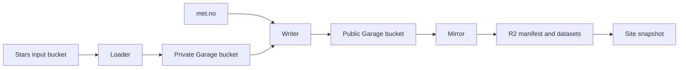

# Stars forecast writer

The grid loader imports the hub's light-pollution grid from R2 every six hours. The same binary imports the monthly CERRA climatology on demand. The loader alone receives read-only R2 source credentials. The weather writer reads both inputs from private Garage storage and starts up to 15 met.no requests per second, with at most 15 in flight. It replaces successful forecasts in 64 site-ID shards. Failed sites retain their hours and fetch time. Refresh removes elapsed hours from each shard before writing it. Only the refresh job writes forecast shards, and its concurrency policy forbids overlapping scheduled runs.

The writer filters elapsed hours and counts clear windows using the hub's rounded solar elevation. It ranks sites before capping their visible windows at 25. It encodes each public dataset one site at a time to temporary disk, hashes those exact bytes and uploads them with immutable caching. A final root manifest references the three uploads. The platform mirror transfers those objects in the same order to prefix `stars-forecast/` of the shared R2 bucket `factory-public`, with a separate destination credential. The site snapshot verifies each digest before updating its section index.

| Component | Untrusted input | Credentials held |
| --- | --- | --- |
| Grid and climatology loader | R2 objects | Read-only R2 source and private Garage key |
| Forecast writer | Weather responses and private inputs | Scoped Garage state and publication keys |
| Mirror | Public Garage objects | Garage read key and scoped R2 destination key |

## Direction

The site will resolve each generation from the mirrored manifest once the public objects and their cache policies have been verified.
