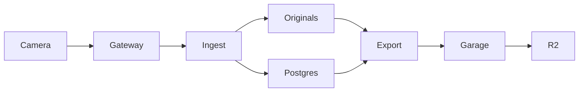

# Trips architecture

| Component | Untrusted input | Credentials held |
| --- | --- | --- |
| ingest | Authenticated multipart uploads | Private originals volume and Trips database writer |
| export | Trip metadata and approved photo bytes | Read access to private state and the public Garage claim's writer key |

## Direction

[HOME-560](https://factory-plan.jomcgi.dev/factory/issue/HOME-560) stages the factory service with its workloads disabled.
[HOME-554](https://factory-plan.jomcgi.dev/factory/issue/HOME-554) migrates the
data, checks parity through an authenticated shadow route, then switches the
private upload route and enables the daily export and mirror.
