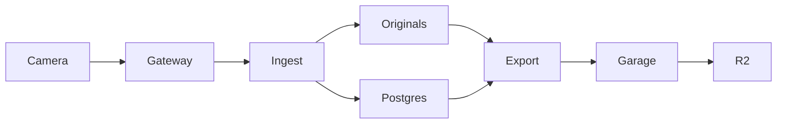

# Trips architecture

| Component | Untrusted input | Credentials held |
| --- | --- | --- |
| ingest | Authenticated multipart uploads | Private originals volume and Trips database writer |
| export | Trip metadata and approved photo bytes | Read access to private state and the public Garage claim's writer key |

## Direction

HOME-401 stages the factory service until migration and parity checks permit
switching the private gateway route and enabling the daily export and mirror.
